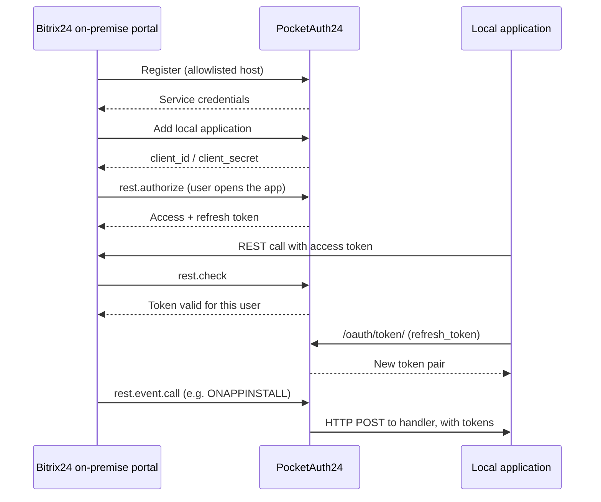

# PocketAuth24

[English](README.md) · **Deutsch** · [Italiano](README.it.md) · [Español](README.es.md) · [Português](README.pt.md) · [Русский](README.ru.md)

**Lokale Anwendungen auf einem Bitrix24-On-Premise-Portal ohne Internetzugang weiter betreiben.**

[](https://github.com/serg-vostrikov-bitrix/pocketauth24/actions/workflows/ci.yml)


[](LICENSE)
<br>


Ein Bitrix24-On-Premise-Portal erledigt OAuth für seine lokalen Anwendungen nicht selbst. Es sendet jeden App-Start, jede Token-Prüfung und jede Token-Erneuerung an den Cloud-OAuth-Server von Bitrix24 (`oauth.bitrix.info` / `oauth.bitrix24.tech`). Das Portal steht also in Ihrem Serverraum, hinter Ihrer Firewall, und fragt trotzdem erst die Cloud, bevor es Ihre eigene App öffnet. PocketAuth24 übernimmt diese Aufgabe in Ihrem Netzwerk. Es besteht aus einem Container und einer PostgreSQL-17-Datenbank. Richten Sie das Portal auf PocketAuth24 aus. Dann öffnen lokale Anwendungen, rufen REST auf, erneuern Tokens und empfangen Ereignisse ohne Verbindung zur Cloud.

> Unabhängiges Open-Source-Projekt. Kein Produkt von Bitrix24. Siehe den [Haftungsausschluss](#haftungsausschluss).


_Die Statusseite unter `/`. Sie zeigt nur aggregierte Zahlen._

## 🔒 Warum

Ein Bitrix24-On-Premise-Portal braucht für seine lokalen Anwendungen den Cloud-OAuth-Server. Verliert das Portal den Internetzugang, stehen seine lokalen Anwendungen still. Sie öffnen nicht, können REST nicht mit Tokens aufrufen, können keine Tokens erneuern und erhalten keine Online-Ereignisse. Das Portal selbst läuft weiter. Seine Anwendungen warten auf einen Server, den sie nicht erreichen.

Teams in geschlossenen Firmennetzwerken und regulierten Umgebungen haben dann zwei schlechte Optionen. Sie verzichten auf lokale Anwendungen, oder sie öffnen eine Internetroute, die sie nicht wollen, in einem Netzwerk, das sie mit Absicht geschlossen haben. PocketAuth24 ist eine dritte Option: Der OAuth-Teil lokaler Anwendungen läuft im eigenen Netzwerk.

**Es lohnt sich auch mit Internetzugang.** Wenn die Portale Ihrer Kunden nur Ihre eigenen lokalen Anwendungen betreiben, bringt ihnen der Cloud-OAuth-Server wenig. Trotzdem geht jeder App-Start, jede Token-Prüfung und jede Erneuerung an ihn. Ihre App fragt auf dem Portal Ihres Kunden einen entfernten Server um Erlaubnis, bevor sie startet. Sie kontrollieren weder diesen Server noch den Netzwerkpfad dorthin. Stellen Sie PocketAuth24 neben das Portal. Dann wandert diese Abhängigkeit in Infrastruktur, die Sie selbst betreiben und überwachen. Der Preis: Nach dem Wechsel nutzt das Portal den Cloud-OAuth-Server nicht mehr, daher funktionieren Marketplace-Anwendungen darauf nicht mehr. Nutzen Sie diese Konfiguration nur für Portale, die lokale Anwendungen und sonst nichts brauchen.

## ✨ Vorteile

- **Lokale Apps funktionieren hinter einer Netztrennung.** Ein geschlossenes Netzwerk bedeutet kein Portal ohne eigene Integrationen mehr.
- **Keine Route zur Cloud.** Lokale Anwendungen brauchen keine ausgehende Verbindung zum Cloud-OAuth-Server.
- **Ihre Verfügbarkeit, nicht die eines anderen.** Bei einem Portal mit Internetzugang und nur Ihren eigenen lokalen Apps hängen App-Starts, Token-Prüfungen und Erneuerungen nicht mehr von einem entfernten Server ab. Marketplace-Apps brauchen die Cloud und funktionieren nach dem Wechsel nicht mehr.
- **Ein Datenbank- oder Log-Leck verrät weniger.** PocketAuth24 speichert Tokens und Secrets nur als Hashes und schreibt nie Query-Strings in die Logs.
- **Ein PocketAuth24 für mehrere Portale.** Partner und Betreiber brauchen keine eigene Instanz pro Portal.
- **Wenig Betriebsaufwand.** Ein Container, eine Datenbank, ein `/health`-Check, JSON-Logs auf stdout und gewöhnliche PostgreSQL-Backups.
- **Offener Code.** Mit der MIT-Lizenz können Integratoren ihn lesen, prüfen und anpassen.

## 🧩 Heute verfügbare Funktionen

| Bereich                  | Was Sie bekommen                                                                                                                                                                                                                                                                                                                                                                                   |
| ------------------------ | -------------------------------------------------------------------------------------------------------------------------------------------------------------------------------------------------------------------------------------------------------------------------------------------------------------------------------------------------------------------------------------------------- |
| **Portal-Registrierung** | Das Portal registriert sich beim nächsten OAuth-Aufruf bei PocketAuth24. PocketAuth24 akzeptiert nur Portale aus einer Allowlist (`PORTAL_ALLOWLIST`, geprüft nach Host und Port). Jeder Dienstaufruf trägt die eigenen Zugangsdaten des Portals, und jedes Portal sieht nur seine eigenen Daten.                                                                                                  |
| **Lokale Anwendungen**   | Legen Sie lokale Anwendungen auf dem Portal wie gewohnt an, ändern und löschen Sie sie. PocketAuth24 vergibt `client_id` (`local.<14 hex>.<8 digits>`) und `client_secret` und hält seine Liste der Anwendungen synchron mit dem Portal. Wenn Sie eine App löschen, löscht PocketAuth24 alle ihre Tokens.                                                                                          |
| **Tokens**               | `rest.authorize` stellt ein Token-Paar für den richtigen Benutzer aus, auch für Nicht-Administratoren. Installationsseiten öffnen mit Tokens. `rest.check` prüft Tokens. Ein Token erhält nur die Scopes, die sowohl die Anfrage als auch die Anwendung haben.                                                                                                                                     |
| **Erneuerung**           | `/oauth/token/` (GET oder POST) mit `grant_type=refresh_token`. Ein Refresh-Token bleibt bis zu seinem Ablauf nutzbar, wie im aufgezeichneten Cloud-Verkehr. Ein Access-Token gilt 3600 s, ein Refresh-Token 180 Tage. PocketAuth24 löscht abgelaufene Paare jede Stunde.                                                                                                                          |
| **Ereignisse**           | Bei `rest.event.call` sendet PocketAuth24 jedes Ereignis per HTTP-POST an den Handler der Anwendung, `ONAPPINSTALL` mit neuen Tokens. Das Portal erhält sofort eine Antwort und wartet nicht auf die Zustellung.                                                                                                                                                                                   |
| **Sicherheit**           | PocketAuth24 speichert Tokens und Secrets als Hashes und bezieht Tokens aus einer kryptografisch sicheren Zufallsquelle. Logs enthalten keine Query-Strings und keine Zugangsdaten in Handler-URLs. In `docker-compose.yml` lauscht der App-Port nur auf Loopback (`127.0.0.1:3000`).                                                                                                              |
| **Betrieb**              | Eine öffentliche Statusseite unter `/` zeigt den Zustand von PocketAuth24 und seiner Datenbank und zählt Portale, Anwendungen, aktive Token-Paare und Ereigniszustellungen. `/api/status` liefert dieselben Daten als JSON. `/health` liefert HTTP 503, wenn PostgreSQL nicht antwortet. Die Logs sind JSON, und alle Pfade akzeptieren einen abschließenden Schrägstrich.                         |
| **Admin-Bereich**        | Unter `/admin` sehen mehrere Benutzer durchsuchbare Tabellen mit Portalen, lokalen Anwendungen, Token-Metadaten (keine Tokens oder Hashes) und täglichen Ereigniszählern. Der Bereich ist schreibgeschützt. Nur die CLI setzt das Passwort des Superusers, und der Superuser verwaltet die Betrachter im Bereich. Sitzungen dauern 12 Stunden, und PocketAuth24 begrenzt die Rate der Anmeldungen. |

## 💡 Einsatzszenarien

PocketAuth24 ist nicht nur für geschlossene Netze gedacht. Es hilft überall dort, wo ein Portal den Cloud-OAuth-Server nicht verwenden darf. Alle diese Szenarien funktionieren schon heute.

| Szenario                                | So setzen Sie PocketAuth24 ein                                                                                                                                                                                                                                                                                                                                                         |
| --------------------------------------- | -------------------------------------------------------------------------------------------------------------------------------------------------------------------------------------------------------------------------------------------------------------------------------------------------------------------------------------------------------------------------------------- |
| **Entwicklerportal**                    | Betreiben Sie ein lokales On-Premise-Portal für die Anwendungsentwicklung und geben Sie ihm eine eigene PocketAuth24-Instanz. Das Portal registriert sich nie in der Cloud und kommt daher nicht mit einem Produktivportal mit demselben Lizenzschlüssel in Konflikt.                                                                                                                  |
| **Staging-, Test- und Schulungskopien** | Stellen Sie eine Kopie der Produktion wieder her und verbinden Sie sie mit einer separaten PocketAuth24-Instanz. Löschen Sie in der Kopie die Service-Zugangsdaten (siehe [Schnellstart](#-schnellstart)) und legen Sie die lokalen Anwendungen neu an. Verbinden Sie die Kopie nicht mit dem produktiven PocketAuth24: Das Backup bringt die Service-Zugangsdaten der Produktion mit. |
| **End-to-End-Tests in CI**              | Starten Sie einen Portal-Container und PocketAuth24 in einem Compose-Stack. Anwendungsinstallation, `ONAPPINSTALL`, REST-Aufrufe und Token-Erneuerung laufen ohne Cloud, daher kann kein externer Dienst Ihre Testergebnisse stören.                                                                                                                                                   |
| **Ein PocketAuth24 für Kundenportale**  | Ein Integrator betreibt ein PocketAuth24 für die On-Premise-Portale mehrerer Kunden. Jedes Portal kommt in `PORTAL_ALLOWLIST`, und PocketAuth24 hält die Daten jedes Portals getrennt.                                                                                                                                                                                                 |
| **Übersicht der lokalen Anwendungen**   | Das Admin-Panel listet die lokalen Anwendungen aller Portale auf und zeigt, welche davon aktive Tokens haben. Dafür müssen Sie sich nicht an jedem Portal anmelden.                                                                                                                                                                                                                    |

Eine Anleitung für Entwickler- und Staging-Kopien ist geplant: [#22](https://github.com/serg-vostrikov-bitrix/b24auth-server/issues/22).

## ⚙️ So funktioniert es



Der OAuth-Verkehr zwischen Portal, lokalen Anwendungen und PocketAuth24 verlässt Ihr Netzwerk nicht. Ein Reverse-Proxy vor PocketAuth24 beendet TLS und entscheidet, wer welchen Pfad erreichen darf.

## ✅ Verifiziert

| Prüfung                                | Was sie abdeckt                                                                                                                                                                                                                                                                                                                                                |
| -------------------------------------- | -------------------------------------------------------------------------------------------------------------------------------------------------------------------------------------------------------------------------------------------------------------------------------------------------------------------------------------------------------------- |
| **Automatisierte Tests**               | Integrationstests gegen echtes PostgreSQL für Portal-Registrierung, Anwendungsregister, Token-Dienst, Ereigniszustellung, Routing und Health sowie Unit-Tests.                                                                                                                                                                                                 |
| **Vertragstests**                      | Antwortformate und Fehlercodes verglichen mit dem Verkehr, der zwischen einem Testportal (`rest` 26.1100) und `oauth.bitrix.info` aufgezeichnet wurde.                                                                                                                                                                                                         |
| **Container-Smoke-Test (CI)**          | Der Container startet. `/health`, die Statusseite und `/api/status` antworten. Ein Portal registriert sich. Die Logs enthalten keine Einträge auf Fehlerebene, und der Prozess läuft nicht als root.                                                                                                                                                           |
| **Ende-zu-Ende im geschlossenen Netz** | Eine Checkliste mit 10 Schritten auf einem lokalen Docker-Testportal (`rest` 26.1100), dessen PHP-Container keinen Internetzugang hatte: Registrierung, App-Erstellung, Installationsseite mit Tokens, REST als Administrator und Nicht-Administrator, `ONAPPINSTALL` mit Tokens, Erneuerung und wiederholte Erneuerung, Löschung. Alle 10 Schritte bestanden. |

Noch niemand hat PocketAuth24 produktiv bei einem Kunden betrieben. Einige Details stammen aus Ableitung, nicht aus aufgezeichnetem Cloud-Verkehr: einige HTTP-Statuscodes (`invalid_client`, unbekannte Methode, `expired_token`) und die genaue Form des `auth`-Blocks in einem Ereignis mit Tokens.

## 🚀 Schnellstart

Es gibt kein veröffentlichtes Image. Bauen Sie es auf einem Rechner mit Internetzugang und bringen Sie es dann ins geschlossene Netzwerk.

```bash
# Outside the closed network
docker build -t pocketauth24:<version> .
docker pull postgres:17
docker save pocketauth24:<version> postgres:17 -o pocketauth24-<version>.tar

# Inside the closed network (copy the tar and docker-compose.yml first)
docker load -i pocketauth24-<version>.tar
docker tag pocketauth24:<version> pocketauth24:local
```

Legen Sie `.env` neben `docker-compose.yml` an:

| Variable            | Beispiel                                        | Bedeutung                                                                                                                                                                                         |
| ------------------- | ----------------------------------------------- | ------------------------------------------------------------------------------------------------------------------------------------------------------------------------------------------------- |
| `BASE_URL`          | `https://auth.corp.local`                       | Die öffentliche URL von PocketAuth24 hinter dem Proxy. Sie wird zu `server_endpoint`.                                                                                                             |
| `DATABASE_URL`      | `postgres://b24auth:<password>@db:5432/b24auth` | Datenbankverbindung.                                                                                                                                                                              |
| `PORTAL_ALLOWLIST`  | `portal.corp.local,crm.corp.local:8443`         | Die Portale (`host[:port]`), die sich registrieren dürfen. Geben Sie Nicht-Standard-Ports ausdrücklich an.                                                                                        |
| `POSTGRES_PASSWORD` | `<password>`                                    | Dasselbe Passwort wie in `DATABASE_URL`.                                                                                                                                                          |
| `TRUST_PROXY`       | `true`                                          | Optional. Akzeptiert nur `true` oder `false`. Setzen Sie `true` nur, wenn der Proxy `X-Forwarded-For` mit der Client-IP überschreibt (nginx: `$remote_addr`, nicht `$proxy_add_x_forwarded_for`). |

`BASE_URL`, `DATABASE_URL` und `PORTAL_ALLOWLIST` sind Pflicht. Ohne sie startet PocketAuth24 nicht. Dann:

```bash
docker compose up -d                       # migrations run on start
curl https://auth.corp.local/health        # {"status":"ok"}
```

**Reverse-Proxy (erforderlich).** Leiten Sie `https://<BASE_URL host>/` an `http://<app host>:3000/` weiter, mit einem Zertifikat Ihrer internen CA. Verweigern Sie standardmäßig alles. Erlauben Sie alle Pfade nur von den IP-Adressen der Portalserver. Wenden Sie diese Beschränkung nicht auf `/oauth/token`, `/health` und, falls gewünscht, die Statusseite (`/`, `/assets/*`, `/api/status`) an. Prüfen Sie jeden Pfad mit und ohne abschließenden Schrägstrich.

**Portal auf PocketAuth24 ausrichten.** Öffnen Sie im Administrationsbereich des Portals die "PHP-Befehlszeile" und führen Sie aus:

```php
\Bitrix\Main\Config\Option::set('rest', 'oauth_server', 'https://auth.corp.local');
\Bitrix\Main\Config\Option::delete('rest', ['name' => 'service_client_id']);
\Bitrix\Main\Config\Option::delete('rest', ['name' => 'service_client_secret']);
```

Sie können auch `BITRIX_OAUTH_URL` in `local/php_interface/init.php` definieren. Das überschreibt die Option `oauth_server`. Bearbeiten Sie `dbconn.php` nicht. Das Portal registriert sich beim nächsten OAuth-Aufruf bei PocketAuth24.

**Danach:** Legen Sie die lokalen Anwendungen neu an, die Sie erstellt haben, als das Portal die Cloud nutzte. Die meisten SDKs, auch CRest, haben die Token-URL `https://oauth.bitrix.info/oauth/token/` fest im Code. Ändern Sie sie in `https://auth.corp.local/oauth/token/`. Oder richten Sie den internen DNS für die Cloud-Hostnamen auf den Proxy aus, mit einem Zertifikat Ihrer internen CA.

Alle Schritte, Betrieb und Rollback: [docs/deployment.md](docs/deployment.md).

## 🖥️ Anforderungen auf der Portalseite

Diese Punkte haben wir beim End-to-End-Lauf gefunden. Das sind Marotten des Portals, keine Fehler von PocketAuth24.

- Das Portal muss seine **echte öffentliche URL und seinen Port** kennen. Sonst erhält der App-Frame eine falsche `DOMAIN`, und `BX24` erreicht das Portal nicht.
- Anwendungs- und Handler-URLs brauchen einen **Hostnamen mit Punkt** (FQDN oder IP-Adresse). Das Portal lehnt `localhost` ab.
- **Liefern Sie das `BX24`-Skript in Ihrem Netzwerk aus.** `BX24` ist das alte JS-SDK; für neue Apps empfehlen wir [b24jssdk](https://github.com/bitrix24/b24jssdk). Bestehende Apps, die noch `BX24` nutzen, laden es meist von `//api.bitrix24.com/api/v1/`, und ein geschlossenes Netzwerk erreicht diese Adresse nicht.
- Das Portal verweigert REST-Aufrufe für einen Benutzer, der sich nie angemeldet hat.

## ⚡ Leistung der Ereigniszustellung

**So funktioniert die Zustellung.** Das Portal fasst alle Ereignisse einer Anfrage (Hit) in einem `rest.event.call`-Batch zusammen. Der Batch hat keine Größenbegrenzung, und das Portal sendet ihn nie erneut. PocketAuth24 antwortet sofort mit `{"result":null}` und stellt dann jedes Ereignis im Hintergrund zu, im selben Prozess. Jedes Ereignis erhält einen HTTP-POST-Versuch mit einem Timeout von 10 Sekunden.

**Limits.** Die Werte sind in [`src/config.ts`](src/config.ts) festgelegt.

| Limit                                            | Wert | Was am Limit passiert                                                                          |
| ------------------------------------------------ | ---- | ---------------------------------------------------------------------------------------------- |
| Gleichzeitige Zustellungen insgesamt             | 200  | PocketAuth24 verwirft das Ereignis und protokolliert `event_dropped_overload`, `limit: global` |
| Gleichzeitige Zustellungen an einen Handler-Host | 100  | PocketAuth24 verwirft das Ereignis und protokolliert `event_dropped_overload`, `limit: host`   |
| Timeout einer Zustellung                         | 10 s | PocketAuth24 bricht die Zustellung ab und protokolliert `event_delivery_failed`                |

Ein Handler-Host ist Host und Port der Handler-URL. Das Host-Limit ist die Hälfte des Gesamtlimits. Daher belegt ein langsamer Handler höchstens 100 Slots, und die anderen Handler behalten immer 100. Das Host-Limit ist nicht niedriger, weil ein Portal-Hit einen großen Batch an einen Handler senden kann, zum Beispiel bei einem Massenimport.

**Was ein langsamer Handler PocketAuth24 kostet.** Solange eine Zustellung auf den Handler wartet, hält sie eine offene Verbindung und wenig Speicher. Sie hält keine Datenbankverbindung, weil PocketAuth24 die Tokens ausstellt, bevor es den POST sendet. Die Event-Loop blockiert nicht. Wenn jeder Handler bis zum Timeout wartet, stellt PocketAuth24 insgesamt höchstens 20 Ereignisse pro Sekunde zu und höchstens 10 pro Sekunde an einen Host. Den Rest verwirft es.

**Empfehlungen für Anwendungs-Handler.**

- Antworten Sie innerhalb einer Sekunde. Nehmen Sie das Ereignis an, legen Sie es in Ihre eigene Warteschlange und verarbeiten Sie es danach.
- Geben Sie jeder aufwendigen Anwendung einen eigenen Handler-Host. Dann nutzt eine langsame Anwendung nur ihre eigenen 100 Slots.
- Überwachen Sie das Log von PocketAuth24 auf `event_dropped_overload`. Das Feld `limit` zeigt, welches Limit erreicht wurde.

PocketAuth24 sendet verworfene oder fehlgeschlagene Ereignisse nicht erneut. Eine persistente Warteschlange mit Wiederholungen ist eine vorgeschlagene weitere Stufe.

## 🧭 Einschränkungen

Kennen Sie diese Punkte vor dem Einsatz, nicht erst danach:

- **Nur lokale Anwendungen.** Marketplace-Anwendungen funktionieren nicht, weil ihre Secrets in der Cloud liegen.
- **Sie müssen bestehende Apps neu anlegen** und fest codierte Token-URLs ändern oder umleiten.
- **Der Proxy schützt die Registrierung.** Das Portal sendet kein gemeinsames Secret. Wer `/oauth/register/` mit einer Portaladresse aus der Allowlist erreicht, kann die Zugangsdaten dieses Portals rotieren. Beschränken Sie diesen Pfad per IP.
- **Jedes Ereignis wird einmal zugestellt**, mit einem Timeout von 10 Sekunden. PocketAuth24 speichert und wiederholt Ereignisse nicht. Es verliert sie bei einem Neustart und verwirft sie bei mehr als 200 gleichzeitigen Zustellungen insgesamt oder 100 an einen Handler-Host. Siehe [Leistung der Ereigniszustellung](#-leistung-der-ereigniszustellung).
- **Nur eine Instanz.** Migrationen laufen beim Start ohne Sperre.
- **Nicht unterstützt:** Lizenzprüfungen, der `authorization_code`-Grant, Install- und Uninstall-Behandlung auf der Serverseite. Token-Lebensdauern sind fest. Ein Request-Body darf höchstens 10 MB groß sein.
- **Der Admin-Bereich ist schreibgeschützt.** Er zeigt Daten an, kann aber Portale, Anwendungen oder Tokens nicht ändern. Er hat kein SSO, keine Zwei-Faktor-Authentifizierung und kein Audit-Log. Beschränken Sie `/admin` und `/api/admin` am Proxy.
- **Getestet** mit dem Portal-Modul `rest` 26.1100.

Geplante Arbeiten und die Szenarien, die sie ermöglichen: siehe [Roadmap](#-roadmap).

## 🔭 Roadmap

Nichts hier hat einen Termin, also ist auch nichts überfällig. Die erste Tabelle listet geplante Arbeiten auf. Die zweite listet Szenarien auf, die diese Arbeiten möglich machen. Das sind Ideen, keine Zusagen.

### Geplante Arbeiten

| Punkt                                                                                                                       | Was er bringt                                                                                                                                                                                                        |
| --------------------------------------------------------------------------------------------------------------------------- | -------------------------------------------------------------------------------------------------------------------------------------------------------------------------------------------------------------------- |
| **Vollständiges OAuth 2.0 und Introspection**                                                                               | Den Grant `authorization_code`, den Widerruf von Tokens bei der Deinstallation, Scope-Prüfungen.                                                                                                                     |
| **Persistente Ereigniswarteschlange**                                                                                       | PocketAuth24 speichert Ereignisse, wiederholt fehlgeschlagene Zustellungen und behält Ereignisse über einen Neustart hinweg.                                                                                         |
| **Upstream-Fallback-Modus** ([#10](https://github.com/serg-vostrikov-bitrix/b24auth-server/issues/10))                      | PocketAuth24 leitet Aufrufe an den Cloud-OAuth-Server weiter und beantwortet sie selbst, wenn die Cloud nicht antwortet. Lokale Anwendungen arbeiten bei einem Cloud-Ausfall weiter.                                 |
| **Betrieb**                                                                                                                 | Migration eines bereits registrierten Portals. Eine Warnung, wenn eine erneute Registrierung die Zugangsdaten eines Portals überschreibt ([#23](https://github.com/serg-vostrikov-bitrix/b24auth-server/issues/23)). |
| **Anleitung für Entwickler- und Staging-Kopien** ([#22](https://github.com/serg-vostrikov-bitrix/b24auth-server/issues/22)) | Regeln für die Entwickler- und Staging-Szenarien in [Einsatzszenarien](#-einsatzszenarien).                                                                                                                          |

### Szenarien, die diese Arbeiten ermöglichen

| Szenario                                                                                                                          | Was es braucht                                              |
| --------------------------------------------------------------------------------------------------------------------------------- | ----------------------------------------------------------- |
| **Ereignis-Inspektor.** Ereignisse aufzeichnen, im Admin-Panel anzeigen und erneut an den Handler senden, um Handler zu debuggen. | Die persistente Ereigniswarteschlange.                      |
| **Notfall-Widerruf.** Alle Tokens einer Anwendung oder eines Portals nach einem Leck widerrufen.                                  | Den Widerruf von Tokens und Schreibaktionen im Admin-Panel. |
| **Fehlertests.** Kurze Token-Laufzeiten, ein erzwungenes `expired_token`, langsame Handler, Test-Tokens aus der CLI.              | Konfigurierbare Token-Laufzeiten. Heute sind sie fest.      |
| **Ereignisbus.** Portal-Ereignisse an einen Message Broker für interne Systeme senden.                                            | Die persistente Ereigniswarteschlange.                      |
| **Zugriffsaudit.** Ein Protokoll, wer wann ein Token für welche Anwendung erhalten hat.                                           | Ein Audit-Log.                                              |

## 🔁 CI/CD

CI läuft bei Pushes auf `main` und bei Pull Requests ([`.github/workflows/ci.yml`](.github/workflows/ci.yml)):

| Job         | Was er tut                                                                          |
| ----------- | ----------------------------------------------------------------------------------- |
| `test`      | Node.js 26 mit einem PostgreSQL-17-Dienst: `npm ci`, Lint, Typecheck, Tests, Build. |
| `container` | Baut und startet den Docker-Compose-Stack und führt den Smoke-Test aus.             |
| `audit`     | `npm audit` für Produktionsabhängigkeiten bei hohem Schweregrad.                    |

Dependabot prüft npm-Pakete, GitHub Actions und Docker-Basisimages jede Woche.

Die CD-Hälfte dieser Überschrift gibt es noch nicht: Es gibt keine Release-Pipeline und kein veröffentlichtes Image. Sie bauen das Image selbst.

## 📚 Dokumentation

- [Deployment-Leitfaden](docs/deployment.md): Anforderungen, Schritte, Proxy-Regeln, Betrieb, Rollback.
- [Ende-zu-Ende-Checkliste](docs/e2e-checklist.md): die 10-Schritte-Prüfung im geschlossenen Netzwerk.
- [Protokollaufzeichnung](docs/protocol-capture.md): wie wir den Cloud-Verkehr für die Vertragstests aufgezeichnet haben.
- [Recherche](docs/research/2026-11-18-oauth-server-analysis.md): Protokollanalyse und vorgeschlagene Roadmap.
- [Benutzerhandbuch](docs/launchkit/01-user-manual.en.md): Szenarien, Fehlerfälle, Grenzen.

## 🛠️ Entwicklung

Stack: Node.js 26, TypeScript (strict), Fastify, Drizzle, PostgreSQL 17.

```bash
npm install
docker compose up -d db
npm test
```

Weitere Skripte: `npm run lint`, `npm run typecheck`, `npm run build`, `npm run dev`, `npm run db:generate`.

Konfiguration: `BASE_URL`, `DATABASE_URL`, `PORTAL_ALLOWLIST` (siehe [`.env.example`](.env.example)).

## 📄 Lizenz

[MIT](LICENSE). Copyright 2026 Serg Vostrikov.

## Haftungsausschluss

PocketAuth24 ist ein unabhängiges Projekt. Es ist nicht mit Bitrix24 verbunden und wird von Bitrix24 weder unterstützt noch zertifiziert. "Ersatz für den Cloud-OAuth-Server" beschreibt, was die Software tut, und keine Beziehung zu einem Hersteller. Bitrix24 und andere Marken gehören ihren jeweiligen Inhabern.
