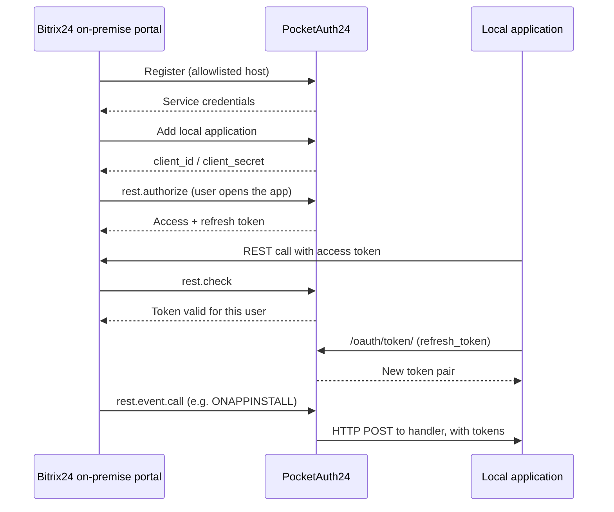

# PocketAuth24

[English](README.md) · **Deutsch** · [Italiano](README.it.md) · [Español](README.es.md) · [Português](README.pt.md) · [Русский](README.ru.md)

**Lokale Anwendungen auf einem Bitrix24-On-Premise-Portal ohne Internetzugang weiter betreiben.**

[](https://github.com/serg-vostrikov-bitrix/pocketauth24/actions/workflows/ci.yml)


[](LICENSE)
<br>


PocketAuth24 ist ein unabhängiger, selbst gehosteter Server. Er beantwortet die OAuth-Aufrufe, die ein Bitrix24-On-Premise-Portal sonst an den Cloud-OAuth-Server (`oauth.bitrix.info` / `oauth.bitrix24.tech`) senden würde. Er läuft als ein Container mit einer PostgreSQL-17-Datenbank in Ihrem Netzwerk. Richten Sie das Portal auf den Server aus. Dann öffnen lokale Anwendungen, rufen REST auf, erneuern Tokens und empfangen Ereignisse ohne Verbindung zur Cloud.

> Unabhängiges Open-Source-Projekt. Kein Produkt von Bitrix24. Siehe den [Haftungsausschluss](#haftungsausschluss).


_Die Statusseite unter `/`. Sie zeigt nur aggregierte Zahlen._

## 🔒 Warum

Ein Bitrix24-On-Premise-Portal hängt für seine lokalen Anwendungen vom Cloud-OAuth-Server ab. Wenn das Portal das Internet nicht erreicht, können lokale Anwendungen nicht öffnen, nicht mit Tokens per REST aufrufen, keine Tokens erneuern und erhalten keine Online-Ereignisse.

Teams in geschlossenen Firmennetzwerken und regulierten Umgebungen haben dann zwei schlechte Optionen: auf lokale Anwendungen verzichten oder eine Internetroute öffnen, die sie nicht wollen. PocketAuth24 bietet eine dritte: die OAuth-Seite lokaler Anwendungen im eigenen Netzwerk betreiben.

**Es lohnt sich auch mit Internetzugang.** Wenn die Portale Ihrer Kunden nur Ihre eigenen lokalen Anwendungen betreiben, bringt der entfernte Cloud-OAuth-Server wenig: App-Starts, Token-Prüfungen und Erneuerungen gehen weiter an einen Server, den Sie nicht kontrollieren. Seine Verfügbarkeit und der Netzwerkpfad dorthin liegen nicht in Ihrer Hand. Mit PocketAuth24 neben dem Portal wandert diese Abhängigkeit in Infrastruktur, die Sie selbst betreiben und überwachen. Der Preis: Nach dem Wechsel nutzt das Portal den Cloud-OAuth-Server nicht mehr, daher funktionieren Marketplace-Anwendungen darauf nicht mehr. Diese Konfiguration ist für Portale gedacht, die nur lokale Anwendungen nutzen.

## ✨ Vorteile

- **Lokale Apps überstehen die Netztrennung.** Ein geschlossenes Netzwerk schließt eigene Integrationen auf dem Portal nicht mehr aus.
- **Eine externe Abhängigkeit weniger.** Lokale Anwendungen brauchen keine ausgehende Route zum Cloud-OAuth-Server.
- **Ihre Verfügbarkeit, nicht die eines anderen.** Auch bei einem Portal mit Internetzugang, das nur Ihre eigenen lokalen Apps nutzt, hängen App-Starts, Token-Prüfungen und Erneuerungen nicht mehr von der Verfügbarkeit eines fremden Servers ab. (Marketplace-Apps brauchen die Cloud und funktionieren nach dem Wechsel nicht.)
- **Begrenzt die Folgen eines Datenbank- oder Log-Lecks.** Tokens und Secrets werden nur als Hashes gespeichert, und Query-Strings gelangen nie in die Logs.
- **Ein Server, mehrere Portale.** Partner und Betreiber brauchen keine Instanz pro Portal.
- **Kleiner Fußabdruck.** Ein Container, eine Datenbank, ein `/health`-Check, JSON-Logs auf stdout und Standard-PostgreSQL-Backups.
- **Offener Code.** MIT-lizenziert, damit Integratoren ihn lesen, prüfen und anpassen können.

## 🧩 Heute verfügbare Funktionen

| Bereich                  | Was Sie bekommen                                                                                                                                                                                                                                                                                                                                                                         |
| ------------------------ | ---------------------------------------------------------------------------------------------------------------------------------------------------------------------------------------------------------------------------------------------------------------------------------------------------------------------------------------------------------------------------------------- |
| **Portal-Registrierung** | Das Portal registriert sich beim nächsten OAuth-Aufruf selbst. Die Registrierung ist auf eine Allowlist beschränkt (`PORTAL_ALLOWLIST`, geprüft nach Host und Port). Jeder Dienstaufruf wird mit den eigenen Zugangsdaten des Portals authentifiziert, und alle Daten sind auf das aufrufende Portal begrenzt.                                                                           |
| **Lokale Anwendungen**   | Lokale Anwendungen auf dem Portal wie gewohnt anlegen, ändern und löschen. Der Server vergibt `client_id` (`local.<14 hex>.<8 digits>`) und `client_secret` und hält sein Register synchron. Beim Löschen einer App werden alle ihre Tokens entfernt.                                                                                                                                    |
| **Tokens**               | `rest.authorize` stellt Token-Paare für den richtigen Benutzer aus, auch für Nicht-Administratoren; Installationsseiten öffnen mit Tokens. `rest.check` prüft Tokens. Der Token-Scope ist die Schnittmenge aus angefordertem Scope und Scope der Anwendung.                                                                                                                              |
| **Erneuerung**           | `/oauth/token/` (GET oder POST) mit `grant_type=refresh_token`. Refresh-Tokens sind bis zum Ablauf wiederverwendbar, wie im aufgezeichneten Cloud-Verkehr beobachtet. Access-Tokens gelten 3600 s, Refresh-Tokens 180 Tage; abgelaufene Paare werden stündlich gelöscht.                                                                                                                 |
| **Ereignisse**           | `rest.event.call` stellt jedes Ereignis per HTTP-POST an den Handler der Anwendung zu, auch `ONAPPINSTALL` mit frisch ausgestellten Tokens. Das Portal erhält sofort eine Antwort.                                                                                                                                                                                                       |
| **Sicherheit**           | Gehashte Speicherung von Tokens und Secrets, Tokens aus einer kryptografisch sicheren Zufallsquelle, Log-Schwärzung (keine Query-Strings, Handler-URLs ohne Zugangsdaten), App-Port in `docker-compose.yml` an Loopback gebunden (`127.0.0.1:3000`).                                                                                                                                     |
| **Betrieb**              | Eine öffentliche Statusseite unter `/` (Zustand von Dienst und Datenbank, Anzahl der Portale, Anwendungen, aktiven Token-Paare und Ereigniszustellungen) und dieselben Daten als JSON unter `/api/status`. `/health` liefert HTTP 503, wenn PostgreSQL nicht antwortet. JSON-Logs, abschließende Schrägstriche werden auf allen Pfaden akzeptiert.                                       |
| **Admin-Bereich**        | Ein Admin-Bereich für mehrere Benutzer unter `/admin`: schreibgeschützte, durchsuchbare Tabellen mit Portalen, lokalen Anwendungen, Token-Metadaten (keine Tokens oder Hashes) und täglichen Ereigniszählern. Das Passwort des Superusers wird nur über die CLI gesetzt; der Superuser verwaltet die Betrachter im Bereich. Sitzungen dauern 12 Stunden; Anmeldungen sind ratenbegrenzt. |

## 💡 Einsatzszenarien

Der Server hilft auch außerhalb geschlossener Netze: überall dort, wo ein Portal den Cloud-OAuth-Server nicht verwenden darf. Diese Szenarien funktionieren schon heute.

| Szenario                                | So setzen Sie den Server ein                                                                                                                                                                                                                                                                                                                                                          |
| --------------------------------------- | ------------------------------------------------------------------------------------------------------------------------------------------------------------------------------------------------------------------------------------------------------------------------------------------------------------------------------------------------------------------------------------- |
| **Entwicklerportal**                    | Betreiben Sie ein lokales On-Premise-Portal für die Anwendungsentwicklung und verbinden Sie es mit einer eigenen Serverinstanz. Das Portal registriert sich nicht in der Cloud und kommt daher nicht mit einem Produktivportal mit demselben Lizenzschlüssel in Konflikt.                                                                                                             |
| **Staging-, Test- und Schulungskopien** | Stellen Sie eine Kopie der Produktion wieder her und verbinden Sie sie mit einer separaten Serverinstanz. Löschen Sie die Service-Zugangsdaten in der Kopie (siehe [Schnellstart](#-schnellstart)) und legen Sie ihre lokalen Anwendungen neu an. Verbinden Sie die Kopie nicht mit dem Produktivserver: Die Kopie bringt die Service-Zugangsdaten der Produktion aus dem Backup mit. |
| **End-to-End-Tests in CI**              | Starten Sie einen Portal-Container und den Server in einem Compose-Stack. Anwendungsinstallation, `ONAPPINSTALL`, REST-Aufrufe und Token-Erneuerung laufen ohne Cloud, daher hängen die Testergebnisse von keinem externen Dienst ab.                                                                                                                                                 |
| **Ein Server für Kundenportale**        | Ein Integrator betreibt eine Instanz für die On-Premise-Portale mehrerer Kunden. Tragen Sie jedes Portal in `PORTAL_ALLOWLIST` ein. Der Server hält die Daten jedes Portals getrennt.                                                                                                                                                                                                 |
| **Übersicht der lokalen Anwendungen**   | Das Admin-Panel listet die lokalen Anwendungen aller Portale auf und zeigt, welche davon aktive Tokens haben. Diese Übersicht erhalten Sie ohne Anmeldung an jedem Portal.                                                                                                                                                                                                            |

Eine Anleitung für Entwickler- und Staging-Kopien ist geplant: [#22](https://github.com/serg-vostrikov-bitrix/b24auth-server/issues/22).

## ⚙️ So funktioniert es



Der OAuth-Verkehr zwischen Portal, lokalen Anwendungen und Server bleibt in Ihrem Netzwerk. Der Reverse-Proxy vor dem Server beendet TLS und beschränkt, wer welchen Pfad erreichen darf.

## ✅ Verifiziert

| Prüfung                                | Was sie abdeckt                                                                                                                                                                                                                                                                                                                                              |
| -------------------------------------- | ------------------------------------------------------------------------------------------------------------------------------------------------------------------------------------------------------------------------------------------------------------------------------------------------------------------------------------------------------------ |
| **Automatisierte Tests**               | Integrationstests gegen echtes PostgreSQL für Portal-Registrierung, Anwendungsregister, Token-Dienst, Ereigniszustellung, Routing und Health sowie Unit-Tests.                                                                                                                                                                                               |
| **Vertragstests**                      | Antwortformate und Fehlercodes verglichen mit dem Verkehr, der zwischen einem Testportal (`rest` 26.1100) und `oauth.bitrix.info` aufgezeichnet wurde.                                                                                                                                                                                                       |
| **Container-Smoke-Test (CI)**          | Der Container startet, `/health` antwortet, Statusseite und `/api/status` antworten, ein Portal registriert sich, keine Logs auf Fehlerebene, der Prozess läuft nicht als root.                                                                                                                                                                              |
| **Ende-zu-Ende im geschlossenen Netz** | Eine Checkliste mit 10 Schritten auf einem lokalen Docker-Testportal (`rest` 26.1100), dessen PHP-Container vom Internet getrennt war: Registrierung, App-Erstellung, Installationsseite mit Tokens, REST als Administrator und Nicht-Administrator, `ONAPPINSTALL` mit Tokens, Erneuerung und wiederholte Erneuerung, Löschung. Alle 10 Schritte bestanden. |

Es wurde noch nicht produktiv bei einem Kunden betrieben. Einige Details wurden abgeleitet und nicht aus der Cloud aufgezeichnet: einige HTTP-Statuscodes (`invalid_client`, unbekannte Methode, `expired_token`) und die genaue Form eines `auth`-Blocks in einem Ereignis mit Tokens.

## 🚀 Schnellstart

Es gibt kein veröffentlichtes Image: Bauen Sie es auf einem Rechner mit Internetzugang und bringen Sie es ins geschlossene Netzwerk.

```bash
# Outside the closed network
docker build -t pocketauth24:<version> .
docker pull postgres:17
docker save pocketauth24:<version> postgres:17 -o pocketauth24-<version>.tar

# Inside the closed network (copy the tar and docker-compose.yml first)
docker load -i pocketauth24-<version>.tar
docker tag pocketauth24:<version> pocketauth24:local
```

Legen Sie `.env` neben `docker-compose.yml` an:

| Variable            | Beispiel                                        | Bedeutung                                                                                                                                                                                         |
| ------------------- | ----------------------------------------------- | ------------------------------------------------------------------------------------------------------------------------------------------------------------------------------------------------- |
| `BASE_URL`          | `https://auth.corp.local`                       | Öffentliche URL hinter dem Proxy; wird zu `server_endpoint`.                                                                                                                                      |
| `DATABASE_URL`      | `postgres://b24auth:<password>@db:5432/b24auth` | Datenbankverbindung.                                                                                                                                                                              |
| `PORTAL_ALLOWLIST`  | `portal.corp.local,crm.corp.local:8443`         | Portal-`host[:port]`, die sich registrieren dürfen; Nicht-Standard-Ports ausdrücklich angeben.                                                                                                    |
| `POSTGRES_PASSWORD` | `<password>`                                    | Dasselbe Passwort wie in `DATABASE_URL`.                                                                                                                                                          |
| `TRUST_PROXY`       | `true`                                          | Optional. Akzeptiert nur `true` oder `false`. Setzen Sie `true` nur, wenn der Proxy `X-Forwarded-For` mit der Client-IP überschreibt (nginx: `$remote_addr`, nicht `$proxy_add_x_forwarded_for`). |

`BASE_URL`, `DATABASE_URL` und `PORTAL_ALLOWLIST` sind Pflicht; ohne sie startet der Server nicht. Dann:

```bash
docker compose up -d                       # migrations run on start
curl https://auth.corp.local/health        # {"status":"ok"}
```

**Reverse-Proxy (erforderlich).** Leiten Sie `https://<BASE_URL host>/` an `http://<app host>:3000/` weiter, mit einem Zertifikat Ihrer internen CA. Verweigern Sie standardmäßig; erlauben Sie jeden Pfad nur von den IP-Adressen der Portalserver, außer `/oauth/token`, `/health` und, falls gewünscht, die Statusseite (`/`, `/assets/*`, `/api/status`). Prüfen Sie Pfade mit und ohne abschließenden Schrägstrich.

**Portal auf den Server ausrichten.** Im Administrationsbereich, "PHP-Befehlszeile":

```php
\Bitrix\Main\Config\Option::set('rest', 'oauth_server', 'https://auth.corp.local');
\Bitrix\Main\Config\Option::delete('rest', ['name' => 'service_client_id']);
\Bitrix\Main\Config\Option::delete('rest', ['name' => 'service_client_secret']);
```

Alternativ definieren Sie `BITRIX_OAUTH_URL` in `local/php_interface/init.php` (überschreibt die Option `oauth_server`; bearbeiten Sie `dbconn.php` nicht). Das Portal registriert sich beim nächsten OAuth-Aufruf selbst.

**Danach:** Erstellen Sie lokale Anwendungen neu, die angelegt wurden, als das Portal die Cloud nutzte, und ändern Sie fest codierte Token-URLs (`https://oauth.bitrix.info/oauth/token/`, von den meisten SDKs verwendet, auch CRest) in `https://auth.corp.local/oauth/token/`, oder richten Sie den internen DNS für die Cloud-Hostnamen auf den Proxy aus, mit einem Zertifikat der internen CA.

Alle Schritte, Betrieb und Rollback: [docs/deployment.md](docs/deployment.md).

## 🖥️ Anforderungen auf der Portalseite

Beim End-to-End-Lauf gefunden. Das ist Verhalten des Portals, kein Fehler des Servers.

- Das Portal muss seine **echte öffentliche URL und seinen Port** kennen; sonst erhält der App-Frame eine falsche `DOMAIN` und `BX24` erreicht das Portal nicht.
- Anwendungs- und Handler-URLs brauchen einen **Hostnamen mit Punkt** (FQDN oder IP-Adresse); `localhost` wird abgelehnt.
- **Liefern Sie das `BX24`-Skript intern aus.** `BX24` ist das alte JS-SDK; für neue Apps empfehlen wir [b24jssdk](https://github.com/bitrix24/b24jssdk). Bestehende Apps, die noch `BX24` nutzen, laden es meist von `//api.bitrix24.com/api/v1/`, das im geschlossenen Netzwerk nicht erreichbar ist.
- Das Portal verweigert REST-Aufrufe für einen Benutzer, der sich nie angemeldet hat.

## ⚡ Leistung der Ereigniszustellung

**So funktioniert die Zustellung.** Das Portal sendet alle Ereignisse einer Anfrage (Hit) in einem `rest.event.call`-Batch. Der Batch hat keine Größenbegrenzung, und das Portal wiederholt ihn nicht. Der Server antwortet sofort mit `{"result":null}` und stellt jedes Ereignis im Hintergrund zu, im selben Prozess. Jedes Ereignis erhält einen HTTP-POST-Versuch mit einem Timeout von 10 Sekunden.

**Limits.** Die Werte sind in [`src/config.ts`](src/config.ts) festgelegt.

| Limit                                            | Wert | Wann es erreicht wird                                                                       |
| ------------------------------------------------ | ---- | ------------------------------------------------------------------------------------------- |
| Gleichzeitige Zustellungen insgesamt             | 200  | Das Ereignis wird verworfen und als `event_dropped_overload`, `limit: global` protokolliert |
| Gleichzeitige Zustellungen an einen Handler-Host | 100  | Das Ereignis wird verworfen und als `event_dropped_overload`, `limit: host` protokolliert   |
| Timeout einer Zustellung                         | 10 s | Die Zustellung wird abgebrochen und als `event_delivery_failed` protokolliert               |

Ein Handler-Host ist Host und Port der Handler-URL. Das Host-Limit ist die Hälfte des Gesamtlimits. Daher kann ein langsamer Handler höchstens 100 Slots belegen, und andere Handler behalten immer 100 Slots. Das Host-Limit ist nicht niedriger, weil ein Portal-Hit einen großen Batch an einen Handler senden kann, zum Beispiel bei einem Massenimport.

**Was ein langsamer Handler den Server kostet.** Eine Zustellung, die auf den Handler wartet, hält eine offene Verbindung und wenig Speicher. Sie hält keine Datenbankverbindung: Der Server stellt die Tokens aus, bevor er den POST sendet. Die Event-Loop wird nicht blockiert. Wenn jeder Handler bis zum Timeout wartet, stellt der Server insgesamt höchstens 20 Ereignisse pro Sekunde zu und höchstens 10 Ereignisse pro Sekunde an einen Host. Weitere Ereignisse werden verworfen.

**Empfehlungen für Anwendungs-Handler.**

- Antworten Sie innerhalb einer Sekunde. Nehmen Sie das Ereignis an, legen Sie es in Ihre eigene Warteschlange und verarbeiten Sie es danach.
- Geben Sie jeder aufwendigen Anwendung einen eigenen Handler-Host. Dann nutzt eine langsame Anwendung nur ihre eigenen 100 Slots.
- Überwachen Sie das Server-Log auf `event_dropped_overload`. Das Feld `limit` zeigt, welches Limit erreicht wurde.

Verworfene oder fehlgeschlagene Ereignisse werden nicht erneut gesendet. Eine persistente Warteschlange mit Wiederholungen ist eine vorgeschlagene weitere Stufe.

## 🧭 Einschränkungen

Kennen Sie diese Punkte vor dem Einsatz:

- **Nur lokale Anwendungen.** Marketplace-Anwendungen funktionieren nicht, weil ihre Secrets in der Cloud liegen.
- **Bestehende Apps müssen neu erstellt werden**, und fest codierte Token-URLs müssen geändert oder umgeleitet werden.
- **Der Proxy ist die Sicherheitskontrolle für die Registrierung.** Das Portal sendet kein gemeinsames Secret. Wer `/oauth/register/` mit einer Allowlist-Portaladresse erreicht, könnte die Zugangsdaten dieses Portals rotieren. Beschränken Sie den Zugriff per IP.
- **Ereignisse werden einmal zugestellt**, mit einem Timeout von 10 Sekunden. Sie werden nicht gespeichert oder wiederholt, gehen bei einem Neustart verloren und werden bei mehr als 200 gleichzeitigen Zustellungen insgesamt oder 100 gleichzeitigen Zustellungen an einen Handler-Host verworfen. Siehe [Leistung der Ereigniszustellung](#-leistung-der-ereigniszustellung).
- **Einzelne Instanz.** Migrationen laufen beim Start ohne Sperre.
- **Nicht unterstützt:** Lizenzprüfungen, der `authorization_code`-Grant, serverseitige Install-/Uninstall-Behandlung. Token-Lebensdauern sind fest; Request-Bodys sind auf 10 MB begrenzt.
- **Schreibgeschützter Admin-Bereich.** Der Admin-Bereich zeigt Daten an, kann aber Portale, Anwendungen oder Tokens nicht ändern. Er hat kein SSO, keine Zwei-Faktor-Authentifizierung und kein Audit-Log. Beschränken Sie `/admin` und `/api/admin` am Proxy.
- **Getestet** mit dem Portal-Modul `rest` 26.1100.

Geplante Arbeiten und die Szenarien, die sie ermöglichen: siehe [Roadmap](#-roadmap).

## 🔭 Roadmap

Die Punkte haben keine Termine. Die erste Tabelle listet geplante Arbeiten auf. Die zweite Tabelle listet Szenarien auf, die diese Arbeiten möglich machen. Das sind Ideen, keine Zusagen.

### Geplante Arbeiten

| Punkt                                                                                                                       | Was er bringt                                                                                                                                                                                                        |
| --------------------------------------------------------------------------------------------------------------------------- | -------------------------------------------------------------------------------------------------------------------------------------------------------------------------------------------------------------------- |
| **Vollständiges OAuth 2.0 und Introspection**                                                                               | Den Grant `authorization_code`, den Widerruf von Tokens bei der Deinstallation, Scope-Prüfungen.                                                                                                                     |
| **Persistente Ereigniswarteschlange**                                                                                       | Der Server speichert Ereignisse, wiederholt fehlgeschlagene Zustellungen und behält Ereignisse über einen Neustart hinweg.                                                                                           |
| **Upstream-Fallback-Modus** ([#10](https://github.com/serg-vostrikov-bitrix/b24auth-server/issues/10))                      | Der Server leitet Aufrufe an den Cloud-OAuth-Server weiter und beantwortet sie selbst, wenn die Cloud nicht antwortet. Lokale Anwendungen arbeiten bei einem Cloud-Ausfall weiter.                                   |
| **Betrieb**                                                                                                                 | Migration eines bereits registrierten Portals. Eine Warnung, wenn eine erneute Registrierung die Zugangsdaten eines Portals überschreibt ([#23](https://github.com/serg-vostrikov-bitrix/b24auth-server/issues/23)). |
| **Anleitung für Entwickler- und Staging-Kopien** ([#22](https://github.com/serg-vostrikov-bitrix/b24auth-server/issues/22)) | Regeln für die Entwickler- und Staging-Szenarien in [Einsatzszenarien](#-einsatzszenarien).                                                                                                                          |

### Szenarien, die diese Arbeiten ermöglichen

| Szenario                                                                                                                          | Was es braucht                                              |
| --------------------------------------------------------------------------------------------------------------------------------- | ----------------------------------------------------------- |
| **Ereignis-Inspektor.** Ereignisse aufzeichnen, im Admin-Panel anzeigen und erneut an den Handler senden, um Handler zu debuggen. | Die persistente Ereigniswarteschlange.                      |
| **Notfall-Widerruf.** Alle Tokens einer Anwendung oder eines Portals nach einem Leck widerrufen.                                  | Den Widerruf von Tokens und Schreibaktionen im Admin-Panel. |
| **Fehlertests.** Kurze Token-Laufzeiten, ein erzwungenes `expired_token`, langsame Handler, Test-Tokens aus der CLI.              | Konfigurierbare Token-Laufzeiten. Heute sind sie fest.      |
| **Ereignisbus.** Portal-Ereignisse an einen Message Broker für interne Systeme senden.                                            | Die persistente Ereigniswarteschlange.                      |
| **Zugriffsaudit.** Ein Protokoll, wer wann ein Token für welche Anwendung erhalten hat.                                           | Ein Audit-Log.                                              |

## 🔁 CI/CD

CI läuft bei Pushes auf `main` und bei Pull Requests ([`.github/workflows/ci.yml`](.github/workflows/ci.yml)):

| Job         | Was er tut                                                                          |
| ----------- | ----------------------------------------------------------------------------------- |
| `test`      | Node.js 26 mit einem PostgreSQL-17-Dienst: `npm ci`, Lint, Typecheck, Tests, Build. |
| `container` | Baut und startet den Docker-Compose-Stack und führt den Smoke-Test aus.             |
| `audit`     | `npm audit` für Produktionsabhängigkeiten bei hohem Schweregrad.                    |

Dependabot prüft npm-Pakete, GitHub Actions und Docker-Basisimages wöchentlich.

Es gibt noch keinen automatischen Release- oder Publish-Schritt: keine CD-Pipeline und kein veröffentlichtes Image. Sie bauen das Image selbst.

## 📚 Dokumentation

- [Deployment-Leitfaden](docs/deployment.md): Anforderungen, Schritte, Proxy-Regeln, Betrieb, Rollback.
- [Ende-zu-Ende-Checkliste](docs/e2e-checklist.md): die 10-Schritte-Prüfung im geschlossenen Netzwerk.
- [Protokollaufzeichnung](docs/protocol-capture.md): wie der Cloud-Verkehr für die Vertragstests aufgezeichnet wurde.
- [Recherche](docs/research/2026-11-18-oauth-server-analysis.md): Protokollanalyse und vorgeschlagene Roadmap.
- [Benutzerhandbuch](docs/launchkit/01-user-manual.en.md): Szenarien, Fehlerfälle, Grenzen.

## 🛠️ Entwicklung

Stack: Node.js 26, TypeScript (strict), Fastify, Drizzle, PostgreSQL 17.

```bash
npm install
docker compose up -d db
npm test
```

Weitere Skripte: `npm run lint`, `npm run typecheck`, `npm run build`, `npm run dev`, `npm run db:generate`.

Konfiguration: `BASE_URL`, `DATABASE_URL`, `PORTAL_ALLOWLIST` (siehe [`.env.example`](.env.example)).

## 📄 Lizenz

[MIT](LICENSE). Copyright 2026 Serg Vostrikov.

## Haftungsausschluss

PocketAuth24 ist ein unabhängiges Projekt. Es ist nicht mit Bitrix24 verbunden und wird von Bitrix24 weder unterstützt noch zertifiziert. "Ersatz für den Cloud-OAuth-Server" beschreibt, was die Software tut, und keine Beziehung zu einem Hersteller. Bitrix24 und andere Marken gehören ihren jeweiligen Inhabern.
