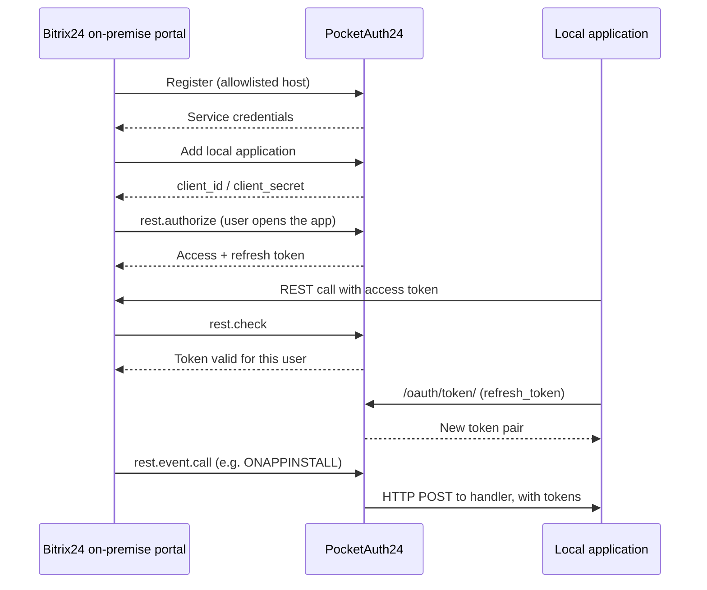

# PocketAuth24

[English](README.md) · [Deutsch](README.de.md) · [Italiano](README.it.md) · **Español** · [Português](README.pt.md) · [Русский](README.ru.md)

**Mantén en funcionamiento las aplicaciones locales de un portal Bitrix24 on-premise sin acceso a internet.**

[](https://github.com/serg-vostrikov-bitrix/pocketauth24/actions/workflows/ci.yml)


[](LICENSE)
<br>


Un portal Bitrix24 on-premise no gestiona por sí mismo el OAuth de sus aplicaciones locales. Envía cada inicio de aplicación, cada comprobación de token y cada renovación de token al servidor OAuth en la nube de Bitrix24 (`oauth.bitrix.info` / `oauth.bitrix24.tech`). Así que el portal está en tu sala de servidores, detrás de tu firewall, y aun así consulta a la nube antes de abrir tu propia aplicación. PocketAuth24 asume esta tarea dentro de tu red. Es un solo contenedor con una base de datos PostgreSQL 17. Apunta el portal a PocketAuth24: las aplicaciones locales se abren, llaman a REST, renuevan tokens y reciben eventos sin conexión a la nube.

> Proyecto de código abierto independiente. No es un producto de Bitrix24. Consulta el [aviso legal](#aviso-legal).


_La página de estado en `/`. Muestra solo recuentos agregados._

## 🔒 Por qué

Un portal Bitrix24 on-premise necesita el servidor OAuth en la nube para sus aplicaciones locales. Si el portal pierde el acceso a internet, sus aplicaciones locales se detienen. No se abren, no pueden llamar a REST con tokens, no pueden renovar tokens y no reciben eventos en línea. El portal en sí sigue funcionando. Sus aplicaciones esperan a un servidor al que no pueden llegar.

Los equipos de redes corporativas cerradas y entornos regulados se quedan entonces con dos malas opciones. Renuncian a las aplicaciones locales o abren una ruta a internet que no quieren, en una red que cerraron a propósito. PocketAuth24 es una tercera opción: el lado OAuth de las aplicaciones locales funciona dentro de su propia red.

**También es útil con acceso a internet.** Si los portales de tus clientes ejecutan solo tus propias aplicaciones locales, el servidor OAuth en la nube les aporta poco. Pero cada inicio de aplicación, cada comprobación de token y cada renovación siguen yendo a él. Tu aplicación, en el portal de tu cliente, pide permiso a un servidor remoto para arrancar. No controlas ni ese servidor ni la ruta de red hasta él. Pon PocketAuth24 junto al portal, y esta dependencia pasa a una infraestructura que operas y supervisas tú. La contrapartida: tras el cambio, el portal deja de usar el servidor OAuth en la nube, así que las aplicaciones de Marketplace dejan de funcionar en él. Usa esta configuración solo para portales que necesitan aplicaciones locales y nada más.

## ✨ Ventajas

- **Las apps locales funcionan en una red aislada.** Una red cerrada ya no significa un portal sin integraciones a medida.
- **Sin ruta a la nube.** Las aplicaciones locales no necesitan una conexión de salida al servidor OAuth en la nube.
- **Tu disponibilidad, no la de otros.** En un portal conectado a internet que ejecuta solo tus propias apps locales, los inicios, las comprobaciones de tokens y las renovaciones dejan de depender de un servidor remoto. Las apps de Marketplace necesitan la nube y dejan de funcionar tras el cambio.
- **Una fuga de la base de datos o de los logs revela menos.** PocketAuth24 guarda los tokens y los secretos solo como hashes y nunca escribe query strings en los logs.
- **Un PocketAuth24 para varios portales.** Socios y operadores no necesitan una instancia separada para cada portal.
- **Poco que operar.** Un contenedor, una base de datos, una comprobación `/health`, logs JSON en stdout y copias de seguridad normales de PostgreSQL.
- **Código abierto.** La licencia MIT permite a los integradores leerlo, auditarlo y adaptarlo.

## 🧩 Funciones disponibles hoy

| Área                        | Qué obtienes                                                                                                                                                                                                                                                                                                                                                                                                    |
| --------------------------- | --------------------------------------------------------------------------------------------------------------------------------------------------------------------------------------------------------------------------------------------------------------------------------------------------------------------------------------------------------------------------------------------------------------- |
| **Registro del portal**     | El portal se registra en PocketAuth24 en su próxima llamada OAuth. PocketAuth24 acepta solo portales de una lista de permitidos (`PORTAL_ALLOWLIST`, comparada por host y puerto). Cada llamada al servicio lleva las credenciales propias del portal, y cada portal ve solo sus propios datos.                                                                                                                 |
| **Aplicaciones locales**    | Crea, cambia y elimina aplicaciones locales en el portal como antes. PocketAuth24 emite el `client_id` (`local.<14 hex>.<8 digits>`) y el `client_secret` y mantiene su lista de aplicaciones sincronizada con el portal. Cuando eliminas una app, PocketAuth24 elimina todos sus tokens.                                                                                                                       |
| **Tokens**                  | `rest.authorize` emite un par de tokens para el usuario correcto, también para usuarios que no son administradores. Las páginas de instalación se abren con tokens. `rest.check` valida los tokens. Un token recibe solo los scopes que tienen a la vez la petición y la aplicación.                                                                                                                            |
| **Renovación**              | `/oauth/token/` (GET o POST) con `grant_type=refresh_token`. Un refresh token se puede usar hasta que caduca, igual que en el tráfico de la nube capturado. Un access token dura 3600 s y un refresh token 180 días. Cada hora PocketAuth24 elimina los pares caducados.                                                                                                                                        |
| **Eventos**                 | Para `rest.event.call`, PocketAuth24 envía cada evento al manejador de la aplicación mediante HTTP POST, incluido `ONAPPINSTALL` con tokens nuevos. El portal recibe su respuesta de inmediato y no espera a la entrega.                                                                                                                                                                                        |
| **Seguridad**               | PocketAuth24 guarda los tokens y los secretos como hashes y toma los tokens de una fuente aleatoria criptográficamente segura. Los logs no contienen query strings ni credenciales en las URL de los manejadores. En `docker-compose.yml`, el puerto de la app escucha solo en loopback (`127.0.0.1:3000`).                                                                                                     |
| **Operación**               | Una página de estado pública en `/` muestra el estado de PocketAuth24 y de su base de datos y cuenta portales, aplicaciones, pares de tokens activos y entregas de eventos. `/api/status` da los mismos datos en JSON. `/health` devuelve HTTP 503 cuando PostgreSQL no responde. Los logs son JSON, y todas las rutas aceptan una barra final.                                                                 |
| **Panel de administración** | En `/admin`, varios usuarios pueden ver tablas con búsqueda de portales, aplicaciones locales, metadatos de tokens (sin tokens ni hashes) y contadores diarios de eventos. El panel es de solo lectura. Solo la CLI establece la contraseña del superusuario, y el superusuario gestiona a los lectores en el panel. Las sesiones duran 12 horas, y PocketAuth24 limita la frecuencia de los inicios de sesión. |

## 💡 Casos de uso

PocketAuth24 no es solo para redes cerradas. Ayuda en cualquier lugar donde un portal no deba usar el servidor OAuth en la nube. Todos estos escenarios funcionan hoy.

| Escenario                                         | Cómo usar PocketAuth24                                                                                                                                                                                                                                                                                                                                             |
| ------------------------------------------------- | ------------------------------------------------------------------------------------------------------------------------------------------------------------------------------------------------------------------------------------------------------------------------------------------------------------------------------------------------------------------ |
| **Portal de desarrollo**                          | Ejecuta un portal on-premise local para desarrollar aplicaciones y dale su propia instancia de PocketAuth24. El portal nunca se registra en la nube, así que no entra en conflicto con un portal de producción con la misma clave de licencia.                                                                                                                     |
| **Copias de staging, pruebas y formación**        | Restaura una copia de producción y conéctala a una instancia separada de PocketAuth24. En la copia, elimina las credenciales de servicio (consulta [Inicio rápido](#-inicio-rápido)) y vuelve a crear las aplicaciones locales. No conectes la copia al PocketAuth24 de producción: la copia de seguridad trae consigo las credenciales de servicio de producción. |
| **Pruebas de extremo a extremo en CI**            | Pon un contenedor del portal y PocketAuth24 en una misma pila de Compose. La instalación de la app, `ONAPPINSTALL`, las llamadas REST y la renovación de tokens funcionan sin la nube, así que un servicio externo no puede romper los resultados de tus pruebas.                                                                                                  |
| **Un PocketAuth24 para los portales de clientes** | Un integrador ejecuta un PocketAuth24 para los portales on-premise de varios clientes. Cada portal va en `PORTAL_ALLOWLIST`, y PocketAuth24 mantiene separados los datos de cada portal.                                                                                                                                                                           |
| **Inventario de aplicaciones locales**            | El panel de administración lista las aplicaciones locales de todos los portales y muestra cuáles tienen tokens activos. Para esto no necesitas iniciar sesión en cada portal.                                                                                                                                                                                      |

Está prevista una guía para las copias de desarrollo y de staging: [#22](https://github.com/serg-vostrikov-bitrix/b24auth-server/issues/22).

## ⚙️ Cómo funciona



El tráfico OAuth entre el portal, las aplicaciones locales y PocketAuth24 no sale de tu red. Un proxy inverso delante de PocketAuth24 termina TLS y decide quién puede llegar a cada ruta.

## ✅ Verificado

| Comprobación                            | Qué cubre                                                                                                                                                                                                                                                                                                                                                 |
| --------------------------------------- | --------------------------------------------------------------------------------------------------------------------------------------------------------------------------------------------------------------------------------------------------------------------------------------------------------------------------------------------------------- |
| **Pruebas automatizadas**               | Pruebas de integración con PostgreSQL real para el registro del portal, el registro de aplicaciones, el servicio de tokens, la entrega de eventos, el enrutamiento y health, además de pruebas unitarias.                                                                                                                                                 |
| **Pruebas de contrato**                 | Formas de respuesta y códigos de error comparados con el tráfico capturado entre un portal de prueba (`rest` 26.1100) y `oauth.bitrix.info`.                                                                                                                                                                                                              |
| **Prueba de humo del contenedor (CI)**  | El contenedor arranca. `/health`, la página de estado y `/api/status` responden. Un portal se registra. Los logs no tienen entradas de nivel error, y el proceso no se ejecuta como root.                                                                                                                                                                 |
| **De extremo a extremo en red cerrada** | Una lista de comprobación de 10 pasos en un portal de prueba local en Docker (`rest` 26.1100) cuyo contenedor PHP no tenía acceso a internet: registro, creación de la app, página de instalación con tokens, REST como administrador y no administrador, `ONAPPINSTALL` con tokens, renovación y renovación repetida, eliminación. Los 10 pasos pasaron. |

Nadie ha ejecutado aún PocketAuth24 en producción en un cliente. Algunos detalles vienen de una deducción, no del tráfico de la nube capturado: algunos códigos de estado HTTP (`invalid_client`, método desconocido, `expired_token`) y la forma exacta del bloque `auth` en un evento que lleva tokens.

## 🚀 Inicio rápido

No hay una imagen publicada. Constrúyela en una máquina con acceso a internet y luego llévala a la red cerrada.

```bash
# Outside the closed network
docker build -t pocketauth24:<version> .
docker pull postgres:17
docker save pocketauth24:<version> postgres:17 -o pocketauth24-<version>.tar

# Inside the closed network (copy the tar and docker-compose.yml first)
docker load -i pocketauth24-<version>.tar
docker tag pocketauth24:<version> pocketauth24:local
```

Crea `.env` junto a `docker-compose.yml`:

| Variable             | Ejemplo                                         | Significado                                                                                                                                                                                                                                                                                                                                                                            |
| -------------------- | ----------------------------------------------- | -------------------------------------------------------------------------------------------------------------------------------------------------------------------------------------------------------------------------------------------------------------------------------------------------------------------------------------------------------------------------------------- |
| `BASE_URL`           | `https://auth.corp.local`                       | La URL pública de PocketAuth24 detrás del proxy. Se convierte en `server_endpoint`.                                                                                                                                                                                                                                                                                                    |
| `DATABASE_URL`       | `postgres://b24auth:<password>@db:5432/b24auth` | Conexión a la base de datos.                                                                                                                                                                                                                                                                                                                                                           |
| `PORTAL_ALLOWLIST`   | `portal.corp.local,crm.corp.local:8443`         | Los portales (`host[:port]`) que pueden registrarse. Indica explícitamente los puertos no estándar.                                                                                                                                                                                                                                                                                    |
| `POSTGRES_PASSWORD`  | `<password>`                                    | La misma contraseña que en `DATABASE_URL`.                                                                                                                                                                                                                                                                                                                                             |
| `TRUST_PROXY`        | `true`                                          | Opcional. Solo acepta `true` o `false`. Pon `true` solo si el proxy sobrescribe `X-Forwarded-For` con la IP del cliente (nginx: `$remote_addr`, no `$proxy_add_x_forwarded_for`).                                                                                                                                                                                                      |
| `TOKEN_PRUNING`      | `true`                                          | Opcional, por defecto `true`. Solo acepta `true` o `false`. Cuando el servidor emite un par de tokens, elimina los pares más antiguos de la misma aplicación y el mismo usuario cuyo refresh token ya se canjeó y cuyo access token ha caducado. Conserva los `TOKEN_PRUNING_KEEP` más recientes de estos pares. Un par cuyo refresh token un cliente recibió y nunca usó se mantiene. |
| `TOKEN_PRUNING_KEEP` | `5`                                             | Opcional, por defecto `5`. Un entero positivo. El número de pares usados más recientes que el servidor conserva para cada aplicación y usuario.                                                                                                                                                                                                                                        |

Para tener exactamente el comportamiento de la nube de Bitrix24, pon `TOKEN_PRUNING=false`. Así cada par se mantiene hasta que caduca su refresh token.

`BASE_URL`, `DATABASE_URL` y `PORTAL_ALLOWLIST` son obligatorias. Sin ellas, PocketAuth24 no arranca. Después:

```bash
docker compose up -d                       # migrations run on start
curl https://auth.corp.local/health        # {"status":"ok"}
```

**Proxy inverso (obligatorio).** Redirige `https://<BASE_URL host>/` a `http://<app host>:3000/` con un certificado de tu CA interna. Deniega todo por defecto. Permite todas las rutas solo desde las direcciones IP de los servidores del portal. No apliques este límite a `/oauth/token`, `/health` y, si quieres, a la página de estado (`/`, `/assets/*`, `/api/status`). Haz coincidir cada ruta con y sin la barra final.

**Apunta el portal a PocketAuth24.** En el panel de administración del portal, abre "Línea de comandos PHP" y ejecuta:

```php
\Bitrix\Main\Config\Option::set('rest', 'oauth_server', 'https://auth.corp.local');
\Bitrix\Main\Config\Option::delete('rest', ['name' => 'service_client_id']);
\Bitrix\Main\Config\Option::delete('rest', ['name' => 'service_client_secret']);
```

También puedes definir `BITRIX_OAUTH_URL` en `local/php_interface/init.php`. Anula la opción `oauth_server`. No edites `dbconn.php`. El portal se registra en PocketAuth24 en su próxima llamada OAuth.

**Después:** vuelve a crear las aplicaciones locales que creaste cuando el portal usaba la nube. La mayoría de los SDK, incluido CRest, tienen la URL de token `https://oauth.bitrix.info/oauth/token/` escrita en el código. Cámbiala por `https://auth.corp.local/oauth/token/`. O apunta el DNS interno de los nombres de host de la nube al proxy, con un certificado de tu CA interna.

Pasos completos, operación y reversión: [docs/deployment.md](docs/deployment.md).

## 🖥️ Requisitos del lado del portal

Los encontramos durante la ejecución de extremo a extremo. Son manías del portal, no defectos de PocketAuth24.

- El portal debe conocer su **URL pública y puerto reales**. Si no, el marco de la app recibe un `DOMAIN` incorrecto y `BX24` no puede llegar al portal.
- Las URL de aplicaciones y manejadores necesitan un **nombre de host con un punto** (un FQDN o una dirección IP). El portal rechaza `localhost`.
- **Sirve el script `BX24` dentro de tu red.** `BX24` es el SDK de JS antiguo; para apps nuevas recomendamos [b24jssdk](https://github.com/bitrix24/b24jssdk). Las apps existentes que aún usan `BX24` suelen cargarlo desde `//api.bitrix24.com/api/v1/`, y una red cerrada no puede llegar a esa dirección.
- El portal rechaza las llamadas REST de un usuario que nunca ha iniciado sesión.

## ⚡ Rendimiento de la entrega de eventos

**Cómo funciona la entrega.** El portal pone todos los eventos de una petición (hit) en un solo lote `rest.event.call`. El lote no tiene límite de tamaño, y el portal nunca lo vuelve a enviar. PocketAuth24 responde `{"result":null}` de inmediato y luego entrega cada evento en segundo plano, en el mismo proceso. Cada evento recibe un intento de HTTP POST con un tiempo límite de 10 segundos.

**Límites.** Los valores están fijados en [`src/config.ts`](src/config.ts).

| Límite                                      | Valor | Qué pasa al alcanzar el límite                                                       |
| ------------------------------------------- | ----- | ------------------------------------------------------------------------------------ |
| Entregas simultáneas en total               | 200   | PocketAuth24 descarta el evento y registra `event_dropped_overload`, `limit: global` |
| Entregas simultáneas a un host de manejador | 100   | PocketAuth24 descarta el evento y registra `event_dropped_overload`, `limit: host`   |
| Tiempo límite de una entrega                | 10 s  | PocketAuth24 detiene la entrega y registra `event_delivery_failed`                   |

Un host de manejador es el host y el puerto de la URL del manejador. El límite por host es la mitad del límite total. Así, un manejador lento ocupa como máximo 100 ranuras, y los demás manejadores conservan siempre 100. El límite por host no es menor porque un hit del portal puede enviar un lote grande a un solo manejador, por ejemplo en una importación masiva.

**Qué le cuesta a PocketAuth24 un manejador lento.** Mientras una entrega espera al manejador, mantiene una conexión abierta y un poco de memoria. No mantiene una conexión a la base de datos, porque PocketAuth24 emite los tokens antes de enviar el POST. El bucle de eventos no se bloquea. Si todos los manejadores esperan hasta el tiempo límite, PocketAuth24 entrega como máximo 20 eventos por segundo en total y 10 por segundo a un host. Descarta el resto.

**Recomendaciones para los manejadores de las aplicaciones.**

- Responde en menos de un segundo. Acepta el evento, ponlo en tu propia cola y luego procésalo.
- Da a cada aplicación pesada su propio host de manejador. Así una aplicación lenta solo usa sus propias 100 ranuras.
- Supervisa el log de PocketAuth24 en busca de `event_dropped_overload`. Su campo `limit` indica qué límite se alcanzó.

PocketAuth24 no vuelve a enviar los eventos descartados o fallidos. Una cola persistente con reintentos es una etapa siguiente propuesta.

## 🧭 Limitaciones

Conócelas antes de desplegar, no después:

- **Solo aplicaciones locales.** Las aplicaciones de Marketplace no funcionan, porque sus secretos están en la nube.
- **Debes volver a crear las apps existentes** y cambiar o redirigir las URL de token escritas en el código.
- **El proxy es lo que protege el registro.** El portal no envía ningún secreto compartido. Cualquiera que llegue a `/oauth/register/` con la dirección de un portal permitido puede rotar las credenciales de ese portal. Limita esta ruta por IP.
- **Cada evento se entrega una vez**, con un tiempo límite de 10 segundos. PocketAuth24 no almacena ni reintenta los eventos. Los pierde al reiniciar y los descarta por encima de 200 entregas simultáneas en total o 100 a un host de manejador. Consulta [Rendimiento de la entrega de eventos](#-rendimiento-de-la-entrega-de-eventos).
- **Solo una instancia.** Las migraciones se ejecutan al arrancar sin bloqueo.
- **No compatible:** comprobaciones de licencia, el grant `authorization_code`, el tratamiento de la instalación y la desinstalación en el lado del servidor. Las duraciones de los tokens son fijas. El cuerpo de una petición puede tener como máximo 10 MB.
- **El panel de administración es de solo lectura.** Muestra datos, pero no puede cambiar portales, aplicaciones ni tokens. No tiene SSO, autenticación de dos factores ni registro de auditoría. Limita `/admin` y `/api/admin` en el proxy.
- **Probado** con el módulo `rest` del portal 26.1100.

El trabajo planificado y los escenarios que hace posibles: consulta la [hoja de ruta](#-hoja-de-ruta).

## 🔭 Hoja de ruta

Nada aquí tiene fecha, así que nada va con retraso. La primera tabla lista el trabajo planificado. La segunda lista los escenarios que este trabajo hace posibles. Son ideas, no compromisos.

### Trabajo planificado

| Elemento                                                                                                                   | Qué añade                                                                                                                                                                                              |
| -------------------------------------------------------------------------------------------------------------------------- | ------------------------------------------------------------------------------------------------------------------------------------------------------------------------------------------------------ |
| **OAuth 2.0 completo e introspection**                                                                                     | El grant `authorization_code`, la revocación de tokens al desinstalar, las comprobaciones de scope.                                                                                                    |
| **Cola persistente de eventos**                                                                                            | PocketAuth24 almacena los eventos, reintenta las entregas fallidas y conserva los eventos tras un reinicio.                                                                                            |
| **Modo de respaldo upstream** ([#10](https://github.com/serg-vostrikov-bitrix/b24auth-server/issues/10))                   | PocketAuth24 reenvía las llamadas al servidor OAuth en la nube y las responde él mismo cuando la nube no responde. Las aplicaciones locales siguen funcionando mientras la nube está caída.            |
| **Operaciones**                                                                                                            | Migración de un portal que ya está registrado. Un aviso cuando un nuevo registro sobrescribe las credenciales de un portal ([#23](https://github.com/serg-vostrikov-bitrix/b24auth-server/issues/23)). |
| **Guía para copias de desarrollo y de staging** ([#22](https://github.com/serg-vostrikov-bitrix/b24auth-server/issues/22)) | Reglas para los escenarios de desarrollo y de staging de [Casos de uso](#-casos-de-uso).                                                                                                               |

### Escenarios que este trabajo hace posibles

| Escenario                                                                                                                                              | Qué necesita                                                                   |
| ------------------------------------------------------------------------------------------------------------------------------------------------------ | ------------------------------------------------------------------------------ |
| **Inspector de eventos.** Registrar los eventos, mostrarlos en el panel de administración y enviarlos de nuevo al manejador, para depurar manejadores. | La cola persistente de eventos.                                                |
| **Revocación de emergencia.** Revocar todos los tokens de una aplicación o de un portal tras una filtración.                                           | La revocación de tokens y acciones de escritura en el panel de administración. |
| **Pruebas de fallos.** Duraciones cortas de los tokens, un `expired_token` forzado, manejadores lentos, tokens de prueba emitidos desde la CLI.        | Duraciones de tokens configurables. Hoy son fijas.                             |
| **Bus de eventos.** Enviar los eventos del portal a un message broker para sistemas internos.                                                          | La cola persistente de eventos.                                                |
| **Auditoría de accesos.** Un registro de quién recibió un token para qué aplicación, y cuándo.                                                         | Un log de auditoría.                                                           |

## 🔁 CI/CD

La CI se ejecuta en los push a `main` y en las pull requests ([`.github/workflows/ci.yml`](.github/workflows/ci.yml)):

| Job         | Qué hace                                                                             |
| ----------- | ------------------------------------------------------------------------------------ |
| `test`      | Node.js 26 con un servicio PostgreSQL 17: `npm ci`, lint, typecheck, pruebas, build. |
| `container` | Construye e inicia el stack de Docker Compose y ejecuta la prueba de humo.           |
| `audit`     | `npm audit` para las dependencias de producción con severidad alta.                  |

Dependabot revisa cada semana los paquetes npm, las GitHub Actions y las imágenes base de Docker.

La mitad CD de este título todavía no existe: no hay pipeline de release ni imagen publicada. La imagen la construyes tú.

## 📚 Documentación

- [Guía de despliegue](docs/deployment.md): requisitos, pasos, reglas del proxy, operación, reversión.
- [Lista de comprobación de extremo a extremo](docs/e2e-checklist.md): la verificación de 10 pasos en red cerrada.
- [Captura de protocolo](docs/protocol-capture.md): cómo grabamos el tráfico de la nube para las pruebas de contrato.
- [Investigación](docs/research/2026-11-18-oauth-server-analysis.md): análisis del protocolo y hoja de ruta propuesta.
- [Manual de usuario](docs/launchkit/01-user-manual.en.md): escenarios, casos de error, límites.

## 🛠️ Desarrollo

Stack: Node.js 26, TypeScript (strict), Fastify, Drizzle, PostgreSQL 17.

```bash
npm install
docker compose up -d db
npm test
```

Otros scripts: `npm run lint`, `npm run typecheck`, `npm run build`, `npm run dev`, `npm run db:generate`.

Configuración: `BASE_URL`, `DATABASE_URL`, `PORTAL_ALLOWLIST` (consulta [`.env.example`](.env.example)).

## 📄 Licencia

[MIT](LICENSE). Copyright 2026 Serg Vostrikov.

## Aviso legal

PocketAuth24 es un proyecto independiente. No está afiliado a Bitrix24, ni cuenta con su respaldo o certificación. "Sustituto del servidor OAuth en la nube" describe lo que hace el software, no una relación con un proveedor. Bitrix24 y otras marcas pertenecen a sus respectivos propietarios.
