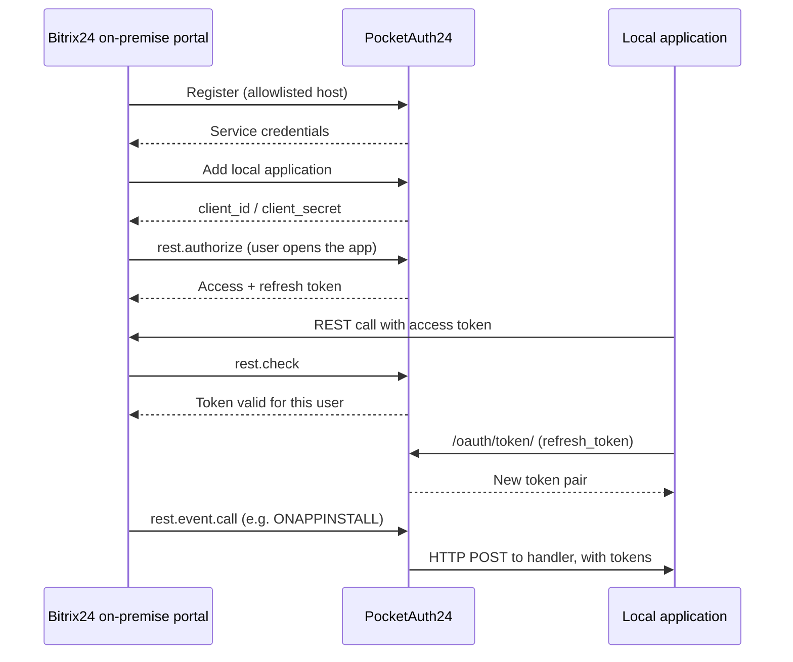

# PocketAuth24

[English](README.md) · [Deutsch](README.de.md) · **Italiano** · [Español](README.es.md) · [Português](README.pt.md) · [Русский](README.ru.md)

**Mantieni funzionanti le applicazioni locali su un portale Bitrix24 on-premise senza accesso a internet.**

[](https://github.com/serg-vostrikov-bitrix/pocketauth24/actions/workflows/ci.yml)


[](LICENSE)
<br>


Un portale Bitrix24 on-premise non gestisce da solo l'OAuth delle sue applicazioni locali. Invia ogni avvio di un'app, ogni verifica e ogni rinnovo di un token al server OAuth cloud di Bitrix24 (`oauth.bitrix.info` / `oauth.bitrix24.tech`). Così il portale sta nella tua sala server, dietro il tuo firewall, e chiede comunque al cloud prima di aprire un'app che è tua. PocketAuth24 si fa carico di questo lavoro dentro la tua rete. È un solo container con un database PostgreSQL 17. Punta il portale a PocketAuth24: le applicazioni locali si aprono, chiamano REST, rinnovano i token e ricevono gli eventi senza alcuna connessione al cloud.

> Progetto open source indipendente. Non è un prodotto Bitrix24. Vedi la [dichiarazione di non responsabilità](#dichiarazione-di-non-responsabilità).


_La pagina di stato su `/`. Mostra solo conteggi aggregati._

## 🔒 Perché

Un portale Bitrix24 on-premise ha bisogno del server OAuth cloud per le sue applicazioni locali. Se il portale perde l'accesso a internet, le sue applicazioni locali si fermano. Non si aprono, non possono chiamare REST con i token, non possono rinnovare i token e non ricevono gli eventi online. Il portale in sé continua a funzionare. Le sue applicazioni aspettano un server che non possono raggiungere.

I team nelle reti aziendali chiuse e negli ambienti regolamentati restano allora con due brutte opzioni. Rinunciano alle applicazioni locali, oppure aprono una rotta verso internet che non vogliono, in una rete che hanno chiuso apposta. PocketAuth24 è una terza opzione: il lato OAuth delle applicazioni locali gira dentro la loro rete.

**Serve anche con accesso a internet.** Se i portali dei tuoi clienti eseguono solo le tue applicazioni locali, il server OAuth cloud dà loro poco. Ma ogni avvio di un'app, ogni verifica e ogni rinnovo di un token passa comunque da lì. La tua app, sul portale del tuo cliente, chiede a un server remoto il permesso di partire. Tu non controlli né quel server né il percorso di rete per raggiungerlo. Metti PocketAuth24 accanto al portale, e questa dipendenza passa a un'infrastruttura che gestisci e monitori tu. Il prezzo: dopo il passaggio il portale non usa più il server OAuth cloud, quindi le applicazioni del Marketplace di altri fornitori smettono di funzionare su di esso. La tua applicazione del Marketplace continua a funzionare se la aggiungi al catalogo di PocketAuth24. Usa questa configurazione solo per portali che hanno bisogno delle applicazioni locali e delle tue applicazioni.

## ✨ Vantaggi

- **Le app locali funzionano dietro un air gap.** Una rete chiusa non significa più un portale senza integrazioni personalizzate.
- **Nessuna rotta verso il cloud.** Le applicazioni locali non hanno bisogno di una connessione in uscita verso il server OAuth cloud.
- **La tua disponibilità, non quella di altri.** Su un portale connesso a internet con solo le tue app locali, avvii, verifiche e rinnovi dei token non dipendono più da un server remoto. Dopo il passaggio le applicazioni del Marketplace di altri fornitori smettono di funzionare, ma le tue continuano a funzionare se le aggiungi al catalogo.
- **Una fuga di database o di log rivela meno.** PocketAuth24 salva token e segreti solo come hash e non scrive mai le query string nei log.
- **Un solo PocketAuth24 per più portali.** Partner e operatori non hanno bisogno di un'istanza separata per ogni portale.
- **Poco da gestire.** Un container, un database, un controllo `/health`, log JSON su stdout e normali backup PostgreSQL.
- **Codice aperto.** La licenza MIT permette agli integratori di leggerlo, verificarlo e adattarlo.

## 🧩 Funzionalità disponibili oggi

| Area                                    | Cosa ottieni                                                                                                                                                                                                                                                                                                                                                                                         |
| --------------------------------------- | ---------------------------------------------------------------------------------------------------------------------------------------------------------------------------------------------------------------------------------------------------------------------------------------------------------------------------------------------------------------------------------------------------- |
| **Registrazione portale**               | Il portale si registra presso PocketAuth24 alla sua prossima chiamata OAuth. PocketAuth24 accetta solo i portali di una allowlist (`PORTAL_ALLOWLIST`, confrontata su host e porta). Ogni chiamata al servizio porta le credenziali del portale stesso, e ogni portale vede solo i propri dati.                                                                                                      |
| **Applicazioni locali**                 | Crea, modifica ed elimina le applicazioni locali sul portale come prima. PocketAuth24 emette `client_id` (`local.<14 hex>.<8 digits>`) e `client_secret` e mantiene il proprio elenco di applicazioni allineato con il portale. Quando elimini un'app, PocketAuth24 elimina tutti i suoi token.                                                                                                      |
| **La tua applicazione del Marketplace** | Aggiungi la tua applicazione del Marketplace al catalogo con la CLI. Il portale la installa dal Marketplace come al solito, e PocketAuth24 emette e rinnova i suoi token con lo stato `F`. Il catalogo memorizza solo l'hash del `client_secret`.                                                                                                                                                    |
| **Token**                               | `rest.authorize` emette una coppia di token per l'utente corretto, anche per gli utenti che non sono amministratori. Le pagine di installazione si aprono con i token. `rest.check` convalida i token. Un token riceve solo gli scope che hanno sia la richiesta sia l'applicazione.                                                                                                                 |
| **Rinnovo**                             | `/oauth/token/` (GET o POST) con `grant_type=refresh_token`. Un refresh token resta utilizzabile fino alla scadenza, come nel traffico cloud catturato. Un access token dura 3600 s, un refresh token 180 giorni. Ogni ora PocketAuth24 elimina le coppie scadute.                                                                                                                                   |
| **Eventi**                              | Per `rest.event.call`, PocketAuth24 invia ogni evento al gestore dell'applicazione con HTTP POST, incluso `ONAPPINSTALL` con i nuovi token. Il portale riceve subito la risposta e non attende la consegna.                                                                                                                                                                                          |
| **Sicurezza**                           | PocketAuth24 salva token e segreti come hash e prende i token da una fonte casuale crittograficamente sicura. I log non contengono query string né credenziali negli URL dei gestori. In `docker-compose.yml`, la porta dell'app ascolta solo sul loopback (`127.0.0.1:3000`).                                                                                                                       |
| **Operatività**                         | Una pagina di stato pubblica su `/` mostra lo stato di PocketAuth24 e del suo database e conta portali, applicazioni, coppie di token attive e consegne di eventi. `/api/status` fornisce gli stessi dati in JSON. `/health` restituisce HTTP 503 quando PostgreSQL non risponde. I log sono in JSON, e tutti i percorsi accettano lo slash finale.                                                  |
| **Pannello di amministrazione**         | Su `/admin`, più utenti possono consultare tabelle ricercabili di portali, applicazioni locali, metadati dei token (senza token né hash) e contatori giornalieri degli eventi. Il pannello è in sola lettura. Solo la CLI imposta la password del superutente, e il superutente gestisce i visualizzatori nel pannello. Le sessioni durano 12 ore, e PocketAuth24 limita la frequenza degli accessi. |

## 💡 Casi d'uso

PocketAuth24 non serve solo nelle reti chiuse. Aiuta ovunque un portale non debba usare il server OAuth cloud. Tutti questi scenari funzionano già oggi.

| Scenario                                      | Come usare PocketAuth24                                                                                                                                                                                                                                                                                                                   |
| --------------------------------------------- | ----------------------------------------------------------------------------------------------------------------------------------------------------------------------------------------------------------------------------------------------------------------------------------------------------------------------------------------- |
| **Portale per sviluppatori**                  | Esegui un portale on-premise locale per lo sviluppo di applicazioni e dagli una propria istanza di PocketAuth24. Il portale non si registra mai nel cloud, quindi non entra in conflitto con un portale di produzione con la stessa chiave di licenza.                                                                                    |
| **Copie di staging, test e formazione**       | Ripristina una copia della produzione e collegala a un'istanza separata di PocketAuth24. Nella copia, elimina le credenziali di servizio (vedi [Avvio rapido](#-avvio-rapido)) e ricrea le applicazioni locali. Non collegare la copia al PocketAuth24 di produzione: il backup porta con sé le credenziali di servizio della produzione. |
| **Test end-to-end in CI**                     | Metti un container del portale e PocketAuth24 in un unico stack Compose. Installazione delle app, `ONAPPINSTALL`, chiamate REST e rinnovo dei token funzionano senza cloud, quindi un servizio esterno non può rompere i risultati dei tuoi test.                                                                                         |
| **Un PocketAuth24 per i portali dei clienti** | Un integratore esegue un solo PocketAuth24 per i portali on-premise di più clienti. Ogni portale entra in `PORTAL_ALLOWLIST`, e PocketAuth24 tiene separati i dati di ogni portale.                                                                                                                                                       |
| **Inventario delle applicazioni locali**      | Il pannello di amministrazione elenca le applicazioni locali di tutti i portali e mostra quali hanno token attivi. Per questo non devi accedere a ogni portale.                                                                                                                                                                           |

È prevista una guida per le copie di sviluppo e di staging: [#22](https://github.com/serg-vostrikov-bitrix/b24auth-server/issues/22).

## ⚙️ Come funziona



Il traffico OAuth tra il portale, le applicazioni locali e PocketAuth24 non esce dalla tua rete. Un reverse proxy davanti a PocketAuth24 termina il TLS e decide chi può raggiungere quale percorso.

## ✅ Verificato

| Verifica                          | Cosa copre                                                                                                                                                                                                                                                                                                                                                 |
| --------------------------------- | ---------------------------------------------------------------------------------------------------------------------------------------------------------------------------------------------------------------------------------------------------------------------------------------------------------------------------------------------------------- |
| **Test automatici**               | Test di integrazione su un PostgreSQL reale per registrazione del portale, registro delle applicazioni, servizio token, consegna degli eventi, routing e health, più test unitari.                                                                                                                                                                         |
| **Test di contratto**             | Forme delle risposte e codici di errore confrontati con il traffico catturato tra un portale di test (`rest` 26.1100) e `oauth.bitrix.info`.                                                                                                                                                                                                               |
| **Smoke test del container (CI)** | Il container si avvia. `/health`, la pagina di stato e `/api/status` rispondono. Un portale si registra. I log non hanno voci di livello error, e il processo non gira come root.                                                                                                                                                                          |
| **End-to-end in una rete chiusa** | Una checklist di 10 passi su un portale di test Docker locale (`rest` 26.1100) il cui container PHP non aveva accesso a internet: registrazione, creazione dell'app, pagina di installazione con token, REST come amministratore e non amministratore, `ONAPPINSTALL` con token, rinnovo e rinnovo ripetuto, eliminazione. Tutti i 10 passi sono riusciti. |

Nessuno ha ancora eseguito PocketAuth24 in produzione presso un cliente. Alcuni dettagli vengono da deduzioni, non dal traffico cloud catturato: alcuni codici di stato HTTP (`invalid_client`, metodo sconosciuto, `expired_token`) e la forma esatta del blocco `auth` in un evento che porta token.

## 🚀 Avvio rapido

Non c'è un'immagine pubblicata. Costruiscila su una macchina con accesso a internet, poi portala nella rete chiusa.

```bash
# Outside the closed network
docker build -t pocketauth24:<version> .
docker pull postgres:17
docker save pocketauth24:<version> postgres:17 -o pocketauth24-<version>.tar

# Inside the closed network (copy the tar and docker-compose.yml first)
docker load -i pocketauth24-<version>.tar
docker tag pocketauth24:<version> pocketauth24:local
```

Crea `.env` accanto a `docker-compose.yml`:

| Variabile            | Esempio                                         | Significato                                                                                                                                                                                                                                                                                                                                                                                                           |
| -------------------- | ----------------------------------------------- | --------------------------------------------------------------------------------------------------------------------------------------------------------------------------------------------------------------------------------------------------------------------------------------------------------------------------------------------------------------------------------------------------------------------- |
| `BASE_URL`           | `https://auth.corp.local`                       | L'URL pubblico di PocketAuth24 dietro il proxy. Diventa `server_endpoint`.                                                                                                                                                                                                                                                                                                                                            |
| `DATABASE_URL`       | `postgres://b24auth:<password>@db:5432/b24auth` | Connessione al database.                                                                                                                                                                                                                                                                                                                                                                                              |
| `PORTAL_ALLOWLIST`   | `portal.corp.local,crm.corp.local:8443`         | I portali (`host[:port]`) che possono registrarsi. Scrivi esplicitamente le porte non predefinite.                                                                                                                                                                                                                                                                                                                    |
| `POSTGRES_PASSWORD`  | `<password>`                                    | La stessa password di `DATABASE_URL`.                                                                                                                                                                                                                                                                                                                                                                                 |
| `TRUST_PROXY`        | `true`                                          | Facoltativa. Accetta solo `true` o `false`. Imposta `true` solo se il proxy sovrascrive `X-Forwarded-For` con l'IP del client (nginx: `$remote_addr`, non `$proxy_add_x_forwarded_for`).                                                                                                                                                                                                                              |
| `TOKEN_PRUNING`      | `true`                                          | Facoltativa, predefinita `true`. Accetta solo `true` o `false`. Quando il server emette una coppia di token, elimina le coppie più vecchie della stessa applicazione e dello stesso utente il cui refresh token è già stato scambiato e il cui access token è scaduto. Conserva le `TOKEN_PRUNING_KEEP` più recenti di queste coppie. Una coppia il cui refresh token un client ha ricevuto e non ha mai usato resta. |
| `TOKEN_PRUNING_KEEP` | `5`                                             | Facoltativa, predefinita `5`. Un intero positivo. Il numero di coppie usate più recenti che il server conserva per ogni applicazione e utente.                                                                                                                                                                                                                                                                        |

Per avere esattamente il comportamento del cloud Bitrix24, imposta `TOKEN_PRUNING=false`. Ogni coppia resta allora fino alla scadenza del suo refresh token.

`BASE_URL`, `DATABASE_URL` e `PORTAL_ALLOWLIST` sono obbligatori. Senza di essi PocketAuth24 non si avvia. Poi:

```bash
docker compose up -d                       # migrations run on start
curl https://auth.corp.local/health        # {"status":"ok"}
```

**Reverse proxy (obbligatorio).** Inoltra `https://<BASE_URL host>/` a `http://<app host>:3000/` con un certificato della tua CA interna. Nega tutto per impostazione predefinita. Consenti tutti i percorsi solo dagli indirizzi IP dei server del portale. Non applicare questo limite a `/oauth/token`, `/health` e, se vuoi, alla pagina di stato (`/`, `/assets/*`, `/api/status`). Fai corrispondere ogni percorso con e senza slash finale.

**Punta il portale a PocketAuth24.** Nel pannello di amministrazione del portale, apri "Riga di comando PHP" ed esegui:

```php
\Bitrix\Main\Config\Option::set('rest', 'oauth_server', 'https://auth.corp.local');
\Bitrix\Main\Config\Option::delete('rest', ['name' => 'service_client_id']);
\Bitrix\Main\Config\Option::delete('rest', ['name' => 'service_client_secret']);
```

Puoi anche definire `BITRIX_OAUTH_URL` in `local/php_interface/init.php`. Sovrascrive l'opzione `oauth_server`. Non modificare `dbconn.php`. Il portale si registra presso PocketAuth24 alla sua prossima chiamata OAuth.

**Poi:** ricrea le applicazioni locali che hai creato quando il portale usava il cloud. La maggior parte degli SDK, CRest incluso, ha nel codice l'URL dei token `https://oauth.bitrix.info/oauth/token/`. Cambialo in `https://auth.corp.local/oauth/token/`. Oppure punta il DNS interno dei nomi host del cloud al proxy, con un certificato della tua CA interna.

Passi completi, operatività e rollback: [docs/deployment.md](docs/deployment.md).

## 🖥️ Requisiti lato portale

Li abbiamo trovati durante l'esecuzione end-to-end. Sono vizi del portale, non difetti di PocketAuth24.

- Il portale deve conoscere il suo **URL pubblico e la porta reali**. Altrimenti il frame dell'app riceve un `DOMAIN` errato, e `BX24` non raggiunge il portale.
- Gli URL delle applicazioni e dei gestori richiedono un **nome host con un punto** (un FQDN o un indirizzo IP). Il portale rifiuta `localhost`.
- **Servi lo script `BX24` dentro la tua rete.** `BX24` è il vecchio SDK JS; per le nuove app consigliamo [b24jssdk](https://github.com/bitrix24/b24jssdk). Le app esistenti che usano ancora `BX24` di solito lo caricano da `//api.bitrix24.com/api/v1/`, e una rete chiusa non raggiunge quell'indirizzo.
- Il portale rifiuta le chiamate REST per un utente che non ha mai effettuato l'accesso.

## ⚡ Prestazioni della consegna degli eventi

**Come funziona la consegna.** Il portale mette tutti gli eventi di una richiesta (hit) in un unico batch `rest.event.call`. Il batch non ha limite di dimensione, e il portale non lo invia mai di nuovo. PocketAuth24 risponde subito `{"result":null}`, poi consegna ogni evento in background, nello stesso processo. Ogni evento ottiene un solo tentativo di HTTP POST con timeout di 10 secondi.

**Limiti.** I valori sono fissati in [`src/config.ts`](src/config.ts).

| Limite                                     | Valore | Cosa succede al limite                                                            |
| ------------------------------------------ | ------ | --------------------------------------------------------------------------------- |
| Consegne concorrenti in totale             | 200    | PocketAuth24 scarta l'evento e registra `event_dropped_overload`, `limit: global` |
| Consegne concorrenti verso un host gestore | 100    | PocketAuth24 scarta l'evento e registra `event_dropped_overload`, `limit: host`   |
| Timeout di una consegna                    | 10 s   | PocketAuth24 interrompe la consegna e registra `event_delivery_failed`            |

Un host gestore è l'host e la porta dell'URL del gestore. Il limite per host è la metà del limite totale. Così un gestore lento occupa al massimo 100 slot, e gli altri gestori mantengono sempre 100 slot. Il limite per host non è più basso perché un hit del portale può inviare un batch grande a un solo gestore, per esempio in un'importazione di massa.

**Cosa costa a PocketAuth24 un gestore lento.** Mentre una consegna attende il gestore, tiene aperta una connessione e un po' di memoria. Non tiene una connessione al database, perché PocketAuth24 emette i token prima di inviare il POST. L'event loop non si blocca. Se ogni gestore attende fino al timeout, PocketAuth24 consegna al massimo 20 eventi al secondo in totale e 10 al secondo verso un host. Scarta il resto.

**Raccomandazioni per i gestori delle applicazioni.**

- Rispondi entro un secondo. Accetta l'evento, mettilo nella tua coda, poi elaboralo.
- Dai a ogni applicazione pesante il proprio host gestore. Così un'applicazione lenta usa solo i suoi 100 slot.
- Monitora il log di PocketAuth24 per `event_dropped_overload`. Il campo `limit` indica quale limite è stato raggiunto.

PocketAuth24 non invia di nuovo gli eventi scartati o falliti. Una coda persistente con ritentativi è una fase successiva proposta.

## 🧭 Limitazioni

Conoscile prima di distribuire, non dopo:

- **Solo applicazioni locali e le tue applicazioni del Marketplace.** Le applicazioni del Marketplace di altri fornitori non funzionano, perché i loro segreti risiedono nel cloud. Le applicazioni a pagamento, di prova e in abbonamento non sono supportate. Il backend della tua applicazione deve rinnovare i token a `server_endpoint`, non a `oauth.bitrix.info`.
- **Devi ricreare le app esistenti** e cambiare o reindirizzare gli URL dei token scritti nel codice.
- **È il proxy a proteggere la registrazione.** Il portale non invia alcun segreto condiviso. Chiunque raggiunga `/oauth/register/` con un indirizzo di portale in allowlist può ruotare le credenziali di quel portale. Limita questo percorso per IP.
- **Ogni evento è consegnato una volta**, con timeout di 10 secondi. PocketAuth24 non archivia né ritenta gli eventi. Li perde al riavvio e li scarta oltre 200 consegne concorrenti in totale o 100 verso un host gestore. Vedi [Prestazioni della consegna degli eventi](#-prestazioni-della-consegna-degli-eventi).
- **Una sola istanza.** Le migrazioni vengono eseguite all'avvio senza lock.
- **Non supportato:** controlli di licenza, il grant `authorization_code`. Le durate dei token sono fisse. Il corpo di una richiesta può essere al massimo di 10 MB.
- **Il pannello di amministrazione è in sola lettura.** Mostra i dati ma non può modificare portali, applicazioni o token. Non ha SSO, autenticazione a due fattori né log di audit. Limita `/admin` e `/api/admin` sul proxy.
- **Testato** con il modulo `rest` del portale 26.1100.

Lavori pianificati e scenari che rendono possibili: vedi [Roadmap](#-roadmap).

## 🔭 Roadmap

Niente qui ha una data, quindi niente è in ritardo. La prima tabella elenca i lavori pianificati. La seconda elenca gli scenari che questi lavori rendono possibili. Sono idee, non promesse.

### Lavori pianificati

| Voce                                                                                                                       | Cosa aggiunge                                                                                                                                                                                          |
| -------------------------------------------------------------------------------------------------------------------------- | ------------------------------------------------------------------------------------------------------------------------------------------------------------------------------------------------------ |
| **OAuth 2.0 completo e introspection**                                                                                     | Il grant `authorization_code`, la revoca dei token alla disinstallazione, i controlli dello scope.                                                                                                     |
| **Coda persistente degli eventi**                                                                                          | PocketAuth24 memorizza gli eventi, ritenta le consegne fallite e conserva gli eventi dopo un riavvio.                                                                                                  |
| **Modalità di fallback upstream** ([#10](https://github.com/serg-vostrikov-bitrix/b24auth-server/issues/10))               | PocketAuth24 inoltra le chiamate al server OAuth cloud e risponde da solo quando il cloud non risponde. Le applicazioni locali continuano a funzionare mentre il cloud non è disponibile.              |
| **Operazioni**                                                                                                             | Migrazione di un portale già registrato. Un avviso quando una nuova registrazione sovrascrive le credenziali di un portale ([#23](https://github.com/serg-vostrikov-bitrix/b24auth-server/issues/23)). |
| **Guida per le copie di sviluppo e di staging** ([#22](https://github.com/serg-vostrikov-bitrix/b24auth-server/issues/22)) | Regole per gli scenari di sviluppo e di staging in [Casi d'uso](#-casi-duso).                                                                                                                          |

### Scenari che questi lavori rendono possibili

| Scenario                                                                                                                                               | Cosa richiede                                                              |
| ------------------------------------------------------------------------------------------------------------------------------------------------------ | -------------------------------------------------------------------------- |
| **Ispettore degli eventi.** Registrare gli eventi, mostrarli nel pannello di amministrazione e inviarli di nuovo al gestore, per il debug dei gestori. | La coda persistente degli eventi.                                          |
| **Revoca di emergenza.** Revocare tutti i token di un'applicazione o di un portale dopo una fuga di dati.                                              | La revoca dei token e azioni di scrittura nel pannello di amministrazione. |
| **Test dei guasti.** Durate brevi dei token, un `expired_token` forzato, gestori lenti, token di test emessi dalla CLI.                                | Durate dei token configurabili. Oggi sono fisse.                           |
| **Bus degli eventi.** Inviare gli eventi del portale a un message broker per i sistemi interni.                                                        | La coda persistente degli eventi.                                          |
| **Audit degli accessi.** Un registro di chi ha ricevuto un token per quale applicazione, e quando.                                                     | Un log di audit.                                                           |

## 🔁 CI/CD

La CI viene eseguita sui push su `main` e sulle pull request ([`.github/workflows/ci.yml`](.github/workflows/ci.yml)):

| Job         | Cosa fa                                                                           |
| ----------- | --------------------------------------------------------------------------------- |
| `test`      | Node.js 26 con un servizio PostgreSQL 17: `npm ci`, lint, typecheck, test, build. |
| `container` | Costruisce e avvia lo stack Docker Compose ed esegue lo smoke test.               |
| `audit`     | `npm audit` per le dipendenze di produzione a severità alta.                      |

Dependabot controlla ogni settimana i pacchetti npm, le GitHub Actions e le immagini base Docker.

La metà CD di questo titolo non esiste ancora: nessuna pipeline di release e nessuna immagine pubblicata. L'immagine la costruisci tu.

## 📚 Documentazione

- [Guida alla distribuzione](docs/deployment.md): requisiti, passi, regole del proxy, operatività, rollback.
- [Checklist end-to-end](docs/e2e-checklist.md): la verifica in 10 passi in rete chiusa.
- [Cattura del protocollo](docs/protocol-capture.md): come abbiamo registrato il traffico cloud per i test di contratto.
- [Ricerca](docs/research/2026-11-18-oauth-server-analysis.md): analisi del protocollo e roadmap proposta.
- [Manuale utente](docs/launchkit/01-user-manual.en.md): scenari, casi di errore, limiti.

## 🛠️ Sviluppo

Stack: Node.js 26, TypeScript (strict), Fastify, Drizzle, PostgreSQL 17.

```bash
npm install
docker compose up -d db
npm test
```

Altri script: `npm run lint`, `npm run typecheck`, `npm run build`, `npm run dev`, `npm run db:generate`.

Configurazione: `BASE_URL`, `DATABASE_URL`, `PORTAL_ALLOWLIST` (vedi [`.env.example`](.env.example)).

## 📄 Licenza

[MIT](LICENSE). Copyright 2026 Serg Vostrikov.

## Dichiarazione di non responsabilità

PocketAuth24 è un progetto indipendente. Non è affiliato a Bitrix24, né approvato o certificato da Bitrix24. "Sostituto del server OAuth cloud" descrive ciò che il software fa, non un rapporto con un fornitore. Bitrix24 e gli altri marchi appartengono ai rispettivi proprietari.
