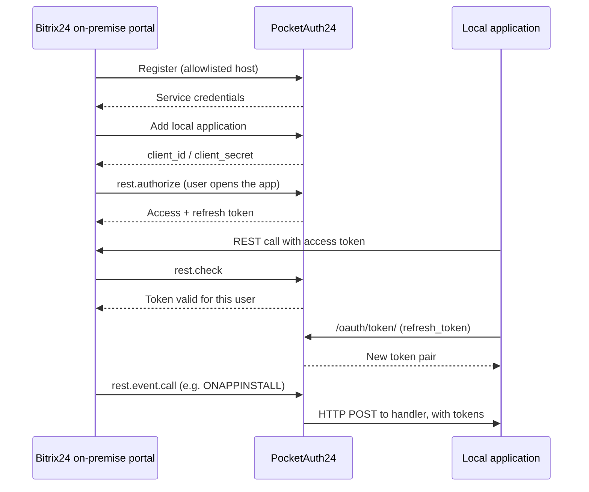

# PocketAuth24

[English](README.md) · [Deutsch](README.de.md) · **Italiano** · [Español](README.es.md) · [Português](README.pt.md) · [Русский](README.ru.md)

**Mantieni funzionanti le applicazioni locali su un portale Bitrix24 on-premise senza accesso a internet.**

[](https://github.com/serg-vostrikov-bitrix/pocketauth24/actions/workflows/ci.yml)


[](LICENSE)
<br>


PocketAuth24 è un server indipendente e self-hosted. Risponde alle chiamate OAuth che un portale Bitrix24 on-premise altrimenti invierebbe al server OAuth cloud (`oauth.bitrix.info` / `oauth.bitrix24.tech`). Gira come un solo container con un database PostgreSQL 17 all'interno della tua rete. Punta il portale al server: le applicazioni locali si aprono, chiamano REST, rinnovano i token e ricevono gli eventi senza alcuna connessione al cloud.

> Progetto open source indipendente. Non è un prodotto Bitrix24. Vedi la [dichiarazione di non responsabilità](#dichiarazione-di-non-responsabilità).


_La pagina di stato su `/`. Mostra solo conteggi aggregati._

## 🔒 Perché

Un portale Bitrix24 on-premise dipende dal server OAuth cloud per le sue applicazioni locali. Quando il portale non raggiunge internet, le applicazioni locali non si aprono, non possono chiamare REST con i token, non possono rinnovare i token e non ricevono gli eventi online.

I team nelle reti aziendali chiuse e negli ambienti regolamentati restano con due brutte opzioni: rinunciare alle applicazioni locali oppure aprire una rotta verso internet che non vogliono. PocketAuth24 ne offre una terza: eseguire il lato OAuth delle applicazioni locali dentro la propria rete.

**Conviene anche con accesso a internet.** Se i portali dei tuoi clienti eseguono solo le tue applicazioni locali, il server OAuth cloud remoto aggiunge poco: avvii delle app, verifiche e rinnovi dei token vanno comunque a un server che non controlli, e la sua disponibilità e il percorso di rete per raggiungerlo sono fuori dalle tue mani. Con PocketAuth24 accanto al portale, questa dipendenza passa a un'infrastruttura che gestisci e monitori tu. Il compromesso: dopo il passaggio il portale non usa più il server OAuth cloud, quindi le applicazioni del Marketplace non funzionano più su di esso. Questa configurazione è per portali che usano solo applicazioni locali.

## ✨ Vantaggi

- **Le app locali sopravvivono all'air gap.** Una rete chiusa non esclude più le integrazioni personalizzate sul portale.
- **Una dipendenza esterna in meno.** Le applicazioni locali non richiedono alcuna rotta in uscita verso il server OAuth cloud.
- **La tua disponibilità, non quella di altri.** Anche su un portale connesso a internet che esegue solo le tue app locali, avvii delle app, verifiche e rinnovi dei token non dipendono più dalla disponibilità di un server remoto. (Le app del Marketplace richiedono il cloud e non funzionano dopo il passaggio.)
- **Limita l'impatto di una fuga di database o di log.** Token e segreti sono salvati solo come hash, e le query string non arrivano mai nei log.
- **Un server, più portali.** Partner e operatori non hanno bisogno di un'istanza per portale.
- **Ingombro ridotto.** Un container, un database, un controllo `/health`, log JSON su stdout e backup PostgreSQL standard.
- **Codice aperto.** Con licenza MIT, così gli integratori possono leggerlo, verificarlo e adattarlo.

## 🧩 Funzionalità disponibili oggi

| Area                            | Cosa ottieni                                                                                                                                                                                                                                                                                                                                                                                     |
| ------------------------------- | ------------------------------------------------------------------------------------------------------------------------------------------------------------------------------------------------------------------------------------------------------------------------------------------------------------------------------------------------------------------------------------------------ |
| **Registrazione portale**       | Il portale si registra da solo alla sua prossima chiamata OAuth. La registrazione è limitata a una allowlist (`PORTAL_ALLOWLIST`, confrontata su host e porta). Ogni chiamata al servizio è autenticata con le credenziali del portale stesso, e tutti i dati sono limitati al portale chiamante.                                                                                                |
| **Applicazioni locali**         | Crea, aggiorna ed elimina le applicazioni locali sul portale come al solito. Il server emette `client_id` (`local.<14 hex>.<8 digits>`) e `client_secret` e mantiene il proprio registro allineato. L'eliminazione di un'app rimuove tutti i suoi token.                                                                                                                                         |
| **Token**                       | `rest.authorize` emette coppie di token per l'utente corretto, inclusi i non amministratori; le pagine di installazione si aprono con i token. `rest.check` convalida i token. Lo scope del token è l'intersezione tra lo scope richiesto e quello dell'applicazione.                                                                                                                            |
| **Rinnovo**                     | `/oauth/token/` (GET o POST) con `grant_type=refresh_token`. I refresh token sono riutilizzabili fino alla scadenza, come osservato nel traffico cloud catturato. Gli access token durano 3600 s, i refresh token 180 giorni; le coppie scadute vengono eliminate ogni ora.                                                                                                                      |
| **Eventi**                      | `rest.event.call` consegna ogni evento al gestore dell'applicazione con HTTP POST, incluso `ONAPPINSTALL` con token appena emessi. Il portale riceve una risposta immediata.                                                                                                                                                                                                                     |
| **Sicurezza**                   | Archiviazione hash di token e segreti, token da una fonte casuale crittograficamente sicura, oscuramento dei log (nessuna query string, URL dei gestori senza credenziali), porta dell'app legata al loopback (`127.0.0.1:3000`) in `docker-compose.yml`.                                                                                                                                        |
| **Operatività**                 | Una pagina di stato pubblica su `/` (stato di servizio e database, conteggi di portali, applicazioni, coppie di token attive e consegne di eventi) e gli stessi dati in JSON su `/api/status`. `/health` restituisce HTTP 503 quando PostgreSQL non risponde. Log JSON, slash finale accettato su tutti i percorsi.                                                                              |
| **Pannello di amministrazione** | Un pannello di amministrazione multiutente su `/admin`: tabelle in sola lettura e ricercabili di portali, applicazioni locali, metadati dei token (senza token né hash) e contatori giornalieri degli eventi. La password del superutente si imposta solo dalla CLI; il superutente gestisce i visualizzatori nel pannello. Le sessioni durano 12 ore; gli accessi hanno un limite di frequenza. |

## 💡 Casi d'uso

Il server è utile anche fuori dalle reti chiuse: ovunque un portale non debba usare il server OAuth cloud. Questi scenari funzionano già oggi.

| Scenario                                 | Come usare il server                                                                                                                                                                                                                                                                                                                        |
| ---------------------------------------- | ------------------------------------------------------------------------------------------------------------------------------------------------------------------------------------------------------------------------------------------------------------------------------------------------------------------------------------------- |
| **Portale per sviluppatori**             | Esegui un portale on-premise locale per lo sviluppo di applicazioni e collegalo a una propria istanza del server. Il portale non si registra nel cloud, quindi non entra in conflitto con un portale di produzione con la stessa chiave di licenza.                                                                                         |
| **Copie di staging, test e formazione**  | Ripristina una copia della produzione e collegala a un'istanza separata del server. Elimina le credenziali di servizio nella copia (vedi [Avvio rapido](#-avvio-rapido)) e ricrea le sue applicazioni locali. Non collegare la copia al server di produzione: la copia porta con sé le credenziali di servizio della produzione dal backup. |
| **Test end-to-end in CI**                | Avvia un container del portale e il server in un unico stack Compose. Installazione delle applicazioni, `ONAPPINSTALL`, chiamate REST e rinnovo dei token funzionano senza cloud, quindi i risultati dei test non dipendono da un servizio esterno.                                                                                         |
| **Un server per i portali dei clienti**  | Un integratore esegue un'istanza per i portali on-premise di più clienti. Aggiungi ogni portale a `PORTAL_ALLOWLIST`. Il server tiene separati i dati di ogni portale.                                                                                                                                                                      |
| **Inventario delle applicazioni locali** | Il pannello di amministrazione elenca le applicazioni locali di tutti i portali e mostra quali hanno token attivi. Ottieni questa vista senza accedere a ogni portale.                                                                                                                                                                      |

È prevista una guida per le copie di sviluppo e di staging: [#22](https://github.com/serg-vostrikov-bitrix/b24auth-server/issues/22).

## ⚙️ Come funziona



Il traffico OAuth tra portale, applicazioni locali e server resta dentro la tua rete. Il reverse proxy davanti al server termina il TLS e limita chi può raggiungere quale percorso.

## ✅ Verificato

| Verifica                          | Cosa copre                                                                                                                                                                                                                                                                                                                                            |
| --------------------------------- | ----------------------------------------------------------------------------------------------------------------------------------------------------------------------------------------------------------------------------------------------------------------------------------------------------------------------------------------------------- |
| **Test automatici**               | Test di integrazione su PostgreSQL reale per registrazione del portale, registro delle applicazioni, servizio token, consegna degli eventi, routing e health, più test unitari.                                                                                                                                                                       |
| **Test di contratto**             | Forme delle risposte e codici di errore confrontati con il traffico catturato tra un portale di test (`rest` 26.1100) e `oauth.bitrix.info`.                                                                                                                                                                                                          |
| **Smoke test del container (CI)** | Il container si avvia, `/health` risponde, rispondono la pagina di stato e `/api/status`, un portale si registra, nessun log di livello error, il processo non gira come root.                                                                                                                                                                        |
| **End-to-end in una rete chiusa** | Una checklist di 10 passi su un portale di test Docker locale (`rest` 26.1100) il cui container PHP era isolato da internet: registrazione, creazione dell'app, pagina di installazione con token, REST come amministratore e non amministratore, `ONAPPINSTALL` con token, rinnovo e rinnovo ripetuto, eliminazione. Tutti i 10 passi sono riusciti. |

Non è ancora stato eseguito in produzione presso un cliente. Alcuni dettagli sono stati dedotti anziché catturati dal cloud: alcuni codici di stato HTTP (`invalid_client`, metodo sconosciuto, `expired_token`) e la forma esatta di un blocco `auth` di un evento con token.

## 🚀 Avvio rapido

Non c'è un'immagine pubblicata: costruiscila su una macchina con accesso a internet e portala nella rete chiusa.

```bash
# Outside the closed network
docker build -t pocketauth24:<version> .
docker pull postgres:17
docker save pocketauth24:<version> postgres:17 -o pocketauth24-<version>.tar

# Inside the closed network (copy the tar and docker-compose.yml first)
docker load -i pocketauth24-<version>.tar
docker tag pocketauth24:<version> pocketauth24:local
```

Crea `.env` accanto a `docker-compose.yml`:

| Variabile           | Esempio                                         | Significato                                                                                                                                                                              |
| ------------------- | ----------------------------------------------- | ---------------------------------------------------------------------------------------------------------------------------------------------------------------------------------------- |
| `BASE_URL`          | `https://auth.corp.local`                       | URL pubblico dietro il proxy; diventa `server_endpoint`.                                                                                                                                 |
| `DATABASE_URL`      | `postgres://b24auth:<password>@db:5432/b24auth` | Connessione al database.                                                                                                                                                                 |
| `PORTAL_ALLOWLIST`  | `portal.corp.local,crm.corp.local:8443`         | `host[:port]` dei portali autorizzati a registrarsi; elenca esplicitamente le porte non predefinite.                                                                                     |
| `POSTGRES_PASSWORD` | `<password>`                                    | Stessa password di `DATABASE_URL`.                                                                                                                                                       |
| `TRUST_PROXY`       | `true`                                          | Facoltativa. Accetta solo `true` o `false`. Imposta `true` solo se il proxy sovrascrive `X-Forwarded-For` con l'IP del client (nginx: `$remote_addr`, non `$proxy_add_x_forwarded_for`). |

`BASE_URL`, `DATABASE_URL` e `PORTAL_ALLOWLIST` sono obbligatori; il server non si avvia senza di essi. Poi:

```bash
docker compose up -d                       # migrations run on start
curl https://auth.corp.local/health        # {"status":"ok"}
```

**Reverse proxy (obbligatorio).** Inoltra `https://<BASE_URL host>/` a `http://<app host>:3000/` con un certificato della tua CA interna. Nega per impostazione predefinita; consenti ogni percorso solo dagli IP dei server del portale, tranne `/oauth/token`, `/health` e, se vuoi, la pagina di stato (`/`, `/assets/*`, `/api/status`). Fai corrispondere i percorsi con e senza slash finale.

**Punta il portale al server.** Nel pannello di amministrazione, "Riga di comando PHP":

```php
\Bitrix\Main\Config\Option::set('rest', 'oauth_server', 'https://auth.corp.local');
\Bitrix\Main\Config\Option::delete('rest', ['name' => 'service_client_id']);
\Bitrix\Main\Config\Option::delete('rest', ['name' => 'service_client_secret']);
```

In alternativa definisci `BITRIX_OAUTH_URL` in `local/php_interface/init.php` (sovrascrive l'opzione `oauth_server`; non modificare `dbconn.php`). Il portale si registra da solo alla sua prossima chiamata OAuth.

**Poi:** ricrea le applicazioni locali create quando il portale usava il cloud e cambia gli URL dei token scritti nel codice (`https://oauth.bitrix.info/oauth/token/`, usato dalla maggior parte degli SDK, incluso CRest) in `https://auth.corp.local/oauth/token/`, oppure punta il DNS interno dei nomi host del cloud al proxy con un certificato della CA interna.

Passi completi, operatività e rollback: [docs/deployment.md](docs/deployment.md).

## 🖥️ Requisiti lato portale

Trovati durante l'esecuzione end-to-end. Sono comportamenti del portale, non difetti del server.

- Il portale deve conoscere il suo **URL pubblico e la porta reali**; altrimenti il frame dell'app riceve un `DOMAIN` errato e `BX24` non raggiunge il portale.
- Gli URL delle applicazioni e dei gestori richiedono un **nome host con un punto** (un FQDN o un indirizzo IP); `localhost` viene rifiutato.
- **Servi lo script `BX24` internamente.** `BX24` è il vecchio SDK JS; per le nuove app consigliamo [b24jssdk](https://github.com/bitrix24/b24jssdk). Le app esistenti che usano ancora `BX24` di solito lo caricano da `//api.bitrix24.com/api/v1/`, irraggiungibile in una rete chiusa.
- Il portale rifiuta le chiamate REST per un utente che non ha mai effettuato l'accesso.

## ⚡ Prestazioni della consegna degli eventi

**Come funziona la consegna.** Il portale invia tutti gli eventi di una richiesta (hit) in un unico batch `rest.event.call`. Il batch non ha limite di dimensione e il portale non lo ritenta. Il server risponde subito `{"result":null}` e consegna ogni evento in background, nello stesso processo. Ogni evento ottiene un tentativo di HTTP POST con timeout di 10 secondi.

**Limiti.** I valori sono fissati in [`src/config.ts`](src/config.ts).

| Limite                                     | Valore | Quando viene raggiunto                                                              |
| ------------------------------------------ | ------ | ----------------------------------------------------------------------------------- |
| Consegne concorrenti in totale             | 200    | L'evento viene scartato e registrato come `event_dropped_overload`, `limit: global` |
| Consegne concorrenti verso un host gestore | 100    | L'evento viene scartato e registrato come `event_dropped_overload`, `limit: host`   |
| Timeout di una consegna                    | 10 s   | La consegna si interrompe e viene registrata come `event_delivery_failed`           |

Un host gestore è l'host e la porta dell'URL del gestore. Il limite per host è la metà del limite totale. Quindi un gestore lento può occupare al massimo 100 slot, e gli altri gestori mantengono sempre 100 slot. Il limite per host non è più basso perché un hit del portale può inviare un batch grande a un solo gestore, per esempio durante un'importazione di massa.

**Cosa costa al server un gestore lento.** Una consegna che attende il gestore tiene aperta una connessione e una piccola quantità di memoria. Non tiene una connessione al database: il server emette i token prima di inviare il POST. L'event loop non viene bloccato. Se ogni gestore attende fino al timeout, il server consegna al massimo 20 eventi al secondo in totale e 10 eventi al secondo verso un host. Gli eventi successivi vengono scartati.

**Raccomandazioni per i gestori delle applicazioni.**

- Rispondi entro un secondo. Accetta l'evento, mettilo nella tua coda, poi elaboralo.
- Dai a ogni applicazione pesante il proprio host gestore. Così un'applicazione lenta usa solo i suoi 100 slot.
- Monitora il log del server per `event_dropped_overload`. Il campo `limit` indica quale limite è stato raggiunto.

Gli eventi scartati o falliti non vengono rinviati. Una coda persistente con ritentativi è una fase successiva proposta.

## 🧭 Limitazioni

Conoscili prima di distribuire:

- **Solo applicazioni locali.** Le applicazioni del Marketplace non funzionano, perché i loro segreti risiedono nel cloud.
- **Le app esistenti vanno ricreate**, e gli URL dei token scritti nel codice vanno cambiati o reindirizzati.
- **Il proxy è il controllo di sicurezza per la registrazione.** Il portale non invia alcun segreto condiviso, quindi chiunque raggiunga `/oauth/register/` con un indirizzo di portale in allowlist potrebbe ruotare le credenziali di quel portale. Limita l'accesso per IP.
- **Gli eventi sono consegnati una volta**, con timeout di 10 secondi. Non sono archiviati né ritentati, si perdono al riavvio e vengono scartati oltre 200 consegne concorrenti in totale o 100 consegne concorrenti verso un host gestore. Vedi [Prestazioni della consegna degli eventi](#-prestazioni-della-consegna-degli-eventi).
- **Istanza singola.** Le migrazioni vengono eseguite all'avvio senza lock.
- **Non supportato:** controlli di licenza, il grant `authorization_code`, gestione lato server di install/uninstall. Le durate dei token sono fisse; i corpi delle richieste sono limitati a 10 MB.
- **Pannello di amministrazione in sola lettura.** Il pannello mostra i dati ma non può modificare portali, applicazioni o token. Non ha SSO, autenticazione a due fattori né log di audit. Limita `/admin` e `/api/admin` sul proxy.
- **Testato** con il modulo `rest` del portale 26.1100.

Lavori pianificati e scenari che rendono possibili: vedi [Roadmap](#-roadmap).

## 🔭 Roadmap

Le voci non hanno date. La prima tabella elenca i lavori pianificati. La seconda tabella elenca gli scenari che questi lavori rendono possibili. Sono idee, non impegni.

### Lavori pianificati

| Voce                                                                                                                       | Cosa aggiunge                                                                                                                                                                                          |
| -------------------------------------------------------------------------------------------------------------------------- | ------------------------------------------------------------------------------------------------------------------------------------------------------------------------------------------------------ |
| **OAuth 2.0 completo e introspection**                                                                                     | Il grant `authorization_code`, la revoca dei token alla disinstallazione, i controlli dello scope.                                                                                                     |
| **Coda persistente degli eventi**                                                                                          | Il server memorizza gli eventi, ritenta le consegne fallite e conserva gli eventi dopo un riavvio.                                                                                                     |
| **Modalità di fallback upstream** ([#10](https://github.com/serg-vostrikov-bitrix/b24auth-server/issues/10))               | Il server inoltra le chiamate al server OAuth cloud e risponde da solo quando il cloud non risponde. Le applicazioni locali continuano a funzionare durante un'interruzione del cloud.                 |
| **Operazioni**                                                                                                             | Migrazione di un portale già registrato. Un avviso quando una nuova registrazione sovrascrive le credenziali di un portale ([#23](https://github.com/serg-vostrikov-bitrix/b24auth-server/issues/23)). |
| **Guida per le copie di sviluppo e di staging** ([#22](https://github.com/serg-vostrikov-bitrix/b24auth-server/issues/22)) | Regole per gli scenari di sviluppo e di staging in [Casi d'uso](#-casi-duso).                                                                                                                          |

### Scenari che questi lavori rendono possibili

| Scenario                                                                                                                                               | Cosa richiede                                                              |
| ------------------------------------------------------------------------------------------------------------------------------------------------------ | -------------------------------------------------------------------------- |
| **Ispettore degli eventi.** Registrare gli eventi, mostrarli nel pannello di amministrazione e inviarli di nuovo al gestore, per il debug dei gestori. | La coda persistente degli eventi.                                          |
| **Revoca di emergenza.** Revocare tutti i token di un'applicazione o di un portale dopo una fuga di dati.                                              | La revoca dei token e azioni di scrittura nel pannello di amministrazione. |
| **Test dei guasti.** Durate brevi dei token, un `expired_token` forzato, gestori lenti, token di test emessi dalla CLI.                                | Durate dei token configurabili. Oggi sono fisse.                           |
| **Bus degli eventi.** Inviare gli eventi del portale a un message broker per i sistemi interni.                                                        | La coda persistente degli eventi.                                          |
| **Audit degli accessi.** Un registro di chi ha ricevuto un token per quale applicazione, e quando.                                                     | Un log di audit.                                                           |

## 🔁 CI/CD

La CI viene eseguita sui push su `main` e sulle pull request ([`.github/workflows/ci.yml`](.github/workflows/ci.yml)):

| Job         | Cosa fa                                                                           |
| ----------- | --------------------------------------------------------------------------------- |
| `test`      | Node.js 26 con un servizio PostgreSQL 17: `npm ci`, lint, typecheck, test, build. |
| `container` | Costruisce e avvia lo stack Docker Compose ed esegue lo smoke test.               |
| `audit`     | `npm audit` per le dipendenze di produzione a severità alta.                      |

Dependabot controlla ogni settimana i pacchetti npm, le GitHub Actions e le immagini base Docker.

Non c'è ancora alcun passo automatico di release o pubblicazione: nessuna pipeline CD e nessuna immagine pubblicata. L'immagine la costruisci tu.

## 📚 Documentazione

- [Guida alla distribuzione](docs/deployment.md): requisiti, passi, regole del proxy, operatività, rollback.
- [Checklist end-to-end](docs/e2e-checklist.md): la verifica in 10 passi in rete chiusa.
- [Cattura del protocollo](docs/protocol-capture.md): come è stato registrato il traffico cloud per i test di contratto.
- [Ricerca](docs/research/2026-11-18-oauth-server-analysis.md): analisi del protocollo e roadmap proposta.
- [Manuale utente](docs/launchkit/01-user-manual.en.md): scenari, casi di errore, limiti.

## 🛠️ Sviluppo

Stack: Node.js 26, TypeScript (strict), Fastify, Drizzle, PostgreSQL 17.

```bash
npm install
docker compose up -d db
npm test
```

Altri script: `npm run lint`, `npm run typecheck`, `npm run build`, `npm run dev`, `npm run db:generate`.

Configurazione: `BASE_URL`, `DATABASE_URL`, `PORTAL_ALLOWLIST` (vedi [`.env.example`](.env.example)).

## 📄 Licenza

[MIT](LICENSE). Copyright 2026 Serg Vostrikov.

## Dichiarazione di non responsabilità

PocketAuth24 è un progetto indipendente. Non è affiliato a Bitrix24, né approvato o certificato da Bitrix24. "Sostituto del server OAuth cloud" descrive ciò che il software fa, non un rapporto con un fornitore. Bitrix24 e gli altri marchi appartengono ai rispettivi proprietari.
