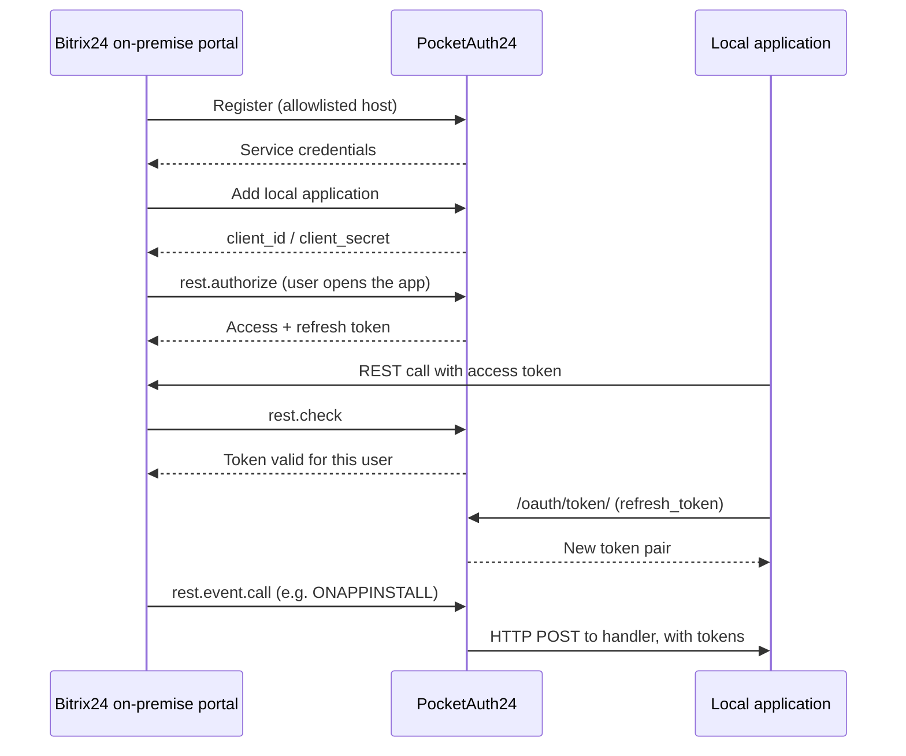

# PocketAuth24

**English** · [Deutsch](README.de.md) · [Italiano](README.it.md) · [Español](README.es.md) · [Português](README.pt.md) · [Русский](README.ru.md)

**Keep local applications working on a Bitrix24 on-premise portal that has no internet access.**

[](https://github.com/serg-vostrikov-bitrix/pocketauth24/actions/workflows/ci.yml)


[](LICENSE)
<br>


A Bitrix24 on-premise portal does not handle OAuth for its local applications by itself. It sends each app launch, token check and token renewal to the Bitrix24 cloud OAuth server (`oauth.bitrix.info` / `oauth.bitrix24.tech`). So the portal stands in your server room, behind your firewall, and still asks the cloud before it opens your own app. PocketAuth24 takes over this job inside your network. It is one container and one PostgreSQL 17 database. Point the portal at PocketAuth24, and local applications open, call REST, renew tokens and receive events with no connection to the cloud.

> Independent open-source project. Not a Bitrix24 product. See the [disclaimer](#disclaimer).


_The status page at `/`. It shows only aggregate counts._

## 🔒 Why

A Bitrix24 on-premise portal needs the cloud OAuth server for its local applications. If the portal loses internet access, its local applications stop. They do not open, cannot call REST with tokens, cannot renew tokens and get no online events. The portal itself keeps working. Its applications wait for a server that they cannot reach.

Teams in closed corporate networks and regulated environments then have two bad options. They give up local applications, or they open an internet route that they do not want, in a network that they closed on purpose. PocketAuth24 is a third option: the OAuth part of local applications runs inside their own network.

**It is useful with internet access too.** If your clients' portals run only your own local applications, the cloud OAuth server gives them little. But each app launch, token check and renewal still goes to it. Your app, on your client's portal, asks a remote server for permission to start. You control neither that server nor the network path to it. Put PocketAuth24 next to the portal, and this dependency moves into infrastructure that you run and monitor. The cost: after the switch, the portal stops using the cloud OAuth server, so Marketplace applications stop working on it. Use this setup only for portals that need local applications and nothing more.

## ✨ Benefits

- **Local apps work behind an air gap.** A closed network no longer means a portal without custom integrations.
- **No route to the cloud.** Local applications do not need an outbound connection to the cloud OAuth server.
- **Your uptime, not someone else's.** On an internet-connected portal with only your own local apps, launches, token checks and renewals stop depending on a remote server. Marketplace apps need the cloud and stop working after the switch.
- **A database or log leak gives away less.** PocketAuth24 stores tokens and secrets only as hashes and never writes query strings to the logs.
- **One PocketAuth24 for several portals.** Partners and operators do not need a separate instance for each portal.
- **Little to run.** One container, one database, a `/health` check, JSON logs to stdout and ordinary PostgreSQL backups.
- **Open code.** The MIT licence lets integrators read, audit and adapt it.

## 🧩 Features available today

| Area                    | What you get                                                                                                                                                                                                                                                                                                                        |
| ----------------------- | ----------------------------------------------------------------------------------------------------------------------------------------------------------------------------------------------------------------------------------------------------------------------------------------------------------------------------------- |
| **Portal registration** | The portal registers with PocketAuth24 on its next OAuth call. PocketAuth24 accepts only portals from an allowlist (`PORTAL_ALLOWLIST`, matched on host and port). Each service call carries the portal's own credentials, and each portal sees only its own data.                                                                  |
| **Local applications**  | Create, change and delete local applications on the portal as before. PocketAuth24 issues the `client_id` (`local.<14 hex>.<8 digits>`) and the `client_secret` and keeps its list of applications in step with the portal. When you delete an app, PocketAuth24 deletes all its tokens.                                            |
| **Tokens**              | `rest.authorize` issues a token pair for the correct user, also for users who are not administrators. Install pages open with tokens. `rest.check` validates tokens. A token gets only the scopes that both the request and the application have.                                                                                   |
| **Renewal**             | `/oauth/token/` (GET or POST) with `grant_type=refresh_token`. A refresh token stays usable until it expires, as in the captured cloud traffic. An access token lives 3600 s, a refresh token 180 days. Every hour PocketAuth24 deletes expired pairs.                                                                              |
| **Events**              | For `rest.event.call`, PocketAuth24 sends each event to the application handler by HTTP POST, `ONAPPINSTALL` with new tokens included. The portal gets its answer at once and does not wait for the delivery.                                                                                                                       |
| **Security**            | PocketAuth24 stores tokens and secrets as hashes and takes tokens from a cryptographically secure random source. Logs contain no query strings and no credentials in handler URLs. In `docker-compose.yml`, the app port listens only on loopback (`127.0.0.1:3000`).                                                               |
| **Operations**          | A public status page at `/` shows the state of PocketAuth24 and its database and counts portals, applications, active token pairs and event deliveries. `/api/status` gives the same data as JSON. `/health` returns HTTP 503 when PostgreSQL does not answer. Logs are JSON, and all paths accept a trailing slash.                |
| **Admin panel**         | At `/admin`, several users can view searchable tables of portals, local applications, token metadata (no tokens or hashes) and daily event counters. The panel is read-only. Only the CLI sets the superuser password, and the superuser manages viewers in the panel. Sessions last 12 hours, and PocketAuth24 rate-limits logins. |

## 💡 Use cases

PocketAuth24 is not only for closed networks. It helps wherever a portal must not use the cloud OAuth server. All these scenarios work today.

| Scenario                                | How to use PocketAuth24                                                                                                                                                                                                                                                                                                     |
| --------------------------------------- | --------------------------------------------------------------------------------------------------------------------------------------------------------------------------------------------------------------------------------------------------------------------------------------------------------------------------- |
| **Developer portal**                    | Run a local on-premise portal for app development and give it its own PocketAuth24 instance. The portal never registers in the cloud, so it does not clash with a production portal on the same licence key.                                                                                                                |
| **Staging, test and training copies**   | Restore a copy of production and connect it to a separate PocketAuth24 instance. In the copy, delete the service credentials (see [Quick start](#-quick-start)) and re-create the local applications. Do not connect the copy to the production PocketAuth24: the backup brings the production service credentials with it. |
| **End-to-end tests in CI**              | Put a portal container and PocketAuth24 in one Compose stack. App install, `ONAPPINSTALL`, REST calls and token renewal run without the cloud, so an external service cannot break your test results.                                                                                                                       |
| **One PocketAuth24 for client portals** | An integrator runs one PocketAuth24 for the on-premise portals of several clients. Each portal goes into `PORTAL_ALLOWLIST`, and PocketAuth24 keeps the data of each portal apart.                                                                                                                                          |
| **Inventory of local applications**     | The admin panel lists the local applications of all portals and shows which of them hold active tokens. You do not have to sign in to each portal for this.                                                                                                                                                                 |

A guide for dev and staging copies is planned: [#22](https://github.com/serg-vostrikov-bitrix/b24auth-server/issues/22).

## ⚙️ How it works



OAuth traffic between the portal, the local applications and PocketAuth24 does not leave your network. A reverse proxy in front of PocketAuth24 terminates TLS and decides who can reach which path.

## ✅ Verified

| Check                              | What it covers                                                                                                                                                                                                                                                                                             |
| ---------------------------------- | ---------------------------------------------------------------------------------------------------------------------------------------------------------------------------------------------------------------------------------------------------------------------------------------------------------- |
| **Automated tests**                | Integration tests against a real PostgreSQL for portal registration, the application registry, the token service, event delivery, routing and health, plus unit tests.                                                                                                                                     |
| **Contract tests**                 | Response shapes and error codes compared with traffic captured between a test portal (`rest` 26.1100) and `oauth.bitrix.info`.                                                                                                                                                                             |
| **Container smoke test (CI)**      | The container starts. `/health`, the status page and `/api/status` answer. A portal registers. The logs have no error-level entries, and the process does not run as root.                                                                                                                                 |
| **End-to-end in a closed network** | A 10-step checklist on a local Docker test portal (`rest` 26.1100) whose PHP container had no internet access: registration, app creation, install page with tokens, REST as administrator and non-administrator, `ONAPPINSTALL` with tokens, renewal and repeated renewal, deletion. All 10 steps passed. |

Nobody has run PocketAuth24 in production at a customer yet. A few details come from inference, not from captured cloud traffic: some HTTP status codes (`invalid_client`, unknown method, `expired_token`) and the exact shape of the `auth` block in an event that carries tokens.

## 🚀 Quick start

There is no published image. Build it on a machine with internet access, then carry it into the closed network.

```bash
# Outside the closed network
docker build -t pocketauth24:<version> .
docker pull postgres:17
docker save pocketauth24:<version> postgres:17 -o pocketauth24-<version>.tar

# Inside the closed network (copy the tar and docker-compose.yml first)
docker load -i pocketauth24-<version>.tar
docker tag pocketauth24:<version> pocketauth24:local
```

Create `.env` next to `docker-compose.yml`:

| Variable            | Example                                         | Meaning                                                                                                                                                                             |
| ------------------- | ----------------------------------------------- | ----------------------------------------------------------------------------------------------------------------------------------------------------------------------------------- |
| `BASE_URL`          | `https://auth.corp.local`                       | The public URL of PocketAuth24 behind the proxy. It becomes `server_endpoint`.                                                                                                      |
| `DATABASE_URL`      | `postgres://b24auth:<password>@db:5432/b24auth` | Database connection.                                                                                                                                                                |
| `PORTAL_ALLOWLIST`  | `portal.corp.local,crm.corp.local:8443`         | The portals (`host[:port]`) that can register. Write non-default ports explicitly.                                                                                                  |
| `POSTGRES_PASSWORD` | `<password>`                                    | The same password as in `DATABASE_URL`.                                                                                                                                             |
| `TRUST_PROXY`       | `true`                                          | Optional. Accepts only `true` or `false`. Set `true` only when the proxy overwrites `X-Forwarded-For` with the client IP (nginx: `$remote_addr`, not `$proxy_add_x_forwarded_for`). |

`BASE_URL`, `DATABASE_URL` and `PORTAL_ALLOWLIST` are required. Without them, PocketAuth24 does not start. Then:

```bash
docker compose up -d                       # migrations run on start
curl https://auth.corp.local/health        # {"status":"ok"}
```

**Reverse proxy (required).** Proxy `https://<BASE_URL host>/` to `http://<app host>:3000/` with a certificate from your internal CA. Deny everything by default. Allow all paths only from the IP addresses of the portal servers. Do not apply this limit to `/oauth/token`, `/health` and, if you want, the status page (`/`, `/assets/*`, `/api/status`). Match each path with and without the trailing slash.

**Point the portal at PocketAuth24.** In the portal's admin panel, open "PHP command line" and run:

```php
\Bitrix\Main\Config\Option::set('rest', 'oauth_server', 'https://auth.corp.local');
\Bitrix\Main\Config\Option::delete('rest', ['name' => 'service_client_id']);
\Bitrix\Main\Config\Option::delete('rest', ['name' => 'service_client_secret']);
```

You can also define `BITRIX_OAUTH_URL` in `local/php_interface/init.php`. It overrides the `oauth_server` option. Do not edit `dbconn.php`. The portal registers with PocketAuth24 on its next OAuth call.

**Then:** re-create the local applications that you made while the portal used the cloud. Most SDKs, CRest included, have the token URL `https://oauth.bitrix.info/oauth/token/` in their code. Change it to `https://auth.corp.local/oauth/token/`. Or point internal DNS for the cloud host names at the proxy, with a certificate from your internal CA.

Full steps, operations and rollback: [docs/deployment.md](docs/deployment.md).

## 🖥️ Requirements on the portal side

We found these during the end-to-end run. They are the habits of the portal, not defects in PocketAuth24.

- The portal must know its **real public URL and port**. If not, the app frame gets a wrong `DOMAIN`, and `BX24` cannot reach the portal.
- Application and handler URLs need a **host name with a dot** (an FQDN or an IP address). The portal rejects `localhost`.
- **Serve the `BX24` script inside your network.** `BX24` is the old JS SDK; for new apps we recommend [b24jssdk](https://github.com/bitrix24/b24jssdk). Existing apps that still use `BX24` usually load it from `//api.bitrix24.com/api/v1/`, and a closed network cannot reach that address.
- The portal refuses REST calls for a user who has never logged in.

## ⚡ Event delivery performance

**How delivery works.** The portal puts all events of one request (hit) into one `rest.event.call` batch. The batch has no size limit, and the portal never sends it again. PocketAuth24 answers `{"result":null}` at once, then delivers each event in the background, in the same process. Each event gets one HTTP POST attempt with a 10-second timeout.

**Limits.** The values are fixed in [`src/config.ts`](src/config.ts).

| Limit                                     | Value | What happens at the limit                                                       |
| ----------------------------------------- | ----- | ------------------------------------------------------------------------------- |
| Concurrent deliveries in total            | 200   | PocketAuth24 drops the event and logs `event_dropped_overload`, `limit: global` |
| Concurrent deliveries to one handler host | 100   | PocketAuth24 drops the event and logs `event_dropped_overload`, `limit: host`   |
| Timeout of one delivery                   | 10 s  | PocketAuth24 stops the delivery and logs `event_delivery_failed`                |

A handler host is the host and port of the handler URL. The host limit is half of the total limit. So one slow handler takes at most 100 slots, and the other handlers always keep 100. The host limit is not lower because one portal hit can send a large batch to one handler, for example in a mass import.

**What a slow handler costs PocketAuth24.** While a delivery waits for the handler, it holds one open connection and a little memory. It holds no database connection, because PocketAuth24 issues the tokens before it sends the POST. The event loop does not block. If every handler waits until the timeout, PocketAuth24 delivers at most 20 events per second in total and 10 per second to one host. It drops the rest.

**Recommendations for application handlers.**

- Answer within one second. Accept the event, put it in your own queue, then process it.
- Give each heavy application its own handler host. A slow application then uses only its own 100 slots.
- Watch the PocketAuth24 log for `event_dropped_overload`. Its `limit` field shows which limit was reached.

PocketAuth24 does not send dropped or failed events again. A persistent queue with retries is a proposed next stage.

## 🧭 Limitations

Know these before you deploy, not after:

- **Local applications only.** Marketplace applications do not work, because their secrets live in the cloud.
- **You must re-create existing apps** and change or redirect hard-coded token URLs.
- **The proxy is what protects registration.** The portal sends no shared secret. Anyone who reaches `/oauth/register/` with an allowlisted portal address can rotate that portal's credentials. Limit this path by IP.
- **Each event is delivered once**, with a 10-second timeout. PocketAuth24 does not store or retry events. It loses them on restart and drops them above 200 concurrent deliveries in total or 100 to one handler host. See [Event delivery performance](#-event-delivery-performance).
- **One instance only.** Migrations run on start without a lock.
- **Not supported:** licence checks, the `authorization_code` grant, install and uninstall handling on the server side. Token lifetimes are fixed. A request body can be at most 10 MB.
- **The admin panel is read-only.** It shows data but cannot change portals, applications or tokens. It has no SSO, no two-factor authentication and no audit log. Limit `/admin` and `/api/admin` at the proxy.
- **Tested** with the portal `rest` module 26.1100.

Planned work and the scenarios it opens: see [Roadmap](#-roadmap).

## 🔭 Roadmap

Nothing here has a date, so nothing here is late. The first table lists planned work. The second lists scenarios that this work makes possible. They are ideas, not promises.

### Planned work

| Item                                                                                                            | What it adds                                                                                                                                                                                          |
| --------------------------------------------------------------------------------------------------------------- | ----------------------------------------------------------------------------------------------------------------------------------------------------------------------------------------------------- |
| **Full OAuth 2.0 and introspection**                                                                            | The `authorization_code` grant, revocation of tokens on uninstall, scope checks.                                                                                                                      |
| **Persistent event queue**                                                                                      | PocketAuth24 stores events, retries failed deliveries and keeps events across a restart.                                                                                                              |
| **Upstream fallback mode** ([#10](https://github.com/serg-vostrikov-bitrix/b24auth-server/issues/10))           | PocketAuth24 passes calls on to the cloud OAuth server and answers them itself when the cloud does not respond. Local applications keep working while the cloud is down.                              |
| **Operations**                                                                                                  | Migration of a portal that is already registered. A warning when a re-registration overwrites the credentials of a portal ([#23](https://github.com/serg-vostrikov-bitrix/b24auth-server/issues/23)). |
| **Guide for dev and staging copies** ([#22](https://github.com/serg-vostrikov-bitrix/b24auth-server/issues/22)) | Rules for the developer and staging scenarios in [Use cases](#-use-cases).                                                                                                                            |

### Scenarios this work opens

| Scenario                                                                                                                | What it needs                                              |
| ----------------------------------------------------------------------------------------------------------------------- | ---------------------------------------------------------- |
| **Event inspector.** Record events, show them in the admin panel and send them to the handler again, to debug handlers. | The persistent event queue.                                |
| **Emergency revocation.** Revoke all tokens of an application or a portal after a leak.                                 | Revocation of tokens and write actions in the admin panel. |
| **Failure tests.** Short token lifetimes, a forced `expired_token`, slow handlers, test tokens issued from the CLI.     | Configurable token lifetimes. Today they are fixed.        |
| **Event bus.** Send portal events to a message broker for internal systems.                                             | The persistent event queue.                                |
| **Access audit.** A log of who received a token for which application, and when.                                        | An audit log.                                              |

## 🔁 CI/CD

CI runs on pushes to `main` and on pull requests ([`.github/workflows/ci.yml`](.github/workflows/ci.yml)):

| Job         | What it does                                                                      |
| ----------- | --------------------------------------------------------------------------------- |
| `test`      | Node.js 26 with a PostgreSQL 17 service: `npm ci`, lint, typecheck, tests, build. |
| `container` | Builds and starts the Docker Compose stack and runs the smoke test.               |
| `audit`     | `npm audit` for production dependencies at high severity.                         |

Dependabot checks npm packages, GitHub Actions and Docker base images every week.

The CD half of this heading does not exist yet: there is no release pipeline and no published image. You build the image yourself.

## 📚 Documentation

- [Deployment guide](docs/deployment.md): requirements, steps, proxy rules, operations, rollback.
- [End-to-end checklist](docs/e2e-checklist.md): the 10-step check in a closed network.
- [Protocol capture](docs/protocol-capture.md): how we recorded the cloud traffic for the contract tests.
- [Research](docs/research/2026-11-18-oauth-server-analysis.md): protocol analysis and proposed roadmap.
- [User manual](docs/launchkit/01-user-manual.en.md): scenarios, error cases, limits.

## 🛠️ Development

Stack: Node.js 26, TypeScript (strict), Fastify, Drizzle, PostgreSQL 17.

```bash
npm install
docker compose up -d db
npm test
```

Other scripts: `npm run lint`, `npm run typecheck`, `npm run build`, `npm run dev`, `npm run db:generate`.

Configuration: `BASE_URL`, `DATABASE_URL`, `PORTAL_ALLOWLIST` (see [`.env.example`](.env.example)).

## 📄 License

[MIT](LICENSE). Copyright 2026 Serg Vostrikov.

## Disclaimer

PocketAuth24 is an independent project. It is not affiliated with, endorsed by or certified by Bitrix24. "Replacement for the cloud OAuth server" describes what the software does, not a vendor relationship. Bitrix24 and other trademarks belong to their respective owners.
