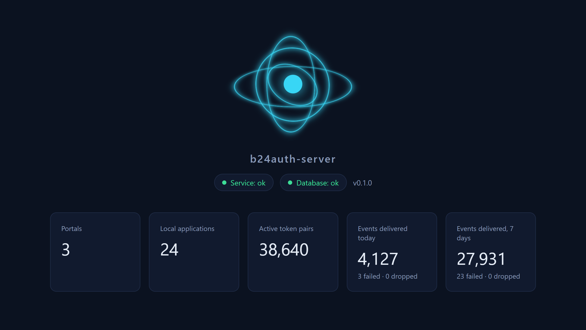
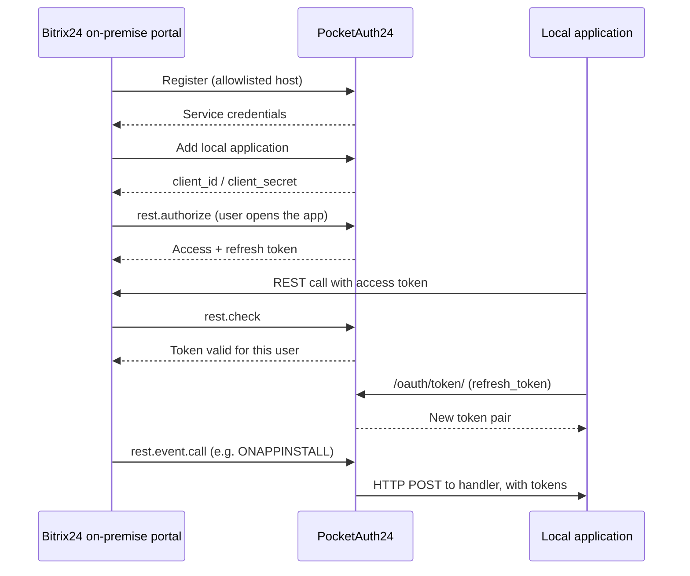

# PocketAuth24

[English](README.md) · [Deutsch](README.de.md) · [Italiano](README.it.md) · [Español](README.es.md) · **Português** · [Русский](README.ru.md)

**Mantenha as aplicações locais funcionando em um portal Bitrix24 on-premise sem acesso à internet.**

[](https://github.com/serg-vostrikov-bitrix/pocketauth24/actions/workflows/ci.yml)


[](LICENSE)
<br>


Um portal Bitrix24 on-premise não trata sozinho o OAuth das suas aplicações locais. Ele envia cada inicialização de app, verificação de token e renovação de token ao servidor OAuth na nuvem da Bitrix24 (`oauth.bitrix.info` / `oauth.bitrix24.tech`). Ou seja, o portal fica na sua sala de servidores, atrás do seu firewall, e mesmo assim pede licença à nuvem antes de abrir o seu próprio app. O PocketAuth24 assume essa tarefa dentro da sua rede. Ele é um único contêiner e um banco de dados PostgreSQL 17. Aponte o portal para o PocketAuth24: as aplicações locais abrem, chamam REST, renovam tokens e recebem eventos sem conexão com a nuvem.

> Projeto de código aberto independente. Não é um produto da Bitrix24. Veja o [aviso legal](#aviso-legal).



_A página de status em `/`. Ela mostra apenas contagens agregadas._

## 🔒 Por quê

Um portal Bitrix24 on-premise precisa do servidor OAuth na nuvem para as suas aplicações locais. Se o portal perde o acesso à internet, as suas aplicações locais param. Elas não abrem, não podem chamar REST com tokens, não podem renovar tokens e não recebem eventos online. O portal em si continua funcionando. As suas aplicações esperam por um servidor que não conseguem alcançar.

Equipes em redes corporativas fechadas e ambientes regulados ficam então com duas opções ruins. Ou abrem mão das aplicações locais, ou abrem uma rota para a internet que não querem, em uma rede que fecharam de propósito. O PocketAuth24 é uma terceira opção: o lado OAuth das aplicações locais roda dentro da própria rede.

**Também é útil com acesso à internet.** Se os portais dos seus clientes executam apenas as suas próprias aplicações locais, o servidor OAuth na nuvem agrega pouco a eles. Mas cada inicialização de app, verificação de token e renovação ainda vai para ele. O seu app, no portal do seu cliente, pede permissão a um servidor remoto para iniciar. Você não controla nem esse servidor nem o caminho de rede até ele. Coloque o PocketAuth24 ao lado do portal, e essa dependência passa para uma infraestrutura que você mesmo opera e monitora. O custo: depois da troca, o portal deixa de usar o servidor OAuth na nuvem, e por isso as aplicações do Marketplace param de funcionar nele. Use esta configuração apenas para portais que precisam de aplicações locais e de nada mais.

## ✨ Benefícios

- **As apps locais funcionam em uma rede isolada.** Uma rede fechada não significa mais um portal sem integrações personalizadas.
- **Nenhuma rota para a nuvem.** As aplicações locais não precisam de uma conexão de saída para o servidor OAuth na nuvem.
- **A sua disponibilidade, não a de outra pessoa.** Em um portal conectado à internet que executa apenas as suas apps locais, inicializações, verificações e renovações de tokens deixam de depender de um servidor remoto. As apps do Marketplace precisam da nuvem e param de funcionar após a troca.
- **Um vazamento do banco de dados ou dos logs revela menos.** O PocketAuth24 armazena tokens e segredos apenas como hashes e nunca grava query strings nos logs.
- **Um PocketAuth24 para vários portais.** Parceiros e operadores não precisam de uma instância separada para cada portal.
- **Pouco para operar.** Um contêiner, um banco de dados, uma verificação `/health`, logs JSON em stdout e backups comuns do PostgreSQL.
- **Código aberto.** A licença MIT permite que integradores o leiam, auditem e adaptem.

## 🧩 Funcionalidades disponíveis hoje

| Área                        | O que você recebe                                                                                                                                                                                                                                                                                                                                                            |
| --------------------------- | ---------------------------------------------------------------------------------------------------------------------------------------------------------------------------------------------------------------------------------------------------------------------------------------------------------------------------------------------------------------------------- |
| **Registro do portal**      | O portal se registra no PocketAuth24 na sua próxima chamada OAuth. O PocketAuth24 aceita apenas portais de uma lista de permissões (`PORTAL_ALLOWLIST`, comparada por host e porta). Cada chamada ao serviço leva as credenciais do próprio portal, e cada portal vê apenas os seus próprios dados.                                                                          |
| **Aplicações locais**       | Crie, altere e exclua aplicações locais no portal como antes. O PocketAuth24 emite o `client_id` (`local.<14 hex>.<8 digits>`) e o `client_secret` e mantém a sua lista de aplicações em sincronia com o portal. Quando você exclui uma app, o PocketAuth24 exclui todos os seus tokens.                                                                                     |
| **Tokens**                  | `rest.authorize` emite um par de tokens para o usuário correto, também para usuários que não são administradores. As páginas de instalação abrem com tokens. `rest.check` valida tokens. Um token recebe apenas os scopes que a requisição e a aplicação têm em comum.                                                                                                       |
| **Renovação**               | `/oauth/token/` (GET ou POST) com `grant_type=refresh_token`. Um refresh token continua utilizável até expirar, como no tráfego da nuvem capturado. Um access token dura 3600 s, um refresh token 180 dias. A cada hora, o PocketAuth24 exclui os pares expirados.                                                                                                           |
| **Eventos**                 | Para `rest.event.call`, o PocketAuth24 envia cada evento ao manipulador da aplicação por HTTP POST, incluindo `ONAPPINSTALL` com tokens novos. O portal recebe a resposta imediatamente e não espera a entrega.                                                                                                                                                              |
| **Segurança**               | O PocketAuth24 armazena tokens e segredos como hashes e obtém os tokens de uma fonte aleatória criptograficamente segura. Os logs não contêm query strings nem credenciais em URLs de manipuladores. Em `docker-compose.yml`, a porta da app escuta apenas no loopback (`127.0.0.1:3000`).                                                                                   |
| **Operação**                | Uma página de status pública em `/` mostra o estado do PocketAuth24 e do seu banco de dados e conta portais, aplicações, pares de tokens ativos e entregas de eventos. `/api/status` fornece os mesmos dados em JSON. `/health` retorna HTTP 503 quando o PostgreSQL não responde. Os logs são JSON, e todos os caminhos aceitam barra final.                                |
| **Painel de administração** | Em `/admin`, vários usuários podem ver tabelas pesquisáveis de portais, aplicações locais, metadados de tokens (sem tokens nem hashes) e contadores diários de eventos. O painel é somente leitura. Apenas a CLI define a senha do superusuário, e o superusuário gerencia os visualizadores no painel. As sessões duram 12 horas, e o PocketAuth24 limita a taxa de logins. |

## 💡 Casos de uso

O PocketAuth24 não serve apenas para redes fechadas. Ele ajuda em qualquer lugar onde um portal não deve usar o servidor OAuth na nuvem. Todos estes cenários funcionam hoje.

| Cenário                                      | Como usar o PocketAuth24                                                                                                                                                                                                                                                                                           |
| -------------------------------------------- | ------------------------------------------------------------------------------------------------------------------------------------------------------------------------------------------------------------------------------------------------------------------------------------------------------------------ |
| **Portal de desenvolvimento**                | Execute um portal on-premise local para desenvolver aplicações e dê a ele a sua própria instância do PocketAuth24. O portal nunca se registra na nuvem, então não entra em conflito com um portal de produção com a mesma chave de licença.                                                                        |
| **Cópias de staging, teste e treinamento**   | Restaure uma cópia da produção e conecte-a a uma instância separada do PocketAuth24. Na cópia, exclua as credenciais de serviço (veja [Início rápido](#-início-rápido)) e recrie as aplicações locais. Não conecte a cópia ao PocketAuth24 de produção: o backup traz junto as credenciais de serviço da produção. |
| **Testes de ponta a ponta na CI**            | Coloque um contêiner do portal e o PocketAuth24 em uma mesma pilha do Compose. A instalação de aplicações, `ONAPPINSTALL`, as chamadas REST e a renovação de tokens funcionam sem a nuvem, então um serviço externo não pode estragar os resultados dos seus testes.                                               |
| **Um PocketAuth24 para portais de clientes** | Um integrador executa um PocketAuth24 para os portais on-premise de vários clientes. Cada portal entra em `PORTAL_ALLOWLIST`, e o PocketAuth24 mantém os dados de cada portal separados.                                                                                                                           |
| **Inventário de aplicações locais**          | O painel de administração lista as aplicações locais de todos os portais e mostra quais delas têm tokens ativos. Para isso, você não precisa entrar em cada portal.                                                                                                                                                |

Está previsto um guia para cópias de desenvolvimento e de staging: [#22](https://github.com/serg-vostrikov-bitrix/b24auth-server/issues/22).

## ⚙️ Como funciona



O tráfego OAuth entre o portal, as aplicações locais e o PocketAuth24 não sai da sua rede. Um proxy reverso na frente do PocketAuth24 encerra o TLS e decide quem pode alcançar cada caminho.

## ✅ Verificado

| Verificação                       | O que cobre                                                                                                                                                                                                                                                                                                                                     |
| --------------------------------- | ----------------------------------------------------------------------------------------------------------------------------------------------------------------------------------------------------------------------------------------------------------------------------------------------------------------------------------------------- |
| **Testes automatizados**          | Testes de integração com PostgreSQL real para registro do portal, registro de aplicações, serviço de tokens, entrega de eventos, roteamento e health, além de testes unitários.                                                                                                                                                                 |
| **Testes de contrato**            | Formatos de resposta e códigos de erro comparados com o tráfego capturado entre um portal de teste (`rest` 26.1100) e `oauth.bitrix.info`.                                                                                                                                                                                                      |
| **Smoke test do contêiner (CI)**  | O contêiner inicia. `/health`, a página de status e `/api/status` respondem. Um portal se registra. Os logs não têm entradas de nível error, e o processo não roda como root.                                                                                                                                                                   |
| **Ponta a ponta em rede fechada** | Uma checklist de 10 passos em um portal de teste Docker local (`rest` 26.1100) cujo contêiner PHP não tinha acesso à internet: registro, criação da app, página de instalação com tokens, REST como administrador e não administrador, `ONAPPINSTALL` com tokens, renovação e renovação repetida, exclusão. Todos os 10 passos foram aprovados. |

Ninguém executou o PocketAuth24 em produção em um cliente ainda. Alguns detalhes vêm de inferência, não do tráfego da nuvem capturado: alguns códigos de status HTTP (`invalid_client`, método desconhecido, `expired_token`) e o formato exato do bloco `auth` em um evento que leva tokens.

## 🚀 Início rápido

Não há imagem publicada. Construa-a em uma máquina com acesso à internet e depois leve-a para a rede fechada.

```bash
# Outside the closed network
docker build -t pocketauth24:<version> .
docker pull postgres:17
docker save pocketauth24:<version> postgres:17 -o pocketauth24-<version>.tar

# Inside the closed network (copy the tar and docker-compose.yml first)
docker load -i pocketauth24-<version>.tar
docker tag pocketauth24:<version> pocketauth24:local
```

Crie `.env` ao lado de `docker-compose.yml`:

| Variável            | Exemplo                                         | Significado                                                                                                                                                                                  |
| ------------------- | ----------------------------------------------- | -------------------------------------------------------------------------------------------------------------------------------------------------------------------------------------------- |
| `BASE_URL`          | `https://auth.corp.local`                       | A URL pública do PocketAuth24 atrás do proxy. Ela se torna `server_endpoint`.                                                                                                                |
| `DATABASE_URL`      | `postgres://b24auth:<password>@db:5432/b24auth` | Conexão com o banco de dados.                                                                                                                                                                |
| `PORTAL_ALLOWLIST`  | `portal.corp.local,crm.corp.local:8443`         | Os portais (`host[:port]`) que podem se registrar. Escreva explicitamente as portas não padrão.                                                                                              |
| `POSTGRES_PASSWORD` | `<password>`                                    | A mesma senha de `DATABASE_URL`.                                                                                                                                                             |
| `TRUST_PROXY`       | `true`                                          | Opcional. Aceita apenas `true` ou `false`. Defina `true` somente quando o proxy sobrescreve `X-Forwarded-For` com o IP do cliente (nginx: `$remote_addr`, não `$proxy_add_x_forwarded_for`). |

`BASE_URL`, `DATABASE_URL` e `PORTAL_ALLOWLIST` são obrigatórias. Sem elas, o PocketAuth24 não inicia. Depois:

```bash
docker compose up -d                       # migrations run on start
curl https://auth.corp.local/health        # {"status":"ok"}
```

**Proxy reverso (obrigatório).** Encaminhe `https://<BASE_URL host>/` para `http://<app host>:3000/` com um certificado da sua CA interna. Negue tudo por padrão. Permita todos os caminhos apenas a partir dos endereços IP dos servidores do portal. Não aplique este limite a `/oauth/token`, `/health` e, se quiser, à página de status (`/`, `/assets/*`, `/api/status`). Faça a correspondência de cada caminho com e sem a barra final.

**Aponte o portal para o PocketAuth24.** No painel de administração do portal, abra "Linha de comando PHP" e execute:

```php
\Bitrix\Main\Config\Option::set('rest', 'oauth_server', 'https://auth.corp.local');
\Bitrix\Main\Config\Option::delete('rest', ['name' => 'service_client_id']);
\Bitrix\Main\Config\Option::delete('rest', ['name' => 'service_client_secret']);
```

Você também pode definir `BITRIX_OAUTH_URL` em `local/php_interface/init.php`. Ela sobrepõe a opção `oauth_server`. Não edite `dbconn.php`. O portal se registra no PocketAuth24 na sua próxima chamada OAuth.

**Depois:** recrie as aplicações locais que você criou quando o portal usava a nuvem. A maioria dos SDKs, incluindo o CRest, tem a URL de token `https://oauth.bitrix.info/oauth/token/` no código. Altere-a para `https://auth.corp.local/oauth/token/`. Ou aponte o DNS interno dos nomes de host da nuvem para o proxy, com um certificado da sua CA interna.

Passos completos, operação e reversão: [docs/deployment.md](docs/deployment.md).

## 🖥️ Requisitos do lado do portal

Nós os encontramos durante a execução ponta a ponta. São manias do portal, não defeitos do PocketAuth24.

- O portal deve conhecer a sua **URL pública e porta reais**. Caso contrário, o frame da app recebe um `DOMAIN` errado e o `BX24` não alcança o portal.
- As URLs de aplicações e manipuladores precisam de um **nome de host com ponto** (um FQDN ou um endereço IP). O portal rejeita `localhost`.
- **Sirva o script `BX24` dentro da sua rede.** O `BX24` é o SDK JS antigo; para apps novas recomendamos o [b24jssdk](https://github.com/bitrix24/b24jssdk). As apps existentes que ainda usam o `BX24` costumam carregá-lo de `//api.bitrix24.com/api/v1/`, e uma rede fechada não alcança esse endereço.
- O portal recusa chamadas REST de um usuário que nunca fez login.

## ⚡ Desempenho da entrega de eventos

**Como funciona a entrega.** O portal coloca todos os eventos de uma requisição (hit) em um único lote `rest.event.call`. O lote não tem limite de tamanho, e o portal nunca o envia de novo. O PocketAuth24 responde `{"result":null}` imediatamente e depois entrega cada evento em segundo plano, no mesmo processo. Cada evento recebe uma tentativa de HTTP POST com tempo limite de 10 segundos.

**Limites.** Os valores estão fixados em [`src/config.ts`](src/config.ts).

| Limite                                        | Valor | O que acontece no limite                                                              |
| --------------------------------------------- | ----- | ------------------------------------------------------------------------------------- |
| Entregas simultâneas no total                 | 200   | O PocketAuth24 descarta o evento e registra `event_dropped_overload`, `limit: global` |
| Entregas simultâneas para um host manipulador | 100   | O PocketAuth24 descarta o evento e registra `event_dropped_overload`, `limit: host`   |
| Tempo limite de uma entrega                   | 10 s  | O PocketAuth24 interrompe a entrega e registra `event_delivery_failed`                |

Um host manipulador é o host e a porta da URL do manipulador. O limite por host é metade do limite total. Assim, um manipulador lento ocupa no máximo 100 slots, e os outros manipuladores sempre mantêm 100. O limite por host não é menor porque um hit do portal pode enviar um lote grande a um único manipulador, por exemplo em uma importação em massa.

**O que um manipulador lento custa ao PocketAuth24.** Enquanto uma entrega espera o manipulador, ela mantém uma conexão aberta e um pouco de memória. Ela não mantém nenhuma conexão com o banco de dados, porque o PocketAuth24 emite os tokens antes de enviar o POST. O event loop não bloqueia. Se todos os manipuladores esperarem até o tempo limite, o PocketAuth24 entrega no máximo 20 eventos por segundo no total e 10 por segundo para um host. Ele descarta o resto.

**Recomendações para os manipuladores das aplicações.**

- Responda em até um segundo. Aceite o evento, coloque-o na sua própria fila e depois processe-o.
- Dê a cada aplicação pesada o seu próprio host manipulador. Assim, uma aplicação lenta usa apenas os seus próprios 100 slots.
- Monitore o log do PocketAuth24 em busca de `event_dropped_overload`. O seu campo `limit` mostra qual limite foi atingido.

O PocketAuth24 não reenvia os eventos descartados ou que falharam. Uma fila persistente com novas tentativas é uma próxima etapa proposta.

## 🧭 Limitações

Conheça estes pontos antes de implantar, não depois:

- **Apenas aplicações locais.** As aplicações do Marketplace não funcionam, porque os seus segredos ficam na nuvem.
- **Você deve recriar as apps existentes** e alterar ou redirecionar as URLs de token escritas no código.
- **É o proxy que protege o registro.** O portal não envia nenhum segredo compartilhado. Qualquer pessoa que alcance `/oauth/register/` com o endereço de um portal da lista de permissões pode rotacionar as credenciais desse portal. Restrinja este caminho por IP.
- **Cada evento é entregue uma vez**, com tempo limite de 10 segundos. O PocketAuth24 não armazena nem repete eventos. Ele os perde em uma reinicialização e os descarta acima de 200 entregas simultâneas no total ou 100 para um host manipulador. Veja [Desempenho da entrega de eventos](#-desempenho-da-entrega-de-eventos).
- **Instância única.** As migrações rodam na inicialização sem bloqueio.
- **Não suportado:** verificações de licença, o grant `authorization_code`, tratamento de install e uninstall no lado do servidor. As durações dos tokens são fixas. O corpo de uma requisição pode ter no máximo 10 MB.
- **O painel de administração é somente leitura.** Ele mostra dados, mas não pode alterar portais, aplicações ou tokens. Não tem SSO, autenticação de dois fatores nem log de auditoria. Restrinja `/admin` e `/api/admin` no proxy.
- **Testado** com o módulo `rest` do portal 26.1100.

O trabalho planejado e os cenários que ele torna possíveis: veja o [roteiro](#-roteiro).

## 🔭 Roteiro

Nada aqui tem data, então nada está atrasado. A primeira tabela lista o trabalho planejado. A segunda lista os cenários que este trabalho torna possíveis. São ideias, não promessas.

### Trabalho planejado

| Item                                                                                                                            | O que acrescenta                                                                                                                                                                               |
| ------------------------------------------------------------------------------------------------------------------------------- | ---------------------------------------------------------------------------------------------------------------------------------------------------------------------------------------------- |
| **OAuth 2.0 completo e introspection**                                                                                          | O grant `authorization_code`, a revogação de tokens na desinstalação, as verificações de scope.                                                                                                |
| **Fila persistente de eventos**                                                                                                 | O PocketAuth24 armazena os eventos, repete as entregas que falharam e mantém os eventos após uma reinicialização.                                                                              |
| **Modo de fallback upstream** ([#10](https://github.com/serg-vostrikov-bitrix/b24auth-server/issues/10))                        | O PocketAuth24 encaminha as chamadas ao servidor OAuth na nuvem e responde ele mesmo quando a nuvem não responde. As aplicações locais continuam funcionando enquanto a nuvem está fora do ar. |
| **Operações**                                                                                                                   | Migração de um portal já registrado. Um aviso quando um novo registro sobrescreve as credenciais de um portal ([#23](https://github.com/serg-vostrikov-bitrix/b24auth-server/issues/23)).      |
| **Guia para cópias de desenvolvimento e de staging** ([#22](https://github.com/serg-vostrikov-bitrix/b24auth-server/issues/22)) | Regras para os cenários de desenvolvimento e de staging em [Casos de uso](#-casos-de-uso).                                                                                                     |

### Cenários que este trabalho torna possíveis

| Cenário                                                                                                                                           | O que precisa                                                        |
| ------------------------------------------------------------------------------------------------------------------------------------------------- | -------------------------------------------------------------------- |
| **Inspetor de eventos.** Gravar os eventos, mostrá-los no painel de administração e enviá-los de novo ao manipulador, para depurar manipuladores. | A fila persistente de eventos.                                       |
| **Revogação de emergência.** Revogar todos os tokens de uma aplicação ou de um portal após um vazamento.                                          | A revogação de tokens e ações de escrita no painel de administração. |
| **Testes de falhas.** Durações curtas dos tokens, um `expired_token` forçado, manipuladores lentos, tokens de teste emitidos pela CLI.            | Durações de tokens configuráveis. Hoje são fixas.                    |
| **Barramento de eventos.** Enviar os eventos do portal a um message broker para sistemas internos.                                                | A fila persistente de eventos.                                       |
| **Auditoria de acessos.** Um registro de quem recebeu um token para qual aplicação, e quando.                                                     | Um log de auditoria.                                                 |

## 🔁 CI/CD

A CI roda nos pushes para `main` e nas pull requests ([`.github/workflows/ci.yml`](.github/workflows/ci.yml)):

| Job         | O que faz                                                                          |
| ----------- | ---------------------------------------------------------------------------------- |
| `test`      | Node.js 26 com um serviço PostgreSQL 17: `npm ci`, lint, typecheck, testes, build. |
| `container` | Constrói e inicia a stack do Docker Compose e executa o smoke test.                |
| `audit`     | `npm audit` para as dependências de produção com severidade alta.                  |

O Dependabot verifica semanalmente os pacotes npm, as GitHub Actions e as imagens base do Docker.

A metade CD deste título ainda não existe: não há pipeline de release nem imagem publicada. Você mesmo constrói a imagem.

## 📚 Documentação

- [Guia de implantação](docs/deployment.md): requisitos, passos, regras do proxy, operação, reversão.
- [Checklist ponta a ponta](docs/e2e-checklist.md): a verificação de 10 passos em rede fechada.
- [Captura de protocolo](docs/protocol-capture.md): como gravamos o tráfego da nuvem para os testes de contrato.
- [Pesquisa](docs/research/2026-11-18-oauth-server-analysis.md): análise do protocolo e roteiro proposto.
- [Manual do usuário](docs/launchkit/01-user-manual.en.md): cenários, casos de erro, limites.

## 🛠️ Desenvolvimento

Stack: Node.js 26, TypeScript (strict), Fastify, Drizzle, PostgreSQL 17.

```bash
npm install
docker compose up -d db
npm test
```

Outros scripts: `npm run lint`, `npm run typecheck`, `npm run build`, `npm run dev`, `npm run db:generate`.

Configuração: `BASE_URL`, `DATABASE_URL`, `PORTAL_ALLOWLIST` (veja [`.env.example`](.env.example)).

## 📄 Licença

[MIT](LICENSE). Copyright 2026 Serg Vostrikov.

## Aviso legal

O PocketAuth24 é um projeto independente. Não é afiliado à Bitrix24, nem endossado ou certificado por ela. "Substituto do servidor OAuth na nuvem" descreve o que o software faz, não um relacionamento com um fornecedor. Bitrix24 e outras marcas pertencem aos seus respectivos proprietários.
