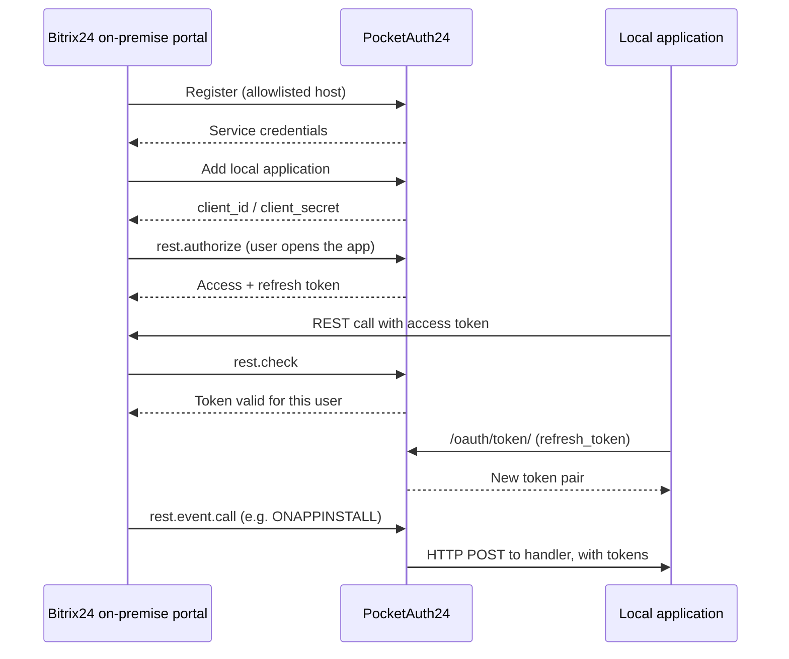

# PocketAuth24

[English](README.md) · [Deutsch](README.de.md) · [Italiano](README.it.md) · [Español](README.es.md) · **Português** · [Русский](README.ru.md)

**Mantenha as aplicações locais funcionando em um portal Bitrix24 on-premise sem acesso à internet.**

[](https://github.com/serg-vostrikov-bitrix/pocketauth24/actions/workflows/ci.yml)


[](LICENSE)
<br>


O PocketAuth24 é um servidor independente e auto-hospedado. Ele responde às chamadas OAuth que um portal Bitrix24 on-premise enviaria, de outra forma, ao servidor OAuth na nuvem (`oauth.bitrix.info` / `oauth.bitrix24.tech`). Ele roda como um único contêiner com um banco de dados PostgreSQL 17 dentro da sua rede. Aponte o portal para o servidor: as aplicações locais abrem, chamam REST, renovam tokens e recebem eventos sem conexão com a nuvem.

> Projeto de código aberto independente. Não é um produto da Bitrix24. Veja o [aviso legal](#aviso-legal).


_A página de status em `/`. Ela mostra apenas contagens agregadas._

## 🔒 Por quê

Um portal Bitrix24 on-premise depende do servidor OAuth na nuvem para as suas aplicações locais. Quando o portal não alcança a internet, as aplicações locais não abrem, não podem chamar REST com tokens, não podem renovar tokens e não recebem eventos online.

Equipes em redes corporativas fechadas e ambientes regulados ficam com duas opções ruins: abrir mão das aplicações locais ou abrir uma rota para a internet que não querem. O PocketAuth24 oferece uma terceira: executar o lado OAuth das aplicações locais dentro da própria rede.

**Compensa também com acesso à internet.** Se os portais dos seus clientes executam apenas as suas próprias aplicações locais, o servidor OAuth remoto na nuvem agrega pouco: inicializações de aplicações, verificações e renovações de tokens ainda vão para um servidor que você não controla, e a sua disponibilidade e o caminho de rede até ele estão fora do seu alcance. Com o PocketAuth24 ao lado do portal, essa dependência passa para uma infraestrutura que você mesmo opera e monitora. A contrapartida: depois da troca, o portal deixa de usar o servidor OAuth na nuvem, e por isso as aplicações do Marketplace param de funcionar nele. Esta configuração é para portais que usam apenas aplicações locais.

## ✨ Benefícios

- **As apps locais sobrevivem ao isolamento de rede.** Uma rede fechada não impede mais integrações personalizadas no portal.
- **Uma dependência externa a menos.** As aplicações locais não precisam de nenhuma rota de saída para o servidor OAuth na nuvem.
- **A sua disponibilidade, não a de outra pessoa.** Mesmo em um portal conectado à internet que executa apenas as suas apps locais, inicializações de apps, verificações e renovações de tokens não dependem mais da disponibilidade de um servidor remoto. (As apps do Marketplace precisam da nuvem e não funcionam após a troca.)
- **Limita o impacto de um vazamento do banco de dados ou de logs.** Tokens e segredos são armazenados apenas como hashes, e as query strings nunca chegam aos logs.
- **Um servidor, vários portais.** Parceiros e operadores não precisam de uma instância por portal.
- **Pegada pequena.** Um contêiner, um banco de dados, uma verificação `/health`, logs JSON em stdout e backups padrão do PostgreSQL.
- **Código aberto.** Licenciado sob MIT, para que integradores possam lê-lo, auditá-lo e adaptá-lo.

## 🧩 Funcionalidades disponíveis hoje

| Área                        | O que você recebe                                                                                                                                                                                                                                                                                                                                                         |
| --------------------------- | ------------------------------------------------------------------------------------------------------------------------------------------------------------------------------------------------------------------------------------------------------------------------------------------------------------------------------------------------------------------------- |
| **Registro do portal**      | O portal se registra sozinho na sua próxima chamada OAuth. O registro é limitado a uma lista de permissões (`PORTAL_ALLOWLIST`, comparada por host e porta). Toda chamada ao serviço é autenticada com as credenciais do próprio portal, e todos os dados ficam restritos ao portal que chama.                                                                            |
| **Aplicações locais**       | Crie, atualize e exclua aplicações locais no portal como de costume. O servidor emite `client_id` (`local.<14 hex>.<8 digits>`) e `client_secret` e mantém o seu registro sincronizado. Excluir uma app remove todos os seus tokens.                                                                                                                                      |
| **Tokens**                  | `rest.authorize` emite pares de tokens para o usuário correto, incluindo não administradores; as páginas de instalação abrem com tokens. `rest.check` valida tokens. O scope do token é a interseção entre o scope solicitado e o da aplicação.                                                                                                                           |
| **Renovação**               | `/oauth/token/` (GET ou POST) com `grant_type=refresh_token`. Os refresh tokens são reutilizáveis até expirar, como observado no tráfego da nuvem capturado. Os access tokens duram 3600 s e os refresh tokens 180 dias; os pares expirados são excluídos a cada hora.                                                                                                    |
| **Eventos**                 | `rest.event.call` entrega cada evento ao manipulador da aplicação por HTTP POST, incluindo `ONAPPINSTALL` com tokens recém-emitidos. O portal recebe uma resposta imediata.                                                                                                                                                                                               |
| **Segurança**               | Armazenamento com hash de tokens e segredos, tokens de uma fonte aleatória criptograficamente segura, ocultação nos logs (sem query strings, URLs de manipuladores sem credenciais), porta da app vinculada ao loopback (`127.0.0.1:3000`) em `docker-compose.yml`.                                                                                                       |
| **Operação**                | Uma página de status pública em `/` (estado do serviço e do banco de dados, contagens de portais, aplicações, pares de tokens ativos e entregas de eventos) e os mesmos dados em JSON em `/api/status`. `/health` retorna HTTP 503 quando o PostgreSQL não responde. Logs JSON, barra final aceita em todos os caminhos.                                                  |
| **Painel de administração** | Um painel de administração multiusuário em `/admin`: tabelas somente leitura e pesquisáveis de portais, aplicações locais, metadados de tokens (sem tokens nem hashes) e contadores diários de eventos. A senha do superusuário é definida apenas pela CLI; o superusuário gerencia os visualizadores no painel. As sessões duram 12 horas; os logins têm limite de taxa. |

## 💡 Casos de uso

O servidor também ajuda fora de redes fechadas: em qualquer lugar onde um portal não deve usar o servidor OAuth na nuvem. Estes cenários funcionam hoje.

| Cenário                                    | Como usar o servidor                                                                                                                                                                                                                                                                                              |
| ------------------------------------------ | ----------------------------------------------------------------------------------------------------------------------------------------------------------------------------------------------------------------------------------------------------------------------------------------------------------------- |
| **Portal de desenvolvimento**              | Execute um portal on-premise local para desenvolver aplicações e conecte-o à sua própria instância do servidor. O portal não se registra na nuvem, então não entra em conflito com um portal de produção com a mesma chave de licença.                                                                            |
| **Cópias de staging, teste e treinamento** | Restaure uma cópia da produção e conecte-a a uma instância separada do servidor. Exclua as credenciais de serviço na cópia (veja [Início rápido](#-início-rápido)) e recrie as suas aplicações locais. Não conecte a cópia ao servidor de produção: a cópia traz as credenciais de serviço da produção do backup. |
| **Testes de ponta a ponta na CI**          | Inicie um contêiner do portal e o servidor em uma mesma pilha do Compose. A instalação de aplicações, `ONAPPINSTALL`, as chamadas REST e a renovação de tokens funcionam sem a nuvem, então os resultados dos testes não dependem de um serviço externo.                                                          |
| **Um servidor para portais de clientes**   | Um integrador executa uma instância para os portais on-premise de vários clientes. Adicione cada portal a `PORTAL_ALLOWLIST`. O servidor mantém os dados de cada portal separados.                                                                                                                                |
| **Inventário de aplicações locais**        | O painel de administração lista as aplicações locais de todos os portais e mostra quais delas têm tokens ativos. Você obtém esta visão sem entrar em cada portal.                                                                                                                                                 |

Está prevista uma guia para cópias de desenvolvimento e de staging: [#22](https://github.com/serg-vostrikov-bitrix/b24auth-server/issues/22).

## ⚙️ Como funciona



O tráfego OAuth entre o portal, as aplicações locais e o servidor permanece dentro da sua rede. O proxy reverso na frente do servidor encerra o TLS e restringe quem pode alcançar cada caminho.

## ✅ Verificado

| Verificação                       | O que cobre                                                                                                                                                                                                                                                                                                                                 |
| --------------------------------- | ------------------------------------------------------------------------------------------------------------------------------------------------------------------------------------------------------------------------------------------------------------------------------------------------------------------------------------------- |
| **Testes automatizados**          | Testes de integração com PostgreSQL real para registro do portal, registro de aplicações, serviço de tokens, entrega de eventos, roteamento e health, além de testes unitários.                                                                                                                                                             |
| **Testes de contrato**            | Formatos de resposta e códigos de erro comparados com o tráfego capturado entre um portal de teste (`rest` 26.1100) e `oauth.bitrix.info`.                                                                                                                                                                                                  |
| **Smoke test do contêiner (CI)**  | O contêiner inicia, `/health` responde, a página de status e `/api/status` respondem, um portal se registra, não há logs de nível error, o processo não roda como root.                                                                                                                                                                     |
| **Ponta a ponta em rede fechada** | Uma checklist de 10 passos em um portal de teste Docker local (`rest` 26.1100) cujo contêiner PHP foi isolado da internet: registro, criação da app, página de instalação com tokens, REST como administrador e não administrador, `ONAPPINSTALL` com tokens, renovação e renovação repetida, exclusão. Todos os 10 passos foram aprovados. |

Ainda não foi executado em produção em um cliente. Alguns detalhes foram inferidos em vez de capturados da nuvem: alguns códigos de status HTTP (`invalid_client`, método desconhecido, `expired_token`) e o formato exato de um bloco `auth` de um evento com tokens.

## 🚀 Início rápido

Não há imagem publicada: construa-a em uma máquina com acesso à internet e leve-a para a rede fechada.

```bash
# Outside the closed network
docker build -t pocketauth24:<version> .
docker pull postgres:17
docker save pocketauth24:<version> postgres:17 -o pocketauth24-<version>.tar

# Inside the closed network (copy the tar and docker-compose.yml first)
docker load -i pocketauth24-<version>.tar
docker tag pocketauth24:<version> pocketauth24:local
```

Crie `.env` ao lado de `docker-compose.yml`:

| Variável            | Exemplo                                         | Significado                                                                                                                                                                                  |
| ------------------- | ----------------------------------------------- | -------------------------------------------------------------------------------------------------------------------------------------------------------------------------------------------- |
| `BASE_URL`          | `https://auth.corp.local`                       | URL pública atrás do proxy; torna-se `server_endpoint`.                                                                                                                                      |
| `DATABASE_URL`      | `postgres://b24auth:<password>@db:5432/b24auth` | Conexão com o banco de dados.                                                                                                                                                                |
| `PORTAL_ALLOWLIST`  | `portal.corp.local,crm.corp.local:8443`         | `host[:port]` dos portais autorizados a se registrar; liste explicitamente as portas não padrão.                                                                                             |
| `POSTGRES_PASSWORD` | `<password>`                                    | A mesma senha de `DATABASE_URL`.                                                                                                                                                             |
| `TRUST_PROXY`       | `true`                                          | Opcional. Aceita apenas `true` ou `false`. Defina `true` somente quando o proxy sobrescreve `X-Forwarded-For` com o IP do cliente (nginx: `$remote_addr`, não `$proxy_add_x_forwarded_for`). |

`BASE_URL`, `DATABASE_URL` e `PORTAL_ALLOWLIST` são obrigatórias; o servidor não inicia sem elas. Depois:

```bash
docker compose up -d                       # migrations run on start
curl https://auth.corp.local/health        # {"status":"ok"}
```

**Proxy reverso (obrigatório).** Encaminhe `https://<BASE_URL host>/` para `http://<app host>:3000/` com um certificado da sua CA interna. Negue por padrão; permita cada caminho apenas a partir dos IPs dos servidores do portal, exceto `/oauth/token`, `/health` e, se quiser, a página de status (`/`, `/assets/*`, `/api/status`). Faça a correspondência dos caminhos com e sem a barra final.

**Aponte o portal para o servidor.** No painel de administração, "Linha de comando PHP":

```php
\Bitrix\Main\Config\Option::set('rest', 'oauth_server', 'https://auth.corp.local');
\Bitrix\Main\Config\Option::delete('rest', ['name' => 'service_client_id']);
\Bitrix\Main\Config\Option::delete('rest', ['name' => 'service_client_secret']);
```

Como alternativa, defina `BITRIX_OAUTH_URL` em `local/php_interface/init.php` (sobrepõe a opção `oauth_server`; não edite `dbconn.php`). O portal se registra sozinho na sua próxima chamada OAuth.

**Depois:** recrie as aplicações locais que foram criadas quando o portal usava a nuvem e altere as URLs de token escritas no código (`https://oauth.bitrix.info/oauth/token/`, usada pela maioria dos SDKs, incluindo o CRest) para `https://auth.corp.local/oauth/token/`, ou aponte o DNS interno dos nomes de host da nuvem para o proxy com um certificado da CA interna.

Passos completos, operação e reversão: [docs/deployment.md](docs/deployment.md).

## 🖥️ Requisitos do lado do portal

Encontrados durante a execução ponta a ponta. São comportamentos do portal, não defeitos do servidor.

- O portal deve conhecer a sua **URL pública e porta reais**; caso contrário, o frame da app recebe um `DOMAIN` errado e o `BX24` não alcança o portal.
- As URLs de aplicações e manipuladores precisam de um **nome de host com ponto** (um FQDN ou um endereço IP); `localhost` é rejeitado.
- **Sirva o script `BX24` internamente.** O `BX24` é o SDK JS antigo; para apps novas recomendamos o [b24jssdk](https://github.com/bitrix24/b24jssdk). As apps existentes que ainda usam o `BX24` costumam carregá-lo de `//api.bitrix24.com/api/v1/`, que é inacessível em uma rede fechada.
- O portal recusa chamadas REST de um usuário que nunca fez login.

## ⚡ Desempenho da entrega de eventos

**Como funciona a entrega.** O portal envia todos os eventos de uma requisição (hit) em um único lote `rest.event.call`. O lote não tem limite de tamanho e o portal não o repete. O servidor responde `{"result":null}` imediatamente e entrega cada evento em segundo plano, no mesmo processo. Cada evento recebe uma tentativa de HTTP POST com tempo limite de 10 segundos.

**Limites.** Os valores estão fixados em [`src/config.ts`](src/config.ts).

| Limite                                        | Valor | Quando é atingido                                                                 |
| --------------------------------------------- | ----- | --------------------------------------------------------------------------------- |
| Entregas simultâneas no total                 | 200   | O evento é descartado e registrado como `event_dropped_overload`, `limit: global` |
| Entregas simultâneas para um host manipulador | 100   | O evento é descartado e registrado como `event_dropped_overload`, `limit: host`   |
| Tempo limite de uma entrega                   | 10 s  | A entrega é interrompida e registrada como `event_delivery_failed`                |

Um host manipulador é o host e a porta da URL do manipulador. O limite por host é metade do limite total. Assim, um manipulador lento pode ocupar no máximo 100 slots, e os outros manipuladores sempre mantêm 100 slots. O limite por host não é menor porque um hit do portal pode enviar um lote grande a um único manipulador, por exemplo durante uma importação em massa.

**O que um manipulador lento custa ao servidor.** Uma entrega que espera o manipulador mantém uma conexão aberta e uma pequena quantidade de memória. Ela não mantém uma conexão com o banco de dados: o servidor emite os tokens antes de enviar o POST. O event loop não é bloqueado. Se todos os manipuladores esperarem até o tempo limite, o servidor entrega no máximo 20 eventos por segundo no total e 10 eventos por segundo para um host. Os eventos seguintes são descartados.

**Recomendações para os manipuladores das aplicações.**

- Responda em até um segundo. Aceite o evento, coloque-o na sua própria fila e depois processe-o.
- Dê a cada aplicação pesada o seu próprio host manipulador. Assim, uma aplicação lenta usa apenas os seus próprios 100 slots.
- Monitore o log do servidor em busca de `event_dropped_overload`. O campo `limit` indica qual limite foi atingido.

Os eventos descartados ou que falharam não são reenviados. Uma fila persistente com novas tentativas é uma etapa posterior proposta.

## 🧭 Limitações

Conheça estes pontos antes de implantar:

- **Apenas aplicações locais.** As aplicações do Marketplace não funcionam, porque os seus segredos ficam na nuvem.
- **As apps existentes precisam ser recriadas**, e as URLs de token escritas no código precisam ser alteradas ou redirecionadas.
- **O proxy é o controle de segurança do registro.** O portal não envia nenhum segredo compartilhado, então qualquer pessoa que alcance `/oauth/register/` com o endereço de um portal da lista de permissões poderia rotacionar as credenciais desse portal. Restrinja por IP.
- **Os eventos são entregues uma vez**, com tempo limite de 10 segundos. Não são armazenados nem repetidos, são perdidos em uma reinicialização e são descartados acima de 200 entregas simultâneas no total ou 100 entregas simultâneas para um host manipulador. Veja [Desempenho da entrega de eventos](#-desempenho-da-entrega-de-eventos).
- **Instância única.** As migrações rodam na inicialização sem bloqueio.
- **Não suportado:** verificações de licença, o grant `authorization_code`, tratamento no servidor de install/uninstall. As durações dos tokens são fixas; os corpos das requisições são limitados a 10 MB.
- **Painel de administração somente leitura.** O painel mostra dados, mas não pode alterar portais, aplicações ou tokens. Não tem SSO, autenticação de dois fatores nem log de auditoria. Restrinja `/admin` e `/api/admin` no proxy.
- **Testado** com o módulo `rest` do portal 26.1100.

O trabalho planejado e os cenários que ele torna possíveis: veja o [roteiro](#-roteiro).

## 🔭 Roteiro

Os itens não têm datas. A primeira tabela lista o trabalho planejado. A segunda tabela lista os cenários que este trabalho torna possíveis. São ideias, não compromissos.

### Trabalho planejado

| Item                                                                                                                            | O que acrescenta                                                                                                                                                                          |
| ------------------------------------------------------------------------------------------------------------------------------- | ----------------------------------------------------------------------------------------------------------------------------------------------------------------------------------------- |
| **OAuth 2.0 completo e introspection**                                                                                          | O grant `authorization_code`, a revogação de tokens na desinstalação, as verificações de scope.                                                                                           |
| **Fila persistente de eventos**                                                                                                 | O servidor armazena os eventos, repete as entregas que falharam e mantém os eventos após uma reinicialização.                                                                             |
| **Modo de fallback upstream** ([#10](https://github.com/serg-vostrikov-bitrix/b24auth-server/issues/10))                        | O servidor encaminha as chamadas ao servidor OAuth na nuvem e responde ele mesmo quando a nuvem não responde. As aplicações locais continuam funcionando durante uma queda da nuvem.      |
| **Operações**                                                                                                                   | Migração de um portal já registrado. Um aviso quando um novo registro sobrescreve as credenciais de um portal ([#23](https://github.com/serg-vostrikov-bitrix/b24auth-server/issues/23)). |
| **Guia para cópias de desenvolvimento e de staging** ([#22](https://github.com/serg-vostrikov-bitrix/b24auth-server/issues/22)) | Regras para os cenários de desenvolvimento e de staging em [Casos de uso](#-casos-de-uso).                                                                                                |

### Cenários que este trabalho torna possíveis

| Cenário                                                                                                                                           | O que precisa                                                        |
| ------------------------------------------------------------------------------------------------------------------------------------------------- | -------------------------------------------------------------------- |
| **Inspetor de eventos.** Gravar os eventos, mostrá-los no painel de administração e enviá-los de novo ao manipulador, para depurar manipuladores. | A fila persistente de eventos.                                       |
| **Revogação de emergência.** Revogar todos os tokens de uma aplicação ou de um portal após um vazamento.                                          | A revogação de tokens e ações de escrita no painel de administração. |
| **Testes de falhas.** Durações curtas dos tokens, um `expired_token` forçado, manipuladores lentos, tokens de teste emitidos pela CLI.            | Durações de tokens configuráveis. Hoje são fixas.                    |
| **Barramento de eventos.** Enviar os eventos do portal a um message broker para sistemas internos.                                                | A fila persistente de eventos.                                       |
| **Auditoria de acessos.** Um registro de quem recebeu um token para qual aplicação, e quando.                                                     | Um log de auditoria.                                                 |

## 🔁 CI/CD

A CI roda nos pushes para `main` e nas pull requests ([`.github/workflows/ci.yml`](.github/workflows/ci.yml)):

| Job         | O que faz                                                                          |
| ----------- | ---------------------------------------------------------------------------------- |
| `test`      | Node.js 26 com um serviço PostgreSQL 17: `npm ci`, lint, typecheck, testes, build. |
| `container` | Constrói e inicia a stack do Docker Compose e executa o smoke test.                |
| `audit`     | `npm audit` para as dependências de produção com severidade alta.                  |

O Dependabot verifica semanalmente os pacotes npm, as GitHub Actions e as imagens base do Docker.

Ainda não há nenhuma etapa automática de release ou publicação: nenhum pipeline de CD e nenhuma imagem publicada. Você mesmo constrói a imagem.

## 📚 Documentação

- [Guia de implantação](docs/deployment.md): requisitos, passos, regras do proxy, operação, reversão.
- [Checklist ponta a ponta](docs/e2e-checklist.md): a verificação de 10 passos em rede fechada.
- [Captura de protocolo](docs/protocol-capture.md): como o tráfego da nuvem foi gravado para os testes de contrato.
- [Pesquisa](docs/research/2026-11-18-oauth-server-analysis.md): análise do protocolo e roteiro proposto.
- [Manual do usuário](docs/launchkit/01-user-manual.en.md): cenários, casos de erro, limites.

## 🛠️ Desenvolvimento

Stack: Node.js 26, TypeScript (strict), Fastify, Drizzle, PostgreSQL 17.

```bash
npm install
docker compose up -d db
npm test
```

Outros scripts: `npm run lint`, `npm run typecheck`, `npm run build`, `npm run dev`, `npm run db:generate`.

Configuração: `BASE_URL`, `DATABASE_URL`, `PORTAL_ALLOWLIST` (veja [`.env.example`](.env.example)).

## 📄 Licença

[MIT](LICENSE). Copyright 2026 Serg Vostrikov.

## Aviso legal

O PocketAuth24 é um projeto independente. Não é afiliado à Bitrix24, nem endossado ou certificado por ela. "Substituto do servidor OAuth na nuvem" descreve o que o software faz, não um relacionamento com um fornecedor. Bitrix24 e outras marcas pertencem aos seus respectivos proprietários.
