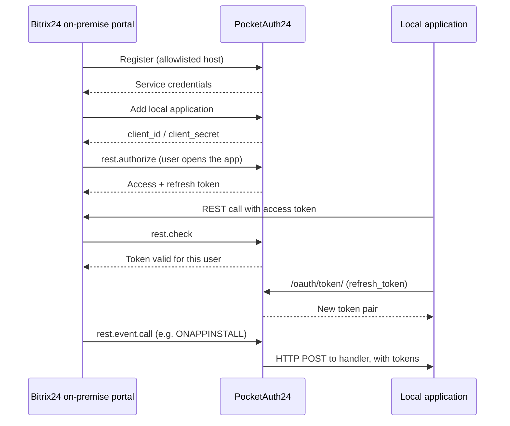

# PocketAuth24

[English](README.md) · [Deutsch](README.de.md) · [Italiano](README.it.md) · [Español](README.es.md) · [Português](README.pt.md) · **Русский**

**Локальные приложения продолжают работать на коробочном портале Bitrix24 без доступа в интернет.**

[](https://github.com/serg-vostrikov-bitrix/pocketauth24/actions/workflows/ci.yml)


[](LICENSE)
<br>


PocketAuth24 — независимый сервер для самостоятельного размещения. Он отвечает на OAuth-вызовы, которые коробочный портал Bitrix24 иначе отправил бы на облачный OAuth-сервер (`oauth.bitrix.info` / `oauth.bitrix24.tech`). Он работает как один контейнер с одной базой PostgreSQL 17 внутри вашей сети. Укажите порталу этот сервер, и локальные приложения откроются, вызовут REST, обновят токены и получат события без связи с облаком.

> Независимый проект с открытым кодом. Не продукт Bitrix24. См. [отказ от ответственности](#отказ-от-ответственности).


_Страница статуса по адресу `/`. Она показывает только агрегированные числа._

## 🔒 Зачем

Коробочный портал Bitrix24 зависит от облачного OAuth-сервера в части локальных приложений. Когда портал не выходит в интернет, локальные приложения не открываются, не могут вызывать REST с токенами, не могут обновлять токены и не получают онлайн-события.

Команды в закрытых корпоративных сетях и регулируемых средах остаются с двумя плохими вариантами: отказаться от локальных приложений или открыть маршрут в интернет, который им не нужен. PocketAuth24 даёт третий: запустить OAuth-часть локальных приложений внутри собственной сети.

**Это выгодно и при наличии интернета.** Если порталы ваших клиентов запускают только ваши локальные приложения, удалённый облачный OAuth-сервер даёт мало: запуск приложений, проверка и обновление токенов всё равно идут на сервер, который вы не контролируете. Его доступность и сетевой путь до него вне вашей власти. Когда PocketAuth24 стоит рядом с порталом, эта зависимость переходит в инфраструктуру, которую вы эксплуатируете и отслеживаете сами. Компромисс: после переключения портал больше не использует облачный OAuth-сервер, поэтому приложения Маркетплейса на нём перестают работать. Такая схема подходит для порталов, которые используют только локальные приложения.

## ✨ Преимущества

- **Локальные приложения переживают изоляцию сети.** Закрытая сеть больше не исключает собственные интеграции на портале.
- **Одна внешняя зависимость меньше.** Локальным приложениям не нужен исходящий маршрут к облачному OAuth-серверу.
- **Ваша доступность, а не чужая.** Даже на портале с интернетом, который запускает только ваши локальные приложения, запуск приложений, проверка и обновление токенов больше не зависят от доступности удалённого сервера. (Приложениям Маркетплейса нужно облако, и после переключения они не работают.)
- **Ограничивает последствия утечки базы данных или логов.** Токены и секреты хранятся только в виде хешей, а строки запроса никогда не попадают в логи.
- **Один сервер, несколько порталов.** Партнёрам и операторам не нужен отдельный экземпляр на каждый портал.
- **Небольшой размер.** Один контейнер, одна база, проверка `/health`, JSON-логи в stdout и стандартные резервные копии PostgreSQL.
- **Открытый код.** Лицензия MIT: интеграторы могут читать, проверять и адаптировать код.

## 🧩 Возможности, доступные сегодня

| Область                  | Что вы получаете                                                                                                                                                                                                                                                                                                  |
| ------------------------ | ----------------------------------------------------------------------------------------------------------------------------------------------------------------------------------------------------------------------------------------------------------------------------------------------------------------- |
| **Регистрация портала**  | Портал регистрируется сам при следующем OAuth-вызове. Регистрация ограничена списком разрешённых адресов (`PORTAL_ALLOWLIST`, сравнение по хосту и порту). Каждый вызов сервиса аутентифицируется собственными учётными данными портала, и все данные привязаны к вызывающему порталу.                            |
| **Локальные приложения** | Создавайте, обновляйте и удаляйте локальные приложения на портале как обычно. Сервер выдаёт `client_id` (`local.<14 hex>.<8 digits>`) и `client_secret` и держит свой реестр в актуальном состоянии. Удаление приложения удаляет все его токены.                                                                  |
| **Токены**               | `rest.authorize` выдаёт пары токенов для нужного пользователя, включая не администраторов; страницы установки открываются с токенами. `rest.check` проверяет токены. Область (scope) токена — это пересечение запрошенной области и области приложения.                                                           |
| **Обновление**           | `/oauth/token/` (GET или POST) с `grant_type=refresh_token`. Refresh-токены можно использовать повторно до истечения срока, как это видно в записанном облачном трафике. Access-токены живут 3600 с, refresh-токены 180 дней; истёкшие пары удаляются каждый час.                                                 |
| **События**              | `rest.event.call` доставляет каждое событие обработчику приложения по HTTP POST, включая `ONAPPINSTALL` со свежевыданными токенами. Портал сразу получает ответ.                                                                                                                                                  |
| **Безопасность**         | Хранение токенов и секретов в виде хешей, токены из криптографически стойкого источника случайных чисел, скрытие данных в логах (без строк запроса, URL обработчиков без учётных данных), порт приложения привязан к loopback (`127.0.0.1:3000`) в `docker-compose.yml`.                                          |
| **Эксплуатация**         | Публичная страница статуса по адресу `/` (состояние сервиса и базы данных, число порталов, приложений, активных пар токенов и доставок событий) и те же данные в JSON по адресу `/api/status`. `/health` возвращает HTTP 503, если PostgreSQL не отвечает. JSON-логи, завершающий слеш принимается на всех путях. |

## ⚙️ Как это работает



OAuth-трафик между порталом, локальными приложениями и сервером остаётся внутри вашей сети. Обратный прокси перед сервером завершает TLS и ограничивает, кто может обращаться к какому пути.

## ✅ Проверено

| Проверка                              | Что охватывает                                                                                                                                                                                                                                                                                                                             |
| ------------------------------------- | ------------------------------------------------------------------------------------------------------------------------------------------------------------------------------------------------------------------------------------------------------------------------------------------------------------------------------------------ |
| **69 автоматических тестов**          | Интеграционные тесты на настоящем PostgreSQL: регистрация портала, реестр приложений, сервис токенов, доставка событий, маршрутизация и health, а также модульные тесты.                                                                                                                                                                   |
| **Контрактные тесты**                 | Формы ответов и коды ошибок сравниваются с трафиком, записанным между тестовым порталом (`rest` 26.1100) и `oauth.bitrix.info`.                                                                                                                                                                                                            |
| **Дымовой тест контейнера (CI)**      | Контейнер запускается, `/health` отвечает, отвечают страница статуса и `/api/status`, портал регистрируется, нет логов уровня error, процесс не работает от root.                                                                                                                                                                          |
| **Сквозная проверка в закрытой сети** | Чек-лист из 10 шагов на локальном тестовом портале в Docker (`rest` 26.1100), PHP-контейнер которого был отрезан от интернета: регистрация, создание приложения, страница установки с токенами, REST от администратора и не администратора, `ONAPPINSTALL` с токенами, обновление и повторное обновление, удаление. Все 10 шагов пройдены. |

Сервер ещё не запускался в продуктиве у заказчика. Некоторые детали выведены, а не записаны из облака: часть HTTP-кодов статуса (`invalid_client`, неизвестный метод, `expired_token`) и точная форма блока `auth` в событии с токенами.

## 🚀 Быстрый старт

Готового образа нет: соберите его на машине с интернетом и перенесите в закрытую сеть.

```bash
# Outside the closed network
docker build -t pocketauth24:<version> .
docker pull postgres:17
docker save pocketauth24:<version> postgres:17 -o pocketauth24-<version>.tar

# Inside the closed network (copy the tar and docker-compose.yml first)
docker load -i pocketauth24-<version>.tar
docker tag pocketauth24:<version> pocketauth24:local
```

Создайте `.env` рядом с `docker-compose.yml`:

| Переменная          | Пример                                          | Значение                                                                                    |
| ------------------- | ----------------------------------------------- | ------------------------------------------------------------------------------------------- |
| `BASE_URL`          | `https://auth.corp.local`                       | Публичный URL за прокси; становится `server_endpoint`.                                      |
| `DATABASE_URL`      | `postgres://b24auth:<password>@db:5432/b24auth` | Подключение к базе данных.                                                                  |
| `PORTAL_ALLOWLIST`  | `portal.corp.local,crm.corp.local:8443`         | `host[:port]` порталов, которым разрешена регистрация; нестандартные порты указывайте явно. |
| `POSTGRES_PASSWORD` | `<password>`                                    | Тот же пароль, что в `DATABASE_URL`.                                                        |

`BASE_URL`, `DATABASE_URL` и `PORTAL_ALLOWLIST` обязательны; без них сервер не запускается. Затем:

```bash
docker compose up -d                       # migrations run on start
curl https://auth.corp.local/health        # {"status":"ok"}
```

**Обратный прокси (обязателен).** Проксируйте `https://<BASE_URL host>/` на `http://<app host>:3000/` с сертификатом вашего внутреннего УЦ. Запрещайте всё по умолчанию; разрешайте каждый путь только с IP-адресов серверов портала, кроме `/oauth/token`, `/health` и, если нужно, страницы статуса (`/`, `/assets/*`, `/api/status`). Сопоставляйте пути с завершающим слешем и без него.

**Укажите порталу сервер.** В административной панели, «Командная PHP-строка»:

```php
\Bitrix\Main\Config\Option::set('rest', 'oauth_server', 'https://auth.corp.local');
\Bitrix\Main\Config\Option::delete('rest', ['name' => 'service_client_id']);
\Bitrix\Main\Config\Option::delete('rest', ['name' => 'service_client_secret']);
```

Либо определите `BITRIX_OAUTH_URL` в `local/php_interface/init.php` (он переопределяет опцию `oauth_server`; не правьте `dbconn.php`). Портал регистрируется сам при следующем OAuth-вызове.

**Затем:** пересоздайте локальные приложения, созданные, пока портал использовал облако, и замените жёстко прописанные URL токенов (`https://oauth.bitrix.info/oauth/token/`, его используют большинство SDK, включая CRest) на `https://auth.corp.local/oauth/token/`, либо направьте внутренний DNS для облачных имён хостов на прокси с сертификатом внутреннего УЦ.

Полные шаги, эксплуатация и откат: [docs/deployment.md](docs/deployment.md).

## 🖥️ Требования на стороне портала

Найдены при сквозной проверке. Это поведение портала, а не дефекты сервера.

- Портал должен знать свой **настоящий публичный URL и порт**; иначе фрейм приложения получает неверный `DOMAIN`, и `BX24` не может обратиться к порталу.
- URL приложений и обработчиков требуют **имя хоста с точкой** (FQDN или IP-адрес); `localhost` отклоняется.
- **Отдавайте скрипт `BX24` изнутри сети.** Приложения обычно грузят его с `//api.bitrix24.com/api/v1/`, а он недоступен в закрытой сети.
- Портал отклоняет REST-вызовы от пользователя, который ни разу не входил.

## ⚡ Производительность доставки событий

**Как работает доставка.** Портал отправляет все события одного запроса (хита) одним пакетом `rest.event.call`. У пакета нет ограничения размера, и портал не повторяет его. Сервер сразу отвечает `{"result":null}` и доставляет каждое событие в фоне, в том же процессе. Каждое событие получает одну попытку HTTP POST с тайм-аутом 10 секунд.

**Лимиты.** Значения зафиксированы в [`src/config.ts`](src/config.ts).

| Лимит                                           | Значение | Когда он достигается                                                               |
| ----------------------------------------------- | -------- | ---------------------------------------------------------------------------------- |
| Одновременные доставки всего                    | 200      | Событие отбрасывается и записывается как `event_dropped_overload`, `limit: global` |
| Одновременные доставки на один хост обработчика | 100      | Событие отбрасывается и записывается как `event_dropped_overload`, `limit: host`   |
| Тайм-аут одной доставки                         | 10 с     | Доставка прерывается и записывается как `event_delivery_failed`                    |

Хост обработчика — это хост и порт URL обработчика. Лимит на хост равен половине общего лимита. Поэтому один медленный обработчик может занять не более 100 слотов, а другие обработчики всегда сохраняют 100 слотов. Лимит на хост не ниже, потому что один хит портала может отправить большой пакет одному обработчику, например при массовом импорте.

**Чего стоит серверу медленный обработчик.** Доставка, которая ждёт обработчика, держит одно открытое соединение и небольшой объём памяти. Она не держит соединение с базой данных: сервер выдаёт токены до отправки POST. Цикл событий не блокируется. Если каждый обработчик ждёт до тайм-аута, сервер доставляет не более 20 событий в секунду в сумме и 10 событий в секунду на один хост. Остальные события отбрасываются.

**Рекомендации для обработчиков приложений.**

- Отвечайте в течение одной секунды. Примите событие, положите его в собственную очередь, затем обработайте.
- Дайте каждому тяжёлому приложению собственный хост обработчика. Тогда медленное приложение использует только свои 100 слотов.
- Следите в логе сервера за `event_dropped_overload`. Поле `limit` показывает, какой лимит достигнут.

Отброшенные и неудавшиеся события повторно не отправляются. Постоянная очередь с повторами — предлагаемый следующий этап.

## 🧭 Ограничения и план развития

Узнайте о них до развёртывания:

- **Только локальные приложения.** Приложения Маркетплейса не работают, потому что их секреты хранятся в облаке.
- **Существующие приложения нужно пересоздать**, а жёстко прописанные URL токенов — изменить или перенаправить.
- **Прокси — это средство защиты регистрации.** Портал не отправляет общий секрет, поэтому любой, кто достигнет `/oauth/register/` с адресом портала из списка разрешённых, может сменить учётные данные этого портала. Ограничьте доступ по IP.
- **События доставляются один раз**, с тайм-аутом 10 секунд. Они не сохраняются и не повторяются, теряются при перезапуске и отбрасываются при более чем 200 одновременных доставках в сумме или 100 одновременных доставках на один хост обработчика. См. [Производительность доставки событий](#-производительность-доставки-событий).
- **Один экземпляр.** Миграции запускаются при старте без блокировки.
- **Не поддерживается:** проверки лицензии, grant `authorization_code`, обработка install/uninstall на стороне сервера. Сроки жизни токенов фиксированы; тела запросов ограничены 10 МБ.
- **Только страница статуса.** Интерфейс — страница статуса только для чтения по адресу `/`. Административного интерфейса пока нет.
- **Проверено** на модуле `rest` портала 26.1100.

Предлагаемые следующие этапы, без сроков: полноценный OAuth 2.0 и интроспекция (включая отзыв при удалении приложения и проверки области), постоянная очередь событий с повторами и функции эксплуатации, такие как страница администрирования и перенос уже зарегистрированного портала.

## 🔁 CI/CD

CI запускается при push в `main` и для pull request ([`.github/workflows/ci.yml`](.github/workflows/ci.yml)):

| Задача      | Что делает                                                                     |
| ----------- | ------------------------------------------------------------------------------ |
| `test`      | Node.js 24 с сервисом PostgreSQL 17: `npm ci`, lint, typecheck, тесты, сборка. |
| `container` | Собирает и запускает стек Docker Compose и выполняет дымовой тест.             |
| `audit`     | `npm audit` для зависимостей production с высоким уровнем серьёзности.         |

Dependabot раз в неделю проверяет пакеты npm, GitHub Actions и базовые образы Docker.

Автоматического шага релиза или публикации пока нет: нет конвейера CD и нет опубликованного образа. Образ вы собираете сами.

## 📚 Документация

- [Руководство по развёртыванию](docs/deployment.md): требования, шаги, правила прокси, эксплуатация, откат.
- [Сквозной чек-лист](docs/e2e-checklist.md): проверка из 10 шагов в закрытой сети.
- [Запись протокола](docs/protocol-capture.md): как записывали облачный трафик для контрактных тестов.
- [Исследование](docs/research/2026-11-18-oauth-server-analysis.md): анализ протокола и предлагаемый план развития.
- [Руководство пользователя](docs/launchkit/01-user-manual.en.md): сценарии, ошибки, ограничения.

## 🛠️ Разработка

Стек: Node.js 24, TypeScript (strict), Fastify, Drizzle, PostgreSQL 17.

```bash
npm install
docker compose up -d db
npm test
```

Другие скрипты: `npm run lint`, `npm run typecheck`, `npm run build`, `npm run dev`, `npm run db:generate`.

Конфигурация: `BASE_URL`, `DATABASE_URL`, `PORTAL_ALLOWLIST` (см. [`.env.example`](.env.example)).

## 📄 Лицензия

[MIT](LICENSE). Copyright 2026 Serg Vostrikov.

## Отказ от ответственности

PocketAuth24 — независимый проект. Он не связан с Bitrix24, не одобрен и не сертифицирован Bitrix24. Фраза «замена облачного OAuth-сервера» описывает, что делает программа, а не отношения с вендором. Bitrix24 и другие товарные знаки принадлежат их владельцам.
