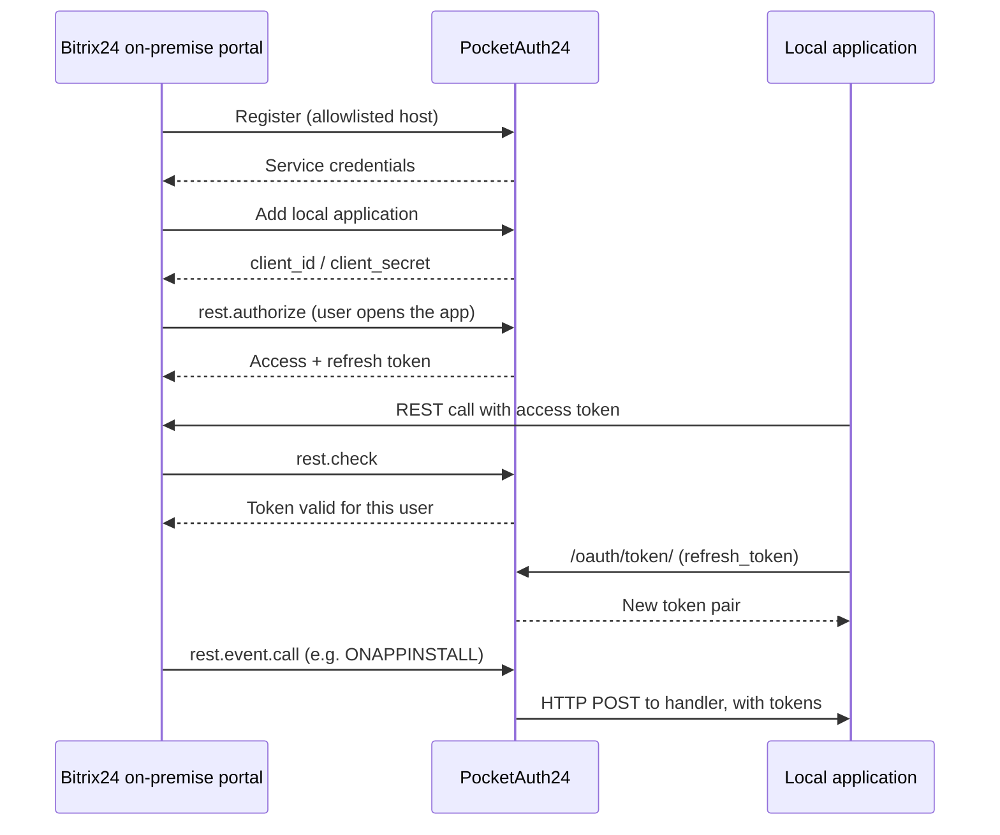

# PocketAuth24

[English](README.md) · [Deutsch](README.de.md) · [Italiano](README.it.md) · [Español](README.es.md) · [Português](README.pt.md) · **Русский**

**Локальные приложения продолжают работать на коробочном портале Bitrix24 без доступа в интернет.**

[](https://github.com/serg-vostrikov-bitrix/pocketauth24/actions/workflows/ci.yml)


[](LICENSE)
<br>


Коробочный портал Bitrix24 не обслуживает OAuth для своих локальных приложений сам. Каждый запуск приложения, каждую проверку и каждое обновление токена он отправляет на облачный OAuth-сервер Bitrix24 (`oauth.bitrix.info` / `oauth.bitrix24.tech`). Получается, что портал стоит в вашей серверной, за вашим файрволом, и всё равно спрашивает облако, прежде чем открыть ваше же приложение. PocketAuth24 берёт эту работу на себя внутри вашей сети. Это один контейнер и одна база PostgreSQL 17. Укажите порталу PocketAuth24, и локальные приложения будут открываться, вызывать REST, обновлять токены и получать события без связи с облаком.

> Независимый проект с открытым кодом. Не продукт Bitrix24. См. [отказ от ответственности](#отказ-от-ответственности).


_Страница статуса по адресу `/`. Она показывает только агрегированные числа._

## 🔒 Зачем

Коробочному порталу Bitrix24 для локальных приложений нужен облачный OAuth-сервер. Если портал теряет доступ в интернет, его локальные приложения останавливаются. Они не открываются, не могут вызывать REST с токенами, не могут обновлять токены и не получают онлайн-события. Сам портал продолжает работать. Его приложения ждут сервер, до которого не могут достучаться.

У команд в закрытых корпоративных сетях и регулируемых средах тогда два плохих варианта: отказаться от локальных приложений или открыть маршрут в интернет, который им не нужен, в сети, которую они специально закрыли. PocketAuth24 — третий вариант: OAuth-часть локальных приложений работает внутри их собственной сети.

**Это полезно и при наличии интернета.** Если на порталах ваших клиентов работают только ваши локальные приложения, облачный OAuth-сервер даёт им мало. Но каждый запуск приложения, каждая проверка и каждое обновление токена всё равно идут на него. Ваше приложение на портале вашего клиента просит у удалённого сервера разрешения на запуск. Вы не контролируете ни этот сервер, ни сетевой путь до него. Поставьте PocketAuth24 рядом с порталом, и эта зависимость перейдёт в инфраструктуру, которую вы сами эксплуатируете и отслеживаете. Цена: после переключения портал перестаёт использовать облачный OAuth-сервер, поэтому приложения Маркетплейса других вендоров на нём перестают работать. Ваше собственное приложение Маркетплейса продолжает работать, если вы добавите его в каталог PocketAuth24. Используйте такую схему только для порталов, которым нужны локальные приложения и ваши собственные приложения.

## ✨ Преимущества

- **Локальные приложения работают в изолированной сети.** Закрытая сеть больше не означает портал без собственных интеграций.
- **Нет маршрута в облако.** Локальным приложениям не нужно исходящее соединение с облачным OAuth-сервером.
- **Ваша доступность, а не чужая.** На портале с интернетом, где работают только ваши локальные приложения, запуск приложений, проверка и обновление токенов больше не зависят от удалённого сервера. После переключения приложения Маркетплейса других вендоров перестают работать, а ваши собственные продолжают работать, если вы добавите их в каталог.
- **Утечка базы данных или логов выдаёт меньше.** PocketAuth24 хранит токены и секреты только в виде хешей и никогда не пишет строки запроса в логи.
- **Один PocketAuth24 на несколько порталов.** Партнёрам и операторам не нужен отдельный экземпляр на каждый портал.
- **Мало забот в эксплуатации.** Один контейнер, одна база, проверка `/health`, JSON-логи в stdout и обычные резервные копии PostgreSQL.
- **Открытый код.** Лицензия MIT позволяет интеграторам читать, проверять и адаптировать код.

## 🧩 Возможности, доступные сегодня

| Область                                      | Что вы получаете                                                                                                                                                                                                                                                                                                                                                                       |
| -------------------------------------------- | -------------------------------------------------------------------------------------------------------------------------------------------------------------------------------------------------------------------------------------------------------------------------------------------------------------------------------------------------------------------------------------- |
| **Регистрация портала**                      | Портал регистрируется в PocketAuth24 при следующем OAuth-вызове. PocketAuth24 принимает только порталы из списка разрешённых (`PORTAL_ALLOWLIST`, сравнение по хосту и порту). Каждый вызов сервиса несёт собственные учётные данные портала, и каждый портал видит только свои данные.                                                                                                |
| **Локальные приложения**                     | Создавайте, меняйте и удаляйте локальные приложения на портале как раньше. PocketAuth24 выдаёт `client_id` (`local.<14 hex>.<8 digits>`) и `client_secret` и поддерживает свой список приложений в соответствии с порталом. Когда вы удаляете приложение, PocketAuth24 удаляет все его токены.                                                                                         |
| **Ваше собственное приложение Маркетплейса** | Добавьте своё приложение Маркетплейса в каталог через CLI. Портал устанавливает его из Маркетплейса как обычно, а PocketAuth24 выдаёт и обновляет его токены со статусом `F`. Каталог хранит только хеш `client_secret`.                                                                                                                                                               |
| **Токены**                                   | `rest.authorize` выдаёт пару токенов для нужного пользователя, в том числе для пользователей без прав администратора. Страницы установки открываются с токенами. `rest.check` проверяет токены. Токен получает только те области (scope), которые есть и в запросе, и у приложения.                                                                                                    |
| **Обновление**                               | `/oauth/token/` (GET или POST) с `grant_type=refresh_token`. Refresh-токен можно использовать, пока не истечёт его срок, как в записанном облачном трафике. Access-токен живёт 3600 с, refresh-токен — 180 дней. Каждый час PocketAuth24 удаляет истёкшие пары.                                                                                                                        |
| **События**                                  | Для `rest.event.call` PocketAuth24 отправляет каждое событие обработчику приложения по HTTP POST, в том числе `ONAPPINSTALL` с новыми токенами. Портал сразу получает ответ и не ждёт доставки.                                                                                                                                                                                        |
| **Безопасность**                             | PocketAuth24 хранит токены и секреты в виде хешей и берёт токены из криптографически стойкого источника случайных чисел. В логах нет строк запроса и нет учётных данных в URL обработчиков. В `docker-compose.yml` порт приложения слушает только loopback (`127.0.0.1:3000`).                                                                                                         |
| **Эксплуатация**                             | Публичная страница статуса по адресу `/` показывает состояние PocketAuth24 и его базы данных и считает порталы, приложения, активные пары токенов и доставки событий. `/api/status` отдаёт те же данные в JSON. `/health` возвращает HTTP 503, если PostgreSQL не отвечает. Логи пишутся в JSON, все пути принимают завершающий слеш.                                                  |
| **Панель администратора**                    | По адресу `/admin` несколько пользователей могут смотреть таблицы с поиском: порталы, локальные приложения, метаданные токенов (без токенов и хешей) и ежедневные счётчики событий. Панель только для чтения. Пароль суперпользователя задаёт только CLI, а суперпользователь управляет наблюдателями в панели. Сессия длится 12 часов, число попыток входа PocketAuth24 ограничивает. |

## 💡 Сценарии применения

PocketAuth24 нужен не только в закрытых сетях. Он помогает везде, где портал не должен использовать облачный OAuth-сервер. Все эти сценарии работают уже сегодня.

| Сценарий                                    | Как использовать PocketAuth24                                                                                                                                                                                                                                                                                                  |
| ------------------------------------------- | ------------------------------------------------------------------------------------------------------------------------------------------------------------------------------------------------------------------------------------------------------------------------------------------------------------------------------ |
| **Портал разработчика**                     | Запустите локальный коробочный портал для разработки приложений и дайте ему собственный экземпляр PocketAuth24. Портал никогда не регистрируется в облаке, поэтому не конфликтует с рабочим порталом на том же лицензионном ключе.                                                                                             |
| **Копии для staging, тестов и обучения**    | Восстановите копию рабочего портала и подключите её к отдельному экземпляру PocketAuth24. В копии удалите служебные учётные данные (см. [Быстрый старт](#-быстрый-старт)) и пересоздайте локальные приложения. Не подключайте копию к рабочему PocketAuth24: бэкап приносит с собой служебные учётные данные рабочего портала. |
| **Сквозные тесты в CI**                     | Поместите контейнер портала и PocketAuth24 в один стек Compose. Установка приложения, `ONAPPINSTALL`, вызовы REST и обновление токенов работают без облака, поэтому внешний сервис не может сломать результаты ваших тестов.                                                                                                   |
| **Один PocketAuth24 для порталов клиентов** | Интегратор запускает один PocketAuth24 для коробочных порталов нескольких клиентов. Каждый портал попадает в `PORTAL_ALLOWLIST`, а PocketAuth24 хранит данные каждого портала отдельно.                                                                                                                                        |
| **Учёт локальных приложений**               | Панель администратора показывает локальные приложения всех порталов и то, у каких из них есть активные токены. Для этого не нужно входить на каждый портал.                                                                                                                                                                    |

Руководство для копий разработки и staging запланировано: [#22](https://github.com/serg-vostrikov-bitrix/b24auth-server/issues/22).

## ⚙️ Как это работает



OAuth-трафик между порталом, локальными приложениями и PocketAuth24 не выходит из вашей сети. Обратный прокси перед PocketAuth24 завершает TLS и решает, кто может обращаться к какому пути.

## ✅ Проверено

| Проверка                              | Что охватывает                                                                                                                                                                                                                                                                                                                             |
| ------------------------------------- | ------------------------------------------------------------------------------------------------------------------------------------------------------------------------------------------------------------------------------------------------------------------------------------------------------------------------------------------ |
| **Автоматические тесты**              | Интеграционные тесты на настоящем PostgreSQL для регистрации портала, реестра приложений, сервиса токенов, доставки событий, маршрутизации и health, а также модульные тесты.                                                                                                                                                              |
| **Контрактные тесты**                 | Формы ответов и коды ошибок сравниваются с трафиком, записанным между тестовым порталом (`rest` 26.1100) и `oauth.bitrix.info`.                                                                                                                                                                                                            |
| **Дымовой тест контейнера (CI)**      | Контейнер запускается. `/health`, страница статуса и `/api/status` отвечают. Портал регистрируется. В логах нет записей уровня error, и процесс не работает от root.                                                                                                                                                                       |
| **Сквозная проверка в закрытой сети** | Чек-лист из 10 шагов на локальном тестовом портале в Docker (`rest` 26.1100), PHP-контейнер которого был отрезан от интернета: регистрация, создание приложения, страница установки с токенами, REST от администратора и не администратора, `ONAPPINSTALL` с токенами, обновление и повторное обновление, удаление. Все 10 шагов пройдены. |

Никто ещё не запускал PocketAuth24 в продуктиве у заказчика. Некоторые детали выведены логически, а не взяты из записанного облачного трафика: часть HTTP-кодов статуса (`invalid_client`, неизвестный метод, `expired_token`) и точная форма блока `auth` в событии с токенами.

## 🚀 Быстрый старт

Опубликованного образа нет. Соберите его на машине с интернетом и перенесите в закрытую сеть.

```bash
# Outside the closed network
docker build -t pocketauth24:<version> .
docker pull postgres:17
docker save pocketauth24:<version> postgres:17 -o pocketauth24-<version>.tar

# Inside the closed network (copy the tar and docker-compose.yml first)
docker load -i pocketauth24-<version>.tar
docker tag pocketauth24:<version> pocketauth24:local
```

Создайте `.env` рядом с `docker-compose.yml`:

| Переменная           | Пример                                          | Значение                                                                                                                                                                                                                                                                                                                                                                              |
| -------------------- | ----------------------------------------------- | ------------------------------------------------------------------------------------------------------------------------------------------------------------------------------------------------------------------------------------------------------------------------------------------------------------------------------------------------------------------------------------- |
| `BASE_URL`           | `https://auth.corp.local`                       | Публичный URL PocketAuth24 за прокси. Он становится `server_endpoint`.                                                                                                                                                                                                                                                                                                                |
| `DATABASE_URL`       | `postgres://b24auth:<password>@db:5432/b24auth` | Подключение к базе данных.                                                                                                                                                                                                                                                                                                                                                            |
| `PORTAL_ALLOWLIST`   | `portal.corp.local,crm.corp.local:8443`         | Порталы (`host[:port]`), которым разрешена регистрация. Нестандартные порты указывайте явно.                                                                                                                                                                                                                                                                                          |
| `POSTGRES_PASSWORD`  | `<password>`                                    | Тот же пароль, что в `DATABASE_URL`.                                                                                                                                                                                                                                                                                                                                                  |
| `TRUST_PROXY`        | `true`                                          | Необязательная. Принимает только `true` или `false`. Ставьте `true`, только если прокси перезаписывает `X-Forwarded-For` IP-адресом клиента (nginx: `$remote_addr`, а не `$proxy_add_x_forwarded_for`).                                                                                                                                                                               |
| `TOKEN_PRUNING`      | `true`                                          | Необязательная, по умолчанию `true`. Принимает только `true` или `false`. Когда сервер выдаёт пару токенов, он удаляет более старые пары того же приложения и пользователя, чей refresh-токен уже обменяли и у которых истёк access-токен. Сервер оставляет `TOKEN_PRUNING_KEEP` самых новых из таких пар. Пара, чей refresh-токен клиент получил и ни разу не использовал, остаётся. |
| `TOKEN_PRUNING_KEEP` | `5`                                             | Необязательная, по умолчанию `5`. Целое положительное число. Сколько самых новых использованных пар сервер оставляет для каждого приложения и пользователя.                                                                                                                                                                                                                           |

Чтобы получить точное поведение облачного Битрикс24, задайте `TOKEN_PRUNING=false`. Тогда каждая пара хранится, пока не истечёт её refresh-токен.

`BASE_URL`, `DATABASE_URL` и `PORTAL_ALLOWLIST` обязательны. Без них PocketAuth24 не запускается. Затем:

```bash
docker compose up -d                       # migrations run on start
curl https://auth.corp.local/health        # {"status":"ok"}
```

**Обратный прокси (обязателен).** Проксируйте `https://<BASE_URL host>/` на `http://<app host>:3000/` с сертификатом вашего внутреннего УЦ. По умолчанию запрещайте всё. Разрешайте все пути только с IP-адресов серверов портала. Не применяйте это ограничение к `/oauth/token`, `/health` и, если хотите, к странице статуса (`/`, `/assets/*`, `/api/status`). Сопоставляйте каждый путь с завершающим слешем и без него.

**Укажите порталу PocketAuth24.** В административной панели портала откройте «Командная PHP-строка» и выполните:

```php
\Bitrix\Main\Config\Option::set('rest', 'oauth_server', 'https://auth.corp.local');
\Bitrix\Main\Config\Option::delete('rest', ['name' => 'service_client_id']);
\Bitrix\Main\Config\Option::delete('rest', ['name' => 'service_client_secret']);
```

Можно также определить `BITRIX_OAUTH_URL` в `local/php_interface/init.php`. Он переопределяет опцию `oauth_server`. Не правьте `dbconn.php`. Портал регистрируется в PocketAuth24 при следующем OAuth-вызове.

**Затем:** пересоздайте локальные приложения, которые вы создали, пока портал использовал облако. В коде большинства SDK, включая CRest, прописан URL токенов `https://oauth.bitrix.info/oauth/token/`. Замените его на `https://auth.corp.local/oauth/token/`. Или направьте внутренний DNS для облачных имён хостов на прокси с сертификатом внутреннего УЦ.

Полные шаги, эксплуатация и откат: [docs/deployment.md](docs/deployment.md).

## 🖥️ Требования на стороне портала

Мы нашли это при сквозной проверке. Это причуды портала, а не дефекты PocketAuth24.

- Портал должен знать свой **настоящий публичный URL и порт**. Иначе фрейм приложения получает неверный `DOMAIN`, и `BX24` не может обратиться к порталу.
- URL приложений и обработчиков требуют **имя хоста с точкой** (FQDN или IP-адрес). Портал отклоняет `localhost`.
- **Отдавайте скрипт `BX24` изнутри сети.** `BX24` — старый JS SDK; новые приложения мы рекомендуем делать на [b24jssdk](https://github.com/bitrix24/b24jssdk). Готовые приложения, которые ещё используют `BX24`, обычно грузят его с `//api.bitrix24.com/api/v1/`, а из закрытой сети этот адрес недоступен.
- Портал отклоняет REST-вызовы от пользователя, который ни разу не входил.

## ⚡ Производительность доставки событий

**Как работает доставка.** Портал собирает все события одного запроса (хита) в один пакет `rest.event.call`. У пакета нет ограничения размера, и портал никогда не отправляет его повторно. PocketAuth24 сразу отвечает `{"result":null}`, затем доставляет каждое событие в фоне, в том же процессе. Каждое событие получает одну попытку HTTP POST с тайм-аутом 10 секунд.

**Лимиты.** Значения зафиксированы в [`src/config.ts`](src/config.ts).

| Лимит                                           | Значение | Что происходит при достижении                                                            |
| ----------------------------------------------- | -------- | ---------------------------------------------------------------------------------------- |
| Одновременные доставки всего                    | 200      | PocketAuth24 отбрасывает событие и пишет в лог `event_dropped_overload`, `limit: global` |
| Одновременные доставки на один хост обработчика | 100      | PocketAuth24 отбрасывает событие и пишет в лог `event_dropped_overload`, `limit: host`   |
| Тайм-аут одной доставки                         | 10 с     | PocketAuth24 прерывает доставку и пишет в лог `event_delivery_failed`                    |

Хост обработчика — это хост и порт URL обработчика. Лимит на хост равен половине общего лимита. Поэтому один медленный обработчик занимает не более 100 слотов, а другим обработчикам всегда остаётся 100. Лимит на хост не ниже, потому что один хит портала может отправить большой пакет одному обработчику, например при массовом импорте.

**Чего стоит PocketAuth24 медленный обработчик.** Пока доставка ждёт обработчика, она держит одно открытое соединение и немного памяти. Соединение с базой данных она не держит: PocketAuth24 выдаёт токены до отправки POST. Цикл событий не блокируется. Если каждый обработчик ждёт до тайм-аута, PocketAuth24 доставляет не более 20 событий в секунду в сумме и 10 в секунду на один хост. Остальные он отбрасывает.

**Рекомендации для обработчиков приложений.**

- Отвечайте в течение одной секунды. Примите событие, положите его в собственную очередь, затем обработайте.
- Дайте каждому тяжёлому приложению собственный хост обработчика. Тогда медленное приложение использует только свои 100 слотов.
- Следите в логе PocketAuth24 за `event_dropped_overload`. Поле `limit` показывает, какой лимит достигнут.

PocketAuth24 не отправляет отброшенные и неудавшиеся события повторно. Постоянная очередь с повторами — предлагаемый следующий этап.

## 🧭 Ограничения

Узнайте о них до развёртывания, а не после:

- **Только локальные приложения и ваши собственные приложения Маркетплейса.** Приложения Маркетплейса других вендоров не работают, потому что их секреты хранятся в облаке. Платные, пробные и подписочные приложения не поддерживаются. Бэкенд вашего приложения должен обновлять токены на `server_endpoint`, а не на `oauth.bitrix.info`.
- **Существующие приложения нужно пересоздать**, а жёстко прописанные URL токенов — изменить или перенаправить.
- **Регистрацию защищает именно прокси.** Портал не отправляет общий секрет. Любой, кто достигнет `/oauth/register/` с адресом портала из списка разрешённых, может сменить учётные данные этого портала. Ограничьте этот путь по IP.
- **Каждое событие доставляется один раз**, с тайм-аутом 10 секунд. PocketAuth24 не сохраняет и не повторяет события. Он теряет их при перезапуске и отбрасывает при более чем 200 одновременных доставках в сумме или 100 на один хост обработчика. См. [Производительность доставки событий](#-производительность-доставки-событий).
- **Один экземпляр.** Миграции запускаются при старте без блокировки.
- **Не поддерживается:** проверки лицензии, grant `authorization_code`. Сроки жизни токенов фиксированы. Тело запроса — не более 10 МБ.
- **Панель администратора только для чтения.** Она показывает данные, но не может менять порталы, приложения или токены. В ней нет SSO, двухфакторной аутентификации и журнала аудита. Ограничьте `/admin` и `/api/admin` на прокси.
- **Проверено** на модуле `rest` портала 26.1100.

Запланированные работы и сценарии, которые они открывают: см. [План развития](#-план-развития).

## 🔭 План развития

У пунктов нет сроков, поэтому ничего не просрочено. Первая таблица перечисляет запланированные работы. Вторая — сценарии, которые эти работы делают возможными. Это идеи, а не обещания.

### Запланированные работы

| Пункт                                                                                                                     | Что он добавляет                                                                                                                                                                                        |
| ------------------------------------------------------------------------------------------------------------------------- | ------------------------------------------------------------------------------------------------------------------------------------------------------------------------------------------------------- |
| **Полный OAuth 2.0 и introspection**                                                                                      | Grant `authorization_code`, отзыв токенов при удалении приложения, проверки scope.                                                                                                                      |
| **Постоянная очередь событий**                                                                                            | PocketAuth24 сохраняет события, повторяет неудачные доставки и сохраняет события при перезапуске.                                                                                                       |
| **Режим резервирования облака** ([#10](https://github.com/serg-vostrikov-bitrix/b24auth-server/issues/10))                | PocketAuth24 передаёт вызовы облачному OAuth-серверу и отвечает на них сам, когда облако не отвечает. Локальные приложения продолжают работать, пока облако недоступно.                                 |
| **Эксплуатация**                                                                                                          | Миграция уже зарегистрированного портала. Предупреждение, когда повторная регистрация перезаписывает учётные данные портала ([#23](https://github.com/serg-vostrikov-bitrix/b24auth-server/issues/23)). |
| **Руководство для копий разработки и staging** ([#22](https://github.com/serg-vostrikov-bitrix/b24auth-server/issues/22)) | Правила для сценариев разработки и staging из раздела [Сценарии применения](#-сценарии-применения).                                                                                                     |

### Сценарии, которые открывают эти работы

| Сценарий                                                                                                                                          | Что для него нужно                                         |
| ------------------------------------------------------------------------------------------------------------------------------------------------- | ---------------------------------------------------------- |
| **Инспектор событий.** Записывать события, показывать их в панели администратора и отправлять обработчику повторно, чтобы отлаживать обработчики. | Постоянная очередь событий.                                |
| **Экстренный отзыв.** Отозвать все токены приложения или портала после утечки.                                                                    | Отзыв токенов и действия записи в панели администратора.   |
| **Тесты сбоев.** Короткое время жизни токенов, принудительный `expired_token`, медленные обработчики, тестовые токены из CLI.                     | Настраиваемое время жизни токенов. Сейчас оно фиксировано. |
| **Шина событий.** Отправлять события портала в брокер сообщений для внутренних систем.                                                            | Постоянная очередь событий.                                |
| **Аудит доступа.** Журнал: кто, когда и для какого приложения получил токен.                                                                      | Журнал аудита.                                             |

## 🔁 CI/CD

CI запускается при push в `main` и для pull request ([`.github/workflows/ci.yml`](.github/workflows/ci.yml)):

| Задача      | Что делает                                                                     |
| ----------- | ------------------------------------------------------------------------------ |
| `test`      | Node.js 26 с сервисом PostgreSQL 17: `npm ci`, lint, typecheck, тесты, сборка. |
| `container` | Собирает и запускает стек Docker Compose и выполняет дымовой тест.             |
| `audit`     | `npm audit` для зависимостей production с высоким уровнем серьёзности.         |

Dependabot раз в неделю проверяет пакеты npm, GitHub Actions и базовые образы Docker.

Половины CD из этого заголовка пока нет: нет конвейера релизов и нет опубликованного образа. Образ вы собираете сами.

## 📚 Документация

- [Руководство по развёртыванию](docs/deployment.md): требования, шаги, правила прокси, эксплуатация, откат.
- [Сквозной чек-лист](docs/e2e-checklist.md): проверка из 10 шагов в закрытой сети.
- [Запись протокола](docs/protocol-capture.md): как записывали облачный трафик для контрактных тестов.
- [Исследование](docs/research/2026-11-18-oauth-server-analysis.md): анализ протокола и предлагаемый план развития.
- [Руководство пользователя](docs/launchkit/01-user-manual.en.md): сценарии, ошибки, ограничения.

## 🛠️ Разработка

Стек: Node.js 26, TypeScript (strict), Fastify, Drizzle, PostgreSQL 17.

```bash
npm install
docker compose up -d db
npm test
```

Другие скрипты: `npm run lint`, `npm run typecheck`, `npm run build`, `npm run dev`, `npm run db:generate`.

Конфигурация: `BASE_URL`, `DATABASE_URL`, `PORTAL_ALLOWLIST` (см. [`.env.example`](.env.example)).

## 📄 Лицензия

[MIT](LICENSE). Copyright 2026 Serg Vostrikov.

## Отказ от ответственности

PocketAuth24 — независимый проект. Он не связан с Bitrix24, не одобрен и не сертифицирован Bitrix24. Фраза «замена облачного OAuth-сервера» описывает, что делает программа, а не отношения с вендором. Bitrix24 и другие товарные знаки принадлежат их владельцам.
